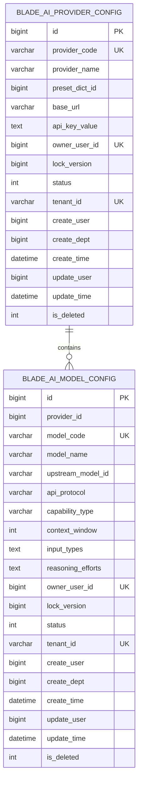

# 大模型供应商与模型配置管理数据库设计

## 1. 文档信息

| 项目 | 内容 |
| --- | --- |
| 数据库设计编号 | DB-REQ-2026-008 |
| 关联需求 | [REQ-2026-008 大模型供应商与模型配置管理](../requirements/REQ-2026-008-ai-model-configuration.md) |
| 关联详细设计 | [DESIGN-REQ-2026-008 大模型供应商与模型配置管理](../design/DESIGN-REQ-2026-008-ai-model-configuration.md) 0.4（待评审） |
| 文档版本 | 0.4 |
| 文档状态 | 待评审 |
| 数据库 | MySQL 8.4 |
| 负责人 | 待指定 |
| 创建/更新日期 | 2026-09-30 |
| 需求索引 | [doc/requirements-index.md](../requirements-index.md) |

## 2. 目标与范围

- 设计目标：持久化每个租户用户自己的供应商接入配置及独立模型记录；一个供应商配置可关联多个模型，修改一个模型不重写其他模型。
- 数据边界：两张新增表均为租户级数据。供应商预设、模型 API 协议和能力选项复用平台全局 `blade_dict`，用户凭据不写入字典。
- 范围外：不创建任务表、模型调用记录、计费表或模型版本表；不迁移 `fast-staratlas-ai` 的现有 YAML 配置；不建设审计或脱敏产品。
- 本文仍待评审。MySQL 全量与升级脚本已写入工作区，尚未执行迁移或验证实际数据库结构。

| 表名 | 变更类型 | 租户表 | Entity 基类 | 说明 |
| --- | --- | :---: | --- | --- |
| `blade_ai_provider_config` | 新增 | 是 | `TenantEntity` | 用户所有的供应商接入地址和凭据 |
| `blade_ai_model_config` | 新增 | 是 | `TenantEntity` | 每个模型一行，保存其标识、协议、能力和参数 |
| `blade_dict` | 增加字典项 | 否 | 现有结构 | 供应商预设、API 协议、能力类型；不新增表 |

## 3. 数据模型

### 3.1 ER 图



### 3.2 关系说明

| 关系 | 基数 | 约束方式 | 删除/停用行为 |
| --- | --- | --- | --- |
| 供应商配置 -> 模型配置 | 1:N | `provider_id` 逻辑引用；写入时校验供应商、租户与所有人，不建物理外键 | 存在未删除模型时拒绝删除供应商；停用供应商使全部子模型不可用于运行读取 |
| 供应商配置 -> `blade_dict` 供应商预设 | N:0/1 | `preset_dict_id` 可空，名称在用户记录中保留快照 | 预设失效不删除已有用户配置 |
| 模型配置 -> `blade_dict` 协议/能力 | N:1 | 保存稳定字符串，写入时校验有效字典项 | 字典项失效后不得新建或改用该项；既有记录保留原值，运行可用性在服务层判定 |
| 业务任务 -> 模型配置 | N:1 | 后续任务服务保存 `model_config_id`，跨服务不建物理外键 | 模型停用或删除后按 ID 读取失败；任务侧的处理随适配需求确定 |

### 3.3 示例映射

示例中的 `apiKeyEnv` 是静态部署配置所用的环境变量名。用户级配置保存该用户提供的凭据，不把 `GROK_API_KEY` 当作密钥本身存入数据库。`baseURL` 存在供应商配置；示例顶层的 `api` 在每个模型行保存为 `api_protocol`，允许同一接入地址下的模型将来选择不同协议。

| 示例配置 | 数据位置 |
| --- | --- |
| `baseURL: https://lyapi.cloud/v1`、用户凭据 | 一条 `blade_ai_provider_config` |
| `models[0].id: grok-4.5`、`name: Grok 4.5` | 一条 `blade_ai_model_config` |
| `contextWindow: 500000` | 该模型行的 `context_window` |
| `input: [text, image]` | 该模型行的 `input_types` |
| `reasoningEfforts: {low: low, medium: medium, high: high}` | 该模型行的 `reasoning_efforts` |

`models` 数组本身不作为 JSON 存储。第二个模型会是第二条 `blade_ai_model_config` 记录。`input_types` 和 `reasoning_efforts` 只属于所在模型行，更新这些值不会重写同一供应商下的其他模型。

## 4. 表结构

### 4.1 SpringBlade 约定

- 主键为应用侧雪花 `BIGINT`，不使用自增；Long 主键在管理 API 中按项目现有字符串序列化约定处理。
- 两张表使用 `TenantEntity`，`tenant_id VARCHAR(12)`，已在工作区加入 `doc/nacos/blade.yaml` 的 `blade.tenant.tables`；目标环境是否生效待验证。
- `owner_user_id` 是配置所有人；`create_user`、`update_user` 是实际操作者。管理员代建时二者可以不同，所有人创建后不可直接变更。
- `status` 为 `0=停用、1=启用`，新配置默认停用；`is_deleted` 为 `0=未删除、1=已删除`。
- 表、索引使用 InnoDB、utf8mb4 和现有全量脚本的 `utf8mb4_general_ci`。ER、字段清单及 DDL 均按主键、业务字段、`tenant_id`、框架基础字段排序。
- 每条模型独立成行。模型内的两个多值参数以 `TEXT` 保存该模型自己的 JSON，并由应用层使用 JSON 解析与结构校验，不用字符串拼接解析；不保存供应商的整份模型列表。

### 4.2 `blade_ai_provider_config` 字段

| 序号 | 字段 | MySQL 类型 | 允许空 | 默认值 | 键/索引 | 说明 |
| ---: | --- | --- | :---: | --- | --- | --- |
| 1 | `id` | `BIGINT` | 否 | 无 | PK | 雪花主键 |
| 2 | `provider_code` | `VARCHAR(64)` | 否 | 无 | UK | 所有人范围内的稳定管理编码，创建后不变 |
| 3 | `provider_name` | `VARCHAR(100)` | 否 | 无 | 无 | 用户显示名称；选择预设时保留名称快照，自定义时由用户填写 |
| 4 | `preset_dict_id` | `BIGINT` | 是 | NULL | 无 | 全局供应商预设字典项的可选逻辑引用 |
| 5 | `base_url` | `VARCHAR(1024)` | 否 | 无 | 无 | 上游接入根地址；可与其他配置不同 |
| 6 | `api_key_value` | `TEXT` | 是 | NULL | 无 | 用户提供的凭据，管理查询不得返回原值；存储保护后续评估 |
| 7 | `owner_user_id` | `BIGINT` | 否 | 无 | UK/IDX | 配置所有人，与实际创建人分离 |
| 8 | `lock_version` | `BIGINT` | 否 | `0` | 无 | 并发控制版本，每次有效写入递增 |
| 9 | `status` | `INT` | 否 | `0` | 无 | `0=停用、1=启用`，默认停用 |
| 10 | `tenant_id` | `VARCHAR(12)` | 否 | `'000000'` | UK/IDX | 所有人所属租户 |
| 11 | `create_user` | `BIGINT` | 是 | NULL | 无 | 实际创建人 |
| 12 | `create_dept` | `BIGINT` | 是 | NULL | 无 | 实际创建部门 |
| 13 | `create_time` | `DATETIME` | 是 | NULL | 无 | 创建时间 |
| 14 | `update_user` | `BIGINT` | 是 | NULL | 无 | 最近修改人 |
| 15 | `update_time` | `DATETIME` | 是 | NULL | IDX | 最近修改时间 |
| 16 | `is_deleted` | `INT` | 否 | `0` | IDX | 逻辑删除标记 |

### 4.3 `blade_ai_model_config` 字段

| 序号 | 字段 | MySQL 类型 | 允许空 | 默认值 | 键/索引 | 说明 |
| ---: | --- | --- | :---: | --- | --- | --- |
| 1 | `id` | `BIGINT` | 否 | 无 | PK | 雪花主键，任务后续关联此 ID |
| 2 | `provider_id` | `BIGINT` | 否 | 无 | IDX | 所属供应商配置 ID |
| 3 | `model_code` | `VARCHAR(64)` | 否 | 无 | UK | 所有人范围内的稳定管理编码，创建后不变 |
| 4 | `model_name` | `VARCHAR(100)` | 否 | 无 | 无 | 展示名称，如 Grok 4.5 |
| 5 | `upstream_model_id` | `VARCHAR(128)` | 否 | 无 | 无 | 上游模型标识，如 grok-4.5；允许多条不同配置使用同一标识 |
| 6 | `api_protocol` | `VARCHAR(32)` | 否 | 无 | 无 | 稳定协议标识，首期三种值见 4.4 |
| 7 | `capability_type` | `VARCHAR(16)` | 否 | 无 | 无 | 主要能力：`text`、`image`、`video` |
| 8 | `context_window` | `INT` | 是 | NULL | 无 | 上下文窗口，填写时须为正数；非适用模型可为空 |
| 9 | `input_types` | `TEXT` | 否 | 无 | 无 | 单模型输入模态的 JSON 数组，如 `["text","image"]` |
| 10 | `reasoning_efforts` | `TEXT` | 是 | NULL | 无 | 单模型推理档位 JSON 对象；NULL 表示不支持或未配置 |
| 11 | `owner_user_id` | `BIGINT` | 否 | 无 | UK/IDX | 与所属供应商的所有人一致 |
| 12 | `lock_version` | `BIGINT` | 否 | `0` | 无 | 单模型并发控制版本，修改一个模型只更新该行 |
| 13 | `status` | `INT` | 否 | `0` | 无 | `0=停用、1=启用`，默认停用 |
| 14 | `tenant_id` | `VARCHAR(12)` | 否 | `'000000'` | UK/IDX | 与所属供应商的租户一致 |
| 15 | `create_user` | `BIGINT` | 是 | NULL | 无 | 实际创建人 |
| 16 | `create_dept` | `BIGINT` | 是 | NULL | 无 | 实际创建部门 |
| 17 | `create_time` | `DATETIME` | 是 | NULL | 无 | 创建时间 |
| 18 | `update_user` | `BIGINT` | 是 | NULL | 无 | 最近修改人 |
| 19 | `update_time` | `DATETIME` | 是 | NULL | IDX | 最近修改时间 |
| 20 | `is_deleted` | `INT` | 否 | `0` | IDX | 逻辑删除标记 |

### 4.4 字典与参数校验

| `blade_dict.code` 分类 | 首期有效 `dict_value` | 用途 |
| --- | --- | --- |
| `ai_model_api_protocol` | `openai-completions`、`openai-responses`、`anthropic-messages` | `api_protocol` 的稳定字符串；现有 `dict_key` 保持整数序号 |
| `ai_model_capability` | `text`、`image`、`video` | `capability_type` 和 `input_types` 的有效候选 |
| `ai_provider_preset` | OpenAI、Anthropic、Google Gemini、Microsoft Azure OpenAI、阿里云百炼、DeepSeek、百度千帆、腾讯混元、智谱 GLM、Moonshot、火山方舟、xAI、Mistral | 录入建议；可不选择，用户可自定义 |

`blade_dict.dict_key` 仍为整数，不把协议字符串强塞进整数列。协议和能力的 `dict_value` 作为稳定机器标识保存到模型表；界面友好名称由后续页面处理，字典项的这些值不得直接改名。供应商预设的 `dict_value` 为名称，`preset_dict_id` 仅用于标记来源，`provider_name` 保存用户配置时的名称快照。

- `input_types` 必须是无重复的字符串数组，元素来自有效能力字典；主要能力类型与输入模态是两种概念，文本模型可以同时接受文字和图片。
- `reasoning_efforts` 必须是字符串到非空字符串的对象，例如 `{"low":"low","medium":"medium","high":"high"}`；无此能力时为 NULL，不保存空对象冒充已配置。
- 两个 JSON 字段仅存一条模型的参数，更新时校验并写回该模型行；不保存整个供应商的 `models` 列表。具体长度上限和推理档位允许键在详细设计中确认。

## 5. 约束与索引

| 名称 | 类型 | 字段顺序 | 支撑规则/查询 |
| --- | --- | --- | --- |
| `uk_blade_ai_provider_owner_code` | UNIQUE | `tenant_id, owner_user_id, provider_code` | 同一租户用户的供应商管理编码唯一 |
| `idx_blade_ai_provider_owner_list` | INDEX | `tenant_id, owner_user_id, is_deleted, update_time, id` | 普通用户分页及所有人筛选 |
| `idx_blade_ai_provider_tenant_list` | INDEX | `tenant_id, is_deleted, update_time, id` | 租户管理员分页 |
| `idx_blade_ai_provider_global_list` | INDEX | `is_deleted, update_time, id` | 超级管理员跨租户分页 |
| `uk_blade_ai_model_owner_code` | UNIQUE | `tenant_id, owner_user_id, model_code` | 同一租户用户的模型管理编码唯一 |
| `idx_blade_ai_model_provider` | INDEX | `tenant_id, provider_id, is_deleted, id` | 供应商下模型列表、删除前关联检查 |
| `idx_blade_ai_model_owner_list` | INDEX | `tenant_id, owner_user_id, is_deleted, update_time, id` | 普通用户分页及所有人筛选 |
| `idx_blade_ai_model_tenant_list` | INDEX | `tenant_id, is_deleted, update_time, id` | 租户管理员分页 |
| `idx_blade_ai_model_global_list` | INDEX | `is_deleted, update_time, id` | 超级管理员跨租户分页 |

- 两个业务唯一键均不含 `is_deleted`。逻辑删除后继续占用原编码，重复删除及重建不会制造第二条同编码历史记录。
- `provider_id` 与 `preset_dict_id` 不建物理外键，沿用仓库现有应用校验模式。新增模型与删除供应商在同一供应商行上加锁并检查未删除子模型，避免并发创建与删除穿透。
- 模型 `provider_id`、`tenant_id`、`owner_user_id` 在同一事务中校验一致。已停用供应商可保留模型，但运行读取必须同时检查供应商和模型的 `status=1`、`is_deleted=0`。
- `lock_version` 用于更新、启停、逻辑删除的乐观并发校验；单模型更新不写供应商行或其他模型行。
- 不为未确认的协议、能力、模型参数筛选创建推测性索引。按 ID 运行读取使用主键，再校验关联关系与状态。

## 6. SQL 与迁移

### 6.1 脚本影响

| 脚本/配置 | 设计确认后是否修改 | 内容 |
| --- | :---: | --- |
| `doc/sql/blade/blade.mysql.all.create.sql` | 是 | 两表DDL、三类字典种子及两页/两查看按钮、查看Scope页面绑定与种子超管只读授权 |
| `doc/sql/blade/blade.mysql.upgrade.5.0.1.ai-model-configuration.sql` | 是 | 存量库建表与字典种子，执行前检查 |
| [只读菜单增量](../sql/blade/blade.mysql.upgrade.5.0.1.ai-model-menu-permission.sql) | 是 | 不改业务表；复用有效菜单/Scope ID，补齐查看权限和必要顶部关联；冲突时跳过全部持久表写入 |
| `doc/nacos/blade.yaml` | 是 | `blade.tenant.tables` 加入两张新表 |

上述全量脚本、升级脚本和 Nacos 配置已在工作区修改；是否发布及实际执行仍待评审和验证。仅维护 MySQL，不产生其他数据库方言。

### 6.2 迁移顺序


全新环境使用全量脚本。存量环境先执行升级脚本，再更新 Nacos 租户表清单和部署服务。新增表无历史数据回填，不迁移 fast YAML。字典种子使用确定的雪花 ID 和存在性检查，不能仅凭 `blade_dict` 当前缺少唯一约束而盲目重复插入。

只读菜单增量在业务库已部署后独立执行，不重复业务建表；只使用一个连接并在暂停菜单/角色/Scope并发修改的维护窗口执行。
菜单种子ID为`220260930200000001`至`220260930200000004`，两查看Scope保留既有资源ID，
`menu_id`分别指向供应商和模型页面而非查看按钮。只为唯一有效的`000000/administrator`角色增加查看授权。
不自动复活已删除资源或启用停用Scope，重复编码、路径/ID冲突、非标准根菜单或既有其他Scope绑定均使`ready=0`，
所有持久表写入被跳过。一个平台顶部菜单自动补三项关联，多个顶部菜单由管理员显式配置。
此阶段没有写按钮、写API授权或内部运行授权。执行前快照、结果核验、缓存与回滚边界见
[部署说明](../guide/ai-model-menu-permission-deployment.md)。未执行MySQL迁移，不能以静态检查代替SQL或权限验收。

### 6.3 待评审的建表 DDL

以下 DDL 只说明设计目标，不是已执行脚本；确认后须与全量及升级脚本保持一致。

```sql
CREATE TABLE blade_ai_provider_config (
  id bigint NOT NULL COMMENT '主键',
  provider_code varchar(64) NOT NULL COMMENT '所有人范围内的供应商管理编码',
  provider_name varchar(100) NOT NULL COMMENT '供应商显示名称快照',
  preset_dict_id bigint NULL DEFAULT NULL COMMENT '供应商预设字典项ID',
  base_url varchar(1024) NOT NULL COMMENT '接入根地址',
  api_key_value text NULL COMMENT '用户提供的接入凭据',
  owner_user_id bigint NOT NULL COMMENT '配置所有人',
  lock_version bigint NOT NULL DEFAULT 0 COMMENT '并发控制版本',
  status int NOT NULL DEFAULT 0 COMMENT '0停用 1启用',
  tenant_id varchar(12) NOT NULL DEFAULT '000000' COMMENT '租户ID',
  create_user bigint NULL DEFAULT NULL COMMENT '实际创建人',
  create_dept bigint NULL DEFAULT NULL COMMENT '创建部门',
  create_time datetime NULL DEFAULT NULL COMMENT '创建时间',
  update_user bigint NULL DEFAULT NULL COMMENT '最近修改人',
  update_time datetime NULL DEFAULT NULL COMMENT '最近修改时间',
  is_deleted int NOT NULL DEFAULT 0 COMMENT '是否已删除',
  PRIMARY KEY (id),
  UNIQUE KEY uk_blade_ai_provider_owner_code (tenant_id, owner_user_id, provider_code),
  KEY idx_blade_ai_provider_owner_list (tenant_id, owner_user_id, is_deleted, update_time, id),
  KEY idx_blade_ai_provider_tenant_list (tenant_id, is_deleted, update_time, id),
  KEY idx_blade_ai_provider_global_list (is_deleted, update_time, id)
) ENGINE=InnoDB DEFAULT CHARSET=utf8mb4 COLLATE=utf8mb4_general_ci COMMENT='用户大模型供应商接入配置';

CREATE TABLE blade_ai_model_config (
  id bigint NOT NULL COMMENT '主键',
  provider_id bigint NOT NULL COMMENT '所属供应商配置ID',
  model_code varchar(64) NOT NULL COMMENT '所有人范围内的模型管理编码',
  model_name varchar(100) NOT NULL COMMENT '模型显示名称',
  upstream_model_id varchar(128) NOT NULL COMMENT '上游模型标识',
  api_protocol varchar(32) NOT NULL COMMENT '模型API协议稳定标识',
  capability_type varchar(16) NOT NULL COMMENT '模型主要能力类型',
  context_window int NULL DEFAULT NULL COMMENT '上下文窗口',
  input_types text NOT NULL COMMENT '单模型输入模态JSON数组',
  reasoning_efforts text NULL COMMENT '单模型推理档位JSON对象',
  owner_user_id bigint NOT NULL COMMENT '配置所有人',
  lock_version bigint NOT NULL DEFAULT 0 COMMENT '并发控制版本',
  status int NOT NULL DEFAULT 0 COMMENT '0停用 1启用',
  tenant_id varchar(12) NOT NULL DEFAULT '000000' COMMENT '租户ID',
  create_user bigint NULL DEFAULT NULL COMMENT '实际创建人',
  create_dept bigint NULL DEFAULT NULL COMMENT '创建部门',
  create_time datetime NULL DEFAULT NULL COMMENT '创建时间',
  update_user bigint NULL DEFAULT NULL COMMENT '最近修改人',
  update_time datetime NULL DEFAULT NULL COMMENT '最近修改时间',
  is_deleted int NOT NULL DEFAULT 0 COMMENT '是否已删除',
  PRIMARY KEY (id),
  UNIQUE KEY uk_blade_ai_model_owner_code (tenant_id, owner_user_id, model_code),
  KEY idx_blade_ai_model_provider (tenant_id, provider_id, is_deleted, id),
  KEY idx_blade_ai_model_owner_list (tenant_id, owner_user_id, is_deleted, update_time, id),
  KEY idx_blade_ai_model_tenant_list (tenant_id, is_deleted, update_time, id),
  KEY idx_blade_ai_model_global_list (is_deleted, update_time, id)
) ENGINE=InnoDB DEFAULT CHARSET=utf8mb4 COLLATE=utf8mb4_general_ci COMMENT='用户大模型配置';
```

升级脚本要求执行前人工确认两张表均不存在；其中 `CREATE TABLE IF NOT EXISTS` 不覆盖已有表，字典与接口权限种子按已有记录检查后插入。脚本中的固定 ID 已与本次全量脚本核对，但尚未在 MySQL 验证首次执行、重复执行及失败后的部分 DDL 处理。

### 6.4 回滚

1. 应用回滚前停止新配置写入，备份两张新表和本次字典行；旧版本服务不引用新表，可先回滚代码与 Nacos 租户表配置。
2. 有用户配置时默认保留新表，不以删除表作为普通代码回滚步骤。若确认数据可以丢弃或已完成导出与恢复准备，才先删除模型表、再删除供应商表，并清理仅由本需求插入且未被其他功能引用的字典行。
3. 不会迁移 `fast-staratlas-ai` 数据，因此其现有 YAML 行为无需数据库回滚。凭据若已写入新表，删除表前必须完成备份与数据处置确认。

## 7. 隔离、一致性与敏感数据

- 租户隔离：两表均加入 `blade.tenant.tables`。普通用户的读写同时匹配当前 `tenant_id`、本人 `owner_user_id` 和 `is_deleted=0`；租户管理员仅匹配当前租户及未删除数据。只有已验证的平台超级管理员走专用跨租户查询路径；全局列表可跨租户展示并标明归属，写入须显式选定目标租户并与目标资源、用户归属一致。不全局关闭租户约束；局部跳过自动过滤时，SQL 仍显式校验相应范围。
- 所有人校验：管理员为他人代建时验证目标用户属于目标租户；`owner_user_id` 不等于 `create_user` 是合法场景，模型与供应商的所有人及租户必须相同。
- 逻辑删除：两表默认查询只返回 `is_deleted=0`，编码删除后不复用；模型逻辑删除后原任务 ID 无法取得运行配置，后续任务服务适配时须处理在途任务。
- 运行读取：任务只保存模型配置 ID，执行时读取该 ID 对应的最新有效模型和供应商配置，不保留任务创建时的配置快照；配置停用或删除后读取失败。
- 并发一致性：唯一键阻止同归属编码并发创建；写操作带 `lock_version`；创建模型与删除供应商使用相同供应商行锁，事务提交后才对外可见。
- 凭据：`api_key_value` 可保存用户输入的凭据，管理 API 只返回是否已配置，内部运行读取首期可返回原值。普通日志、错误响应、字典、SQL 种子和文档不得包含真实凭据；加密落盘、备份访问与额外分发安全策略按用户要求后续评估，本设计不预建审计或脱敏字段。

## 8. 验证清单

2026-09-30只读菜单交付已执行8组工程静态检查，核对全量/增量种子、页面Scope绑定、默认授权、
7条持久表DML的ready保护、冲突/存在性条件及SQL分号/括号结构；70条关联文档链接可达，
目标文件`git diff --check`通过。检查由只读内存脚本执行，不是MySQL引擎语法、迁移、授权或业务验收。
MySQL实际执行与下列数据库检查仍待用户在隔离环境进行，后端14项用例均未执行。

- [ ] 设计经评审确认后，同步 MySQL 全量与升级脚本、Nacos 租户表配置。
- [ ] 全量建库和存量升级后两表字段、顺序、索引、注释与本设计一致，字典种子无重复。
- [ ] 单供应商可有多个独立模型；修改模型 A 只改变 A 行，不改变 B 行或供应商行。
- [ ] 协议、能力、输入数组及推理档位 JSON 校验覆盖合法、重复、非法和边界值。
- [ ] 超级管理员跨租户、租户管理员本租户、普通用户本人查询和写入符合需求；越权失败无数据变化。
- [ ] 模型与供应商租户/所有人一致，关联删除、停用、并发创建和陈旧版本更新按预期拒绝。
- [ ] 运行读取按任务模型 ID 返回有效配置；停用、删除、缺少凭据及不存在时不返回凭据。
- [ ] 管理查询及常规日志不含凭据，脚本与文档不含真实账号、密钥、连接串或生产数据。
- [ ] 升级失败、重复执行和代码回滚按第 6 节检查；记录环境、证据和清理结果。

以上均为待执行检查，当前没有运行 MySQL、接口测试或 Maven 构建。

## 9. 开放问题与变更记录

| 编号 | 问题/风险 | 负责人 | 状态/结论 |
| --- | --- | --- | --- |
| DB-ITEM-001 | 任务创建后配置变化时使用哪个版本？ | 用户 | 已确认：执行时读取最新有效配置；不保存创建时快照 |
| DB-ITEM-002 | 单模型参数是否使用行内 JSON？ | 用户 | 已确认：`input_types`、`reasoning_efforts` 只存该模型的受校验 JSON；供应商模型列表不存 JSON |
| DB-ITEM-003 | 新配置默认状态及删除后编码是否复用？ | 用户 | 已确认：默认停用，逻辑删除后编码不复用 |
| DB-ITEM-004 | `api_key_value` 的落盘保护与备份访问后续评估。`TEXT` 类型允许后续变更存储编码，但生产落地前仍需决定操作要求。 | 用户 | 后续评估，不阻塞当前数据模型评审 |

| 日期 | 版本 | 变更内容 | 修改人 |
| --- | --- | --- | --- |
| 2026-09-30 | 0.1 | 建立两张租户表、字典扩展和单模型参数的数据库设计初稿；未执行迁移 | Codex |
| 2026-09-30 | 0.2 | 确认运行时读取最新配置、单模型 JSON、默认停用与编码不复用，并明确平台超管跨租户写入边界 | Codex |
| 2026-09-30 | 0.3 | 同步全量和升级脚本、Nacos 配置的实际工作区状态及尚未执行的数据库验证 | Codex |
| 2026-09-30 | 0.4 | 补齐只读菜单与授权全量种子及独立增量脚本，说明ID复用、冲突零写入、顶部关联及回滚边界 | Codex |
