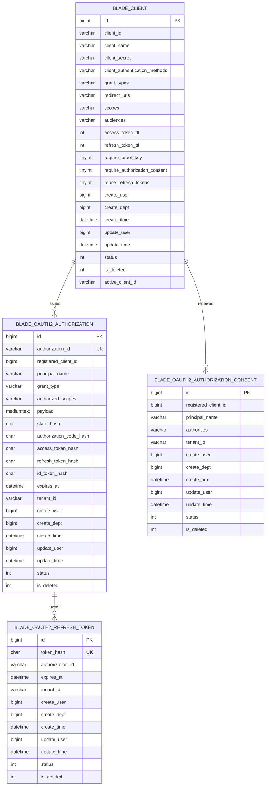

# 生产级 OAuth2/OIDC 认证中心数据库设计

## 1. 文档信息

| 项目 | 内容 |
| --- | --- |
| 数据库设计编号 | DB-REQ-2026-010 |
| 关联需求 | [REQ-2026-010](../requirements/REQ-2026-010-production-authentication.md) |
| 关联详细设计 | [DESIGN-REQ-2026-010](../design/DESIGN-REQ-2026-010-production-authentication.md) |
| 关联测试 | [TEST-REQ-2026-010](../test/TEST-REQ-2026-010-production-authentication.md) |
| 文档版本 | 0.10 |
| 文档状态 | 开发中 |
| 数据库 | MySQL；DDL 目标 MySQL 8 |
| 负责人 | 待指定 |
| 创建/更新日期 | 2026-10-13 |

## 2. 目标与范围

本期采用现有自定义授权表和 AES-GCM 信封密文，不切换官方 JDBC schema。客户端主数据由 system 管理；授权服务持有协议状态。2026-10-13 真实复测发现旧 Refresh Token 重用后后继令牌仍可签发，因此新增刷新摘要归属表，将每个刷新摘要关联到授权记录，授权记录即令牌族。

本期不新增客户端密钥版本表、签名密钥元数据表或多实例协调模型。审计、脱敏不涉及：用户未提出这些横切能力；刷新摘要表用于一次性令牌协议状态，不是审计记录。

当前 `AuthClient` 没有乐观锁版本列或密钥版本；事务和 `active_client_id` 唯一键只保证写入及标识唯一，不保证管理员并发编辑拒绝覆盖。客户端配置按请求经 system 实时读取，没有配置缓存失效事件。本次文档核对不新增模型或 DDL，管理并发风险与验收差距见[详细设计第 16 节](../design/DESIGN-REQ-2026-010-production-authentication.md#16-风险评审与变更)。

| 表 | 变更 | Entity / 边界 |
| --- | --- | --- |
| `blade_client` | 保留客户端模型；BFF 初始种子停用、无共享默认密钥 | `AuthClient extends BaseEntity`，实例级，不加入租户表配置 |
| `blade_user` | 密码列扩容为 VARCHAR(256)，兼容带前缀 BCrypt | 既有用户模型；本轮不批量改写用户数据 |
| `blade_oauth2_authorization` | 复用 status=0 表示令牌族被撤销 | JDBC 技术表，无业务 Entity |
| `blade_oauth2_authorization_consent` | 保留现有唯一键和当前租户复核 | JDBC 技术表，无业务 Entity |
| `blade_oauth2_refresh_token` | 新增不可变的刷新摘要到授权归属 | JDBC 技术表；只保存摘要，不保存原始 Token |

## 3. 数据模型

### 3.1 关系说明

| 关系 | 约束 | 删除/停用规则 |
| --- | --- | --- |
| 客户端 → 授权/同意 | registered_client_id 与客户端雪花主键关联，应用校验；不新增物理外键 | 客户端停用后新请求拒绝，授权数据保留 |
| 授权 → 刷新摘要 | authorization_id；token_hash 全局唯一，不允许更换归属 | 同一授权内连续刷新为一个令牌族；过期记录在维护窗口精确清理 |
| 用户/租户 → 授权 | principal_name 为稳定用户 ID，tenant_id 来自有效服务端身份；client_credentials 的 tenant_id 为空 | 刷新重新复核用户/租户；客户端请求头不能覆盖身份 |

同意唯一键保持 `(registered_client_id, principal_name)`，读取和撤销额外检查当前 tenant_id。用户 ID 在系统内全局唯一；用户换租户后旧同意不可读，重新同意写入新租户。本轮不扩展“同一用户同时属于多个租户”模型。

## 4. 表结构

以下字段与全量 MySQL DDL 的列顺序一致，id 首位、核心业务字段在租户和框架字段之前。

### 4.1 `blade_client`

| 字段 | MySQL 类型 | 允许空 | 说明 |
| --- | --- | :---: | --- |
| `id` | `BIGINT` | 否 | 雪花主键 |
| `client_id` | `VARCHAR(48)` | 否 | 客户端标识 |
| `client_name` | `VARCHAR(100)` | 否 | 客户端名称 |
| `client_secret` | `VARCHAR(256)` | 是 | BCrypt密钥摘要，公共客户端为空 |
| `client_authentication_methods` | `VARCHAR(100)` | 否 | 客户端认证方式 |
| `grant_types` | `VARCHAR(256)` | 否 | OAuth2授权类型 |
| `redirect_uris` | `VARCHAR(2048)` | 是 | 精确回调地址，逗号分隔 |
| `scopes` | `VARCHAR(1024)` | 否 | 授权范围，逗号分隔 |
| `audiences` | `VARCHAR(1024)` | 否 | 目标资源服务，逗号分隔 |
| `access_token_ttl` | `INT` | 否 | 访问令牌有效秒数 |
| `refresh_token_ttl` | `INT` | 否 | 刷新令牌有效秒数 |
| `require_proof_key` | `TINYINT(1)` | 否 | 要求PKCE |
| `require_authorization_consent` | `TINYINT(1)` | 否 | 要求用户授权确认 |
| `reuse_refresh_tokens` | `TINYINT(1)` | 否 | 复用刷新令牌，必须关闭 |
| `create_user` | `BIGINT` | 是 | 创建人 |
| `create_dept` | `BIGINT` | 是 | 创建部门 |
| `create_time` | `DATETIME` | 否 | 创建时间 |
| `update_user` | `BIGINT` | 是 | 修改人 |
| `update_time` | `DATETIME` | 否 | 修改时间 |
| `status` | `INT` | 否 | 状态 |
| `is_deleted` | `INT` | 否 | 是否已删除 |
| `active_client_id` | `VARCHAR(48)` | 是 | 有效客户端唯一标识 |

### 4.2 `blade_oauth2_authorization`

| 字段 | MySQL 类型 | 允许空 | 说明 |
| --- | --- | :---: | --- |
| `id` | `BIGINT` | 否 | 雪花主键 |
| `authorization_id` | `VARCHAR(100)` | 否 | 协议授权编号 |
| `registered_client_id` | `BIGINT` | 否 | 客户端主键 |
| `principal_name` | `VARCHAR(200)` | 否 | 稳定用户主体或客户端标识 |
| `grant_type` | `VARCHAR(100)` | 否 | 授权类型 |
| `authorized_scopes` | `VARCHAR(1024)` | 否 | 已授权范围 |
| `payload` | `MEDIUMTEXT` | 否 | 授权上下文和令牌状态，AES-GCM信封密文，仅授权服务器读取 |
| `state_hash` | `CHAR(64)` | 是 | state的SHA256 |
| `authorization_code_hash` | `CHAR(64)` | 是 | 授权码的SHA256 |
| `access_token_hash` | `CHAR(64)` | 是 | 访问令牌的SHA256 |
| `refresh_token_hash` | `CHAR(64)` | 是 | 刷新令牌的SHA256 |
| `id_token_hash` | `CHAR(64)` | 是 | 身份令牌的SHA256 |
| `expires_at` | `DATETIME(6)` | 否 | 最晚状态到期时间 |
| `tenant_id` | `VARCHAR(12)` | 是 | 用户租户，客户端凭据授权为空 |
| `create_user` | `BIGINT` | 是 | 创建人 |
| `create_dept` | `BIGINT` | 是 | 创建部门 |
| `create_time` | `DATETIME` | 否 | 创建时间 |
| `update_user` | `BIGINT` | 是 | 修改人 |
| `update_time` | `DATETIME` | 否 | 修改时间 |
| `status` | `INT` | 否 | 状态 |
| `is_deleted` | `INT` | 否 | 是否已删除 |

### 4.3 `blade_oauth2_authorization_consent`

| 字段 | MySQL 类型 | 允许空 | 说明 |
| --- | --- | :---: | --- |
| `id` | `BIGINT` | 否 | 雪花主键 |
| `registered_client_id` | `BIGINT` | 否 | 客户端主键 |
| `principal_name` | `VARCHAR(200)` | 否 | 稳定用户主体 |
| `authorities` | `VARCHAR(2048)` | 否 | 已确认授权范围 |
| `tenant_id` | `VARCHAR(12)` | 否 | 用户租户 |
| `create_user` | `BIGINT` | 是 | 创建人 |
| `create_dept` | `BIGINT` | 是 | 创建部门 |
| `create_time` | `DATETIME` | 否 | 创建时间 |
| `update_user` | `BIGINT` | 是 | 修改人 |
| `update_time` | `DATETIME` | 否 | 修改时间 |
| `status` | `INT` | 否 | 状态 |
| `is_deleted` | `INT` | 否 | 是否已删除 |

### 4.4 `blade_oauth2_refresh_token`

| 字段 | MySQL 类型 | 允许空 | 说明 |
| --- | --- | :---: | --- |
| `id` | `BIGINT` | 否 | 雪花主键 |
| `token_hash` | `CHAR(64)` | 否 | 刷新令牌SHA256，不保存令牌原文 |
| `authorization_id` | `VARCHAR(100)` | 否 | 所属授权编号与刷新令牌族 |
| `expires_at` | `DATETIME(6)` | 否 | 该刷新令牌原始到期时间 |
| `tenant_id` | `VARCHAR(12)` | 是 | 用户租户 |
| `create_user` | `BIGINT` | 是 | 创建人 |
| `create_dept` | `BIGINT` | 是 | 创建部门 |
| `create_time` | `DATETIME` | 否 | 创建时间 |
| `update_user` | `BIGINT` | 是 | 修改人 |
| `update_time` | `DATETIME` | 否 | 修改时间 |
| `status` | `INT` | 否 | 状态 |
| `is_deleted` | `INT` | 否 | 是否已删除 |

### 4.5 历史密码与客户端初始化

用户密码保留 VARCHAR(256)。新认证入口只校验真实密码，旧 SHA-1 成功后迁移为带编码器前缀的新哈希；旧摘要兼容入口独立保留。已迁移密码不能回滚为 SHA-1，旧前端摘要链路回滚必须使用支持真实密码/BCrypt 的兼容版本。

BFF 初始种子 `client_secret=NULL,status=0`，管理员使用仓库外密钥配置并启用。不能写入共享默认密钥或裸 BCrypt 摘要。已有客户端由发布配置核对 scope/audience，升级脚本不覆盖已有密钥。

## 5. 约束与索引

| 索引 | 字段 | 语义 |
| --- | --- | --- |
| uk_client_active_id | active_client_id | is_deleted=0 时 client_id 唯一；停用不释放标识，逻辑删除后可复用 |
| uk_authorization_id | authorization_id | 一条授权记录即一个令牌族 |
| idx_authorization_state/code/access/refresh/id_token | 对应 SHA-256 列 | 协议查找，无原始 Token 查询列 |
| idx_authorization_owner/expiry | tenant_id,principal_name,registered_client_id / expires_at | 归属和过期清理 |
| uk_consent_client_principal | registered_client_id,principal_name | 同意业务键，查询再复核当前租户 |
| uk_refresh_token_hash | token_hash | 不可变的摘要归属；冲突时检查归属并回滚 |
| idx_refresh_authorization | authorization_id | 按授权检查/清理状态 |
| idx_refresh_expiry | expires_at | 原始刷新令牌到期后的归属清理 |

授权码和刷新兑换由协议请求事务持有授权行锁。正常刷新保留旧摘要归属；同客户端向 Token 端点重用旧值时将授权 status 置为 0，后继刷新及内省失效。错误客户端、普通内省请求不能触发整族撤销。资源端离线 JWT 的有效期边界仍为 exp，本期不实现即时黑名单。

## 6. SQL 与迁移

### 6.1 脚本影响

| 脚本 | 修改 | 内容 |
| --- | --- | --- |
| [全量 MySQL](../sql/blade/blade.mysql.all.create.sql) | 是 | 四张认证表、密码列扩容和停用 BFF 种子 |
| [MySQL 升级](../sql/blade/blade.mysql.upgrade.5.0.1.oauth2-persistence.sql) | 是 | 既有客户端结构迁移、新刷新归属表及当前摘要回填 |
| [本地数据库探针](../../script/authorization/AuthorizationDatabaseProbe.java) | 是 | 本地限定的诊断、BFF scope/audience 同步、新表准备；不执行旧客户端停用迁移 |

### 6.2 迁移顺序

### 6.3 数据处理与重复执行

1. 首次旧结构迁移仅在旧列存在时执行；发布期间暂停客户端写入，先备份。不能把本轮“新增表准备”当作旧结构全量升级已验证。
2. 新表 CREATE TABLE IF NOT EXISTS 可重复；回填使用 INSERT IGNORE，保存现有当前刷新摘要与授权归属。已有历史摘要已经被覆盖，无法恢复；需重新登录进入完整保护链。
3. 回填 id 使用原授权雪花主键，新签发状态使用授权服务 IdentifierGenerator；主键/摘要冲突不会改写其他归属。
4. 授权应用账号在刷新归属表需要SELECT/INSERT；本轮启用分批清理时还需要授权表、刷新归属表DELETE权限，其他既有权限保持。关闭cleanup-enabled可由维护账号执行同等按expires_at的到期清理；不授予业务表删除权限。
5. 授权服务启动检查新表可读。先准备数据库再发布代码；否则拒绝启动/签发。

### 6.4 应急恢复与隔离迁移验证

- 正式切流后按新认证 runbook 安全停流并向前修复；保留兼容新表/密码列，不恢复旧 auth，不删除未知授权或用户。
- 保留刷新归属表与重用保护，修复版本必须兼容当前结构。隔离迁移快照可验证结构恢复；不能作为生产恢复旧认证的路线。
- 本轮本地 gateway-bff 仅改 scope/audience；[变更前后依据](../test/evidence/REQ-2026-010/2026-10-13-local-client-scope-audience.properties) 不含密钥。回滚只允许在当前值仍等于记录的 after 值时恢复 before 值，避免覆盖并发管理员变更。
- 新表删除或权限撤销必须先停止依赖它的授权代码；本轮未执行这些操作。
- 密码迁移不可逆，不回退为旧摘要。

## 7. 隔离、一致性与安全

技术表不加入 `blade.tenant.tables`。JDBC 查询处理 status/is_deleted，用户授权和同意按稳定主体、客户端及服务端租户复核；刷新归属不接受外部租户头。新表不保存 Token、密码、密钥或连接串。

行锁统一落在授权记录；摘要归属不可变，避免刷新和重用撤销交叉锁顺序。逻辑删除历史摘要不开放业务键复用，按 expires_at 在维护窗口清理；删除授权时相关摘要允许保留到过期，不配置物理外键级联。

MySQL payload 使用 AES-GCM `v1:` 格式，当前没有加密 key ID 或多 key 解密机制；恢复必须使用与原数据一致的外部加密配置。签名 JWK 的 kid 不能替代 payload 加密 key 的版本。密钥来源要求为仓库外受控配置，本轮dev/test/prod样例已移除凭据默认值，密钥及连接信息仍只从受控外部环境注入。

Redis 会话为独立存储边界，AUTH_SESSION/BFF_SESSION 保存协议所需认证对象和授权客户端；BFF 会话包含刷新/转发所需令牌，未实现 Redis 会话应用层加密。MySQL payload 密文不能证明 Redis 备份或会话已加密，需独立验证访问控制、TLS、TTL 和环境存储保护。审计、脱敏不涉及。

## 8. 验证与实际执行

- 已在既有本地测试库两次执行新表准备，首轮回填 10 条当前摘要、次轮回填 0 条；应用账号新表 SELECT/INSERT 已补齐，已确认可读。
- 已实际复测刷新轮换、旧令牌重用后的后继拒绝，以及真实授权码/刷新各四个并发请求。逐项结果见[测试文档](../test/TEST-REQ-2026-010-production-authentication.md)。
- 全量空库、旧结构存量迁移、逻辑删除复用、跨租户夹具、备份恢复和数据库回滚尚未完整执行。
- 本轮仅准备上述具体新表与测试客户端 scope/audience，不停用其他客户端、不修改密钥、不删除既有授权。
- 用户重启全部服务后再次实测刷新轮换、旧值重用撤销后继及真实 code/refresh 各四并发；本轮登记 17 个 Token 全部撤销并内省确认，9 个本轮会话的 18 个精确键确认不存在。证据见[重启后归档](../test/evidence/REQ-2026-010/2026-10-13-after-restart-summary.md)。本次没有新增 DDL 或重复执行迁移，数据库完整验收仍受上述夹具限制。
- 0.8 文档同步仅核对现有 DDL、Entity、JDBC 和编解码源码；以上运行结果沿用 0.7 归档，本次没有连接数据库、执行迁移或增删运行数据。

## 9. 开放问题与变更记录

| 问题 | 状态 |
| --- | --- |
| 独立空库/存量快照和回滚演练 | 待准备、待执行 |
| 既有历史旧刷新摘要已丢失 | 无法回填，重新登录后进入完整保护链 |
| 客户端密钥版本、KMS、多实例协调 | 本期不涉及，后续独立需求 |

| 日期 | 版本 | 变更内容 | 修改人 |
| --- | --- | --- | --- |
| 2026-10-09 | 0.1 | 建立生产认证中心数据库模型、迁移、回滚和验证要求 | Codex |
| 2026-10-09 | 0.2 | 明确一期不新增密钥版本/签名密钥元数据表 | Codex |
| 2026-10-09 | 0.3 | 同步 AES-GCM payload 实际边界 | Codex |
| 2026-10-10 | 0.4 | 标准 Token 与既有客户端 scope/audience 模型 | Codex |
| 2026-10-12 | 0.5 | 用户密码列扩容至 VARCHAR(256) | Antigravity |
| 2026-10-13 | 0.6 | 按真实重用缺陷新增刷新归属表、事务撤销、最小权限、回填与实测记录；移除本期后置模型的混入 | Codex |
| 2026-10-13 | 0.7 | 同步用户重启后的刷新/并发复测和 17 个 Token、9 会话/18 键清理证据；保留全量升级与回滚未执行项，无结构变更 | Codex |
| 2026-10-13 | 0.8 | 与需求/设计同步客户端无版本锁、实时读取、payload 无 key ID 及 Redis 独立凭据存储边界；保留历史执行证据，不新增 DDL | Codex |
| 2026-10-13 | 0.9 | 同步新注册 BCrypt 与新体系安全停流/向前修复，区分隔离数据库恢复和旧架构恢复；不新增 DDL，保留全部历史证据 | Codex |
| 2026-10-13 | 0.10 | 后端注册/改密及全部密码写入口BCrypt落地，新增分批过期作业的DELETE权限与保留期说明；无DDL变化、未连接数据库，历史证据保留 | Codex |
