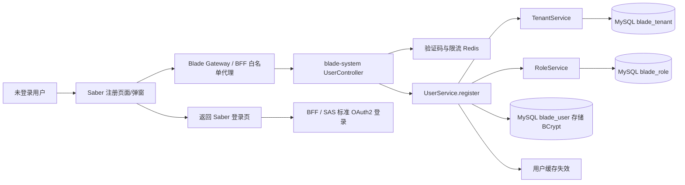
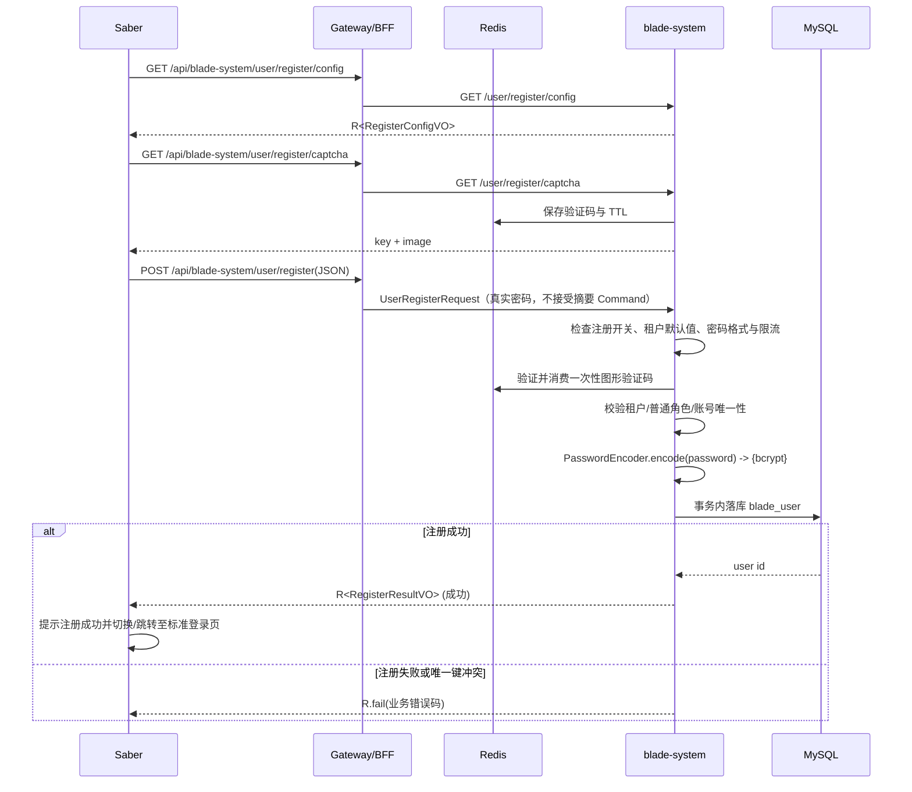

# 用户自助注册详细设计

## 1. 文档信息

| 项目 | 内容 |
| --- | --- |
| 设计编号 | DESIGN-REQ-2026-003 |
| 关联需求 | [REQ-2026-003 用户自助注册](../requirements/REQ-2026-003-user-registration.md) |
| 关联数据库设计 | [DB-REQ-2026-003 用户自助注册数据库设计](../database/DB-REQ-2026-003-user-registration.md) |
| 文档版本 | 0.9 |
| 关联测试/迁移 | [TEST-REQ-2026-003](../test/TEST-REQ-2026-003-user-registration.md)；[DESIGN-REQ-2026-010](DESIGN-REQ-2026-010-production-authentication.md) |
| 文档状态 | 开发中 |
| 技术负责人 | 待指定 |
| 创建/更新日期 | 2026-10-13 |

根据最新架构决策，系统全量切入 Spring Authorization Server + 网关 BFF 体系，旧 `blade-auth` 模块退役下线，不保留逆向回滚链路。用户自助注册的公开端点由 `blade-system` 直接承接（如 `/user/register`、`/user/register/config`），网关 BFF 将其列入匿名白名单；注册密码不再写入 SHA-1 摘要，而是直接调用 `PasswordEncoder` 编码为标准 `{bcrypt}` 格式落库，新用户注册后直接进入标准登录页完成 OAuth2/BFF 登录。原租户归属、普通角色和账号唯一性规则完整保留。

本轮后端已实现system公开接口、精确匿名/CSRF、原子限流、验证码及BCrypt，并以JDK21编译通过；Saber新注册页面及业务验收按关联前端需求执行。

## 2. 设计摘要

### 2.1 目标

1. 在 Saber `/auth/login` 提供 `/auth/register` 新注册入口，支持用户加入已有租户并在注册成功后返回登录界面。
2. 由 `blade-system` 同服务负责公开入口、开关、默认租户、验证码、限流、真实密码校验/BCrypt、普通角色与用户本地事务。
3. `blade-user-api` 定义公开注册 DTO/VO，不新增注册写 Feign，不接受管理端 User Entity；独立公开 Controller 隔离匿名与管理职责。
4. 复用现有 `blade_user` 保存用户，使用租户内账号唯一索引、业务预检查和异常转换保证重复注册及并发注册行为一致。
5. C 端注册用户固定使用目标租户普通用户角色，不创建虚拟部门和岗位，不因共用 Saber UI 获得管理端权限。

### 2.2 非目标

- 不实现新建租户、租户审批、租户试用或租户初始化申请。
- 不实现邮件验证码、短信验证码、手机号/邮箱注册和第三方身份验证。
- 不实现人工审核、待审核状态、注册申请表或审批通知。
- 不实现注册成功自动登录、找回密码、资料完善和多因素认证。
- 不改造现有第三方登录和 `register-guest` 绑定流程。
- 不创建注册申请表、验证码持久化表、用户分组表或 C 端虚拟部门。
- 不建设新的 C 端业务首页；继续由 Saber 现有角色菜单决定登录后的可用页面。
- 不建设注册专用审计或脱敏能力；遵守密码、令牌、密钥和完整敏感请求体不进入日志的通用安全约束。

### 2.3 关键决策

| 决策 | 结论 | 依据 |
| --- | --- | --- |
| 公开入口归属 | `blade-system` 提供 `/user/register/config` 和 `/user/register` | 用户实体主权服务，OAuth2 认证服务器不承载业务注册 |
| 用户落库归属 | `blade-system` 的 `UserServiceImpl.register` | 用户、租户、角色和唯一性均由系统服务控制 |
| 外部请求模型 | `UserRegisterRequest` JSON，不接收 `User` Entity | 禁止匿名用户提交角色、部门、状态和租户技术字段组合 |
| 密码传递与存储 | 传输层 HTTPS 保护真实密码，后端直接使用 `PasswordEncoder` 编码为 `{bcrypt}` 落库 | 消除 SHA-1 历史包袱，注册后直接兼容新认证体系 BCrypt 登录 |
| 默认租户 | `blade.registration.default-tenant-id`，字符串默认值 `"000000"` | 对应 `blade_tenant.tenant_id` 而非主键 `id`，保留前导零和环境配置能力 |
| 注册角色 | 目标租户内 `role_alias=user` 且未逻辑删除的普通角色 | 不允许回退 `admin` 或 `administrator`，避免权限扩大 |
| 部门/岗位 | `dept_id`、`post_id` 使用现有无归属约定 `-1` | C 端用户不属于管理端组织树，现有第三方注册已使用该语义 |
| 用户状态 | 注册成功写入 `status=1`，登录查询拒绝 `status=0` | 注册后立即启用，停用用户不得登录 |
| 注册开关 | Nacos 全局开关，默认关闭；测试环境显式开启 | 不新增注册状态表，支持发布期间快速关闭 |
| 验证码 | 复用现有 Redis 图形验证码，一次性消费 | 首版不引入邮件或短信依赖 |
| 分布式事务 | 不使用 Seata | system 单服务执行本地用户事务 |
| 数据库变更 | 增加 `blade_user(tenant_id, account)` 唯一索引，并将 `name` 扩至 32 位 | 账号最长 32 位且昵称为空时必须等于账号；不新增注册申请表 |

### 2.4 需求映射

| 需求/验收标准 | 设计落点 | 验证方式 |
| --- | --- | --- |
| REQ-001 / AC-001~003 | `RegisterController`、`RegistrationProperties`、Saber 注册入口、网关精确注册路径/方法放行 | 开关开闭、直接调用和现有登录回归 |
| REQ-002 / AC-004~007 | system 默认租户解析；system `ITenantService.getActiveByTenantId` 有效租户校验 | 默认租户、显式租户、无效租户和隔离测试 |
| REQ-003 / AC-008~012 | `UserRegisterRequest`、真实密码/BCrypt、密码规则和非敏感结果映射 | 合法、非法、密码传输和日志检查 |
| REQ-004 / AC-013~016 | `BladeRedis` 一次性验证码和注册限流服务 | 验证码错误/复用/过期、超限和无短信依赖测试 |
| REQ-005 / AC-017~021 | 公开 Controller、`UserServiceImpl.register`、普通角色及 `-1` 组织值 | 角色租户归属、失败回滚和无虚拟部门检查 |
| REQ-006 / AC-022~025 | `RegisterResultVO`、Saber 模式切换和密码清理 | 成功回登录、令牌不存在和失败重试测试 |
| REQ-007 / AC-026~030 | 数据库联合唯一索引、Service 预检查和唯一键异常转换 | 同租户、跨租户、逻辑删除和并发测试 |
| REQ-008 / AC-031~034 | 登录 SQL 状态条件、现有 Saber 动态菜单和服务端权限 | 普通用户登录、管理接口越权和停用账号测试 |

## 3. 改动范围

| 层次 | 模块/路径 | 主要改动 |
| --- | --- | --- |
| API 契约 | `blade-service-api/blade-user-api` | 统一注册 Command、Result、错误语义，新增 UserRegisterRequest/配置与结果 VO，入参真实密码 |
| 用户服务 | `blade-service/blade-system` | 提供注册 Controller、Properties、Service、验证码校验与限流，密码直接 BCrypt 编码入库；执行注册本地事务 |
| 网关 | `blade-gateway`、`doc/nacos/blade.yaml` | 仅放行两个 GET 和一个 POST 精确公开路径，继续拦截管理端接口 |
| 配置 | `doc/nacos/blade.yaml`、环境覆盖配置 | 注册开关、默认租户、密码规则、验证码和限流参数 |
| 数据库 | `doc/sql/blade` | 同步 `blade_user` 全量/升级唯一索引；执行前检查历史重复账号 |
| 调用方 | `D:/workspace/project/Saber/src/api/user.ts`、`src/page/auth` | 注册 API、共用登录 UI、真实密码提交、成功回登录页 |
| 权限数据 | 现有 `blade_role`、菜单和 API Scope | 不新增注册权限；注册用户必须使用租户内普通角色 |

不新增独立服务，由 `blade-system` 直接承接公开注册接口与本地事务，废止旧 `blade-auth` 注册中转。

## 4. 架构与流程

### 4.1 架构图

公开注册请求通过网关 BFF 匿名白名单代理至 `blade-system` 的公开控制器（如 `/api/blade-system/user/register`）。内部写 Feign 接口继续受 `InnerFilter` 保护，禁止外部直接访问。

### 4.2 注册配置与表单时序

### 4.3 与 Saber 范围协同

2026-10-13 用户确认保留 Saber 新注册入口：`/auth/login` 根据开关展示注册按钮，进入 `/auth/register` 调用 system 新接口，成功返回新登录页。前端由 [REQ-2026-015](../../../Saber/doc/requirements/REQ-2026-015-authorization-frontend-adaptation.md)交付页面与请求适配，后端由本需求交付注册规则；不调用旧 `/blade-auth/register`。

### 4.4 注册后登录

用户主动导航 `/oauth2/authorization/blade`，BFF 生成 state/S256 PKCE，SAS 获取登录上下文并通过标准服务 Token 调用 system 校验真实密码；新 `{bcrypt}` 直接匹配。回调后建立 BFF 会话，再读取 system 资料、角色编码、菜单/按钮。注册不创建认证服务登录态、不签发令牌、不调用旧 `/token`。

### 4.5 主要与失败流程

1. config 返回开关与最小规则，关闭时隐藏/禁用入口，直接 POST 仍拒绝，已有登录不受影响。
2. system 规范化租户/账号，校验结构、密码、可信来源限流、一次性验证码。
3. 校验有效租户、唯一普通角色、包含逻辑删除记录的账号占用，再编码 BCrypt 并在本地事务保存。
4. 保存失败回滚用户；验证码消费/计数不随 MySQL 回滚，重试使用新验证码。
5. 提交后清理已有用户缓存；失败不撤销已提交用户，按既有 TTL/维护措施恢复，不记录请求体。
6. 网络结果未知不自动重放；手动重试由永久唯一键保证不产生第二个用户。

## 5. 模块设计

### 5.1 blade-user-api

| 模型 | 字段/边界 |
| --- | --- |
| UserRegisterRequest | tenantId/account/name/password/confirmPassword/captchaKey/captchaCode |
| RegisterConfigVO | enabled/defaultTenantId/captchaEnabled/accountMinLength/accountMaxLength/passwordMinLength/passwordMaxLength/passwordMaxBytes |
| RegisterResultVO | tenantId/account/nextAction=LOGIN，不含用户主键、密码、验证码、角色 ID 或令牌 |

password/confirmPassword 禁止 toString 和普通响应输出。请求不接受 roleId/deptId/postId/status/isDeleted/userId，未知受控字段拒绝或忽略。旧 `UserRegisterCommand.passwordDigest` 不复用为公开请求，旧注册 Feign 依赖清零后退役。

### 5.2 blade-system

独立 `UserRegistrationController` 与管理 Controller 分离，使用统一 `R<T>`、`@Valid @RequestBody`、OpenAPI。注册编排 Service 负责开关/输入/验证码/限流与结果；用户 Service 负责租户/角色/编码/写事务。这是迁移原 auth 职责的必要边界，不新增公共框架。

账号 4~32 字符，规范化首尾空白；昵称最大 32，为空等于账号。密码 8~64 字符且含字母和数字、不等于账号、两次一致，同时最多 72 个 UTF-8 字节；config 返回 passwordMaxBytes=72，前后端均校验，避免 BCrypt 超长失败或截断；编码异常无用户。

UserServiceImpl 使用 ITenantService.getActiveByTenantId 和普通角色服务；TenantProvisionServiceImpl 单向编排租户开通，不产生循环依赖。匿名查询使用已验证目标 tenantId，自定义 SQL 明确租户/逻辑删除，账号占用特意包含删除记录。不得伪造管理员、信任身份头或全局关闭租户隔离。

### 5.3 用户写入规则

User 继承 TenantEntity，雪花 ID；password 直接写 PasswordEncoder 生成的 `{bcrypt}`，不二次 SHA-1；tenantId 为已验证字符串（默认 `000000`）；roleId 为目标租户唯一未删除 role_alias=user，缺失/多条拒绝，不回退管理角色；deptId/postId 为字符串 `-1`，status/isDeleted=1/0。不创建租户、角色、组织；匿名操作人不虚构，客户端受控字段不落库。其他出口 Long 按项目字符串序列化，本注册结果不返回 ID。

## 6. HTTP API 契约

外层代理去除 `/api`，网关去除 `/blade-system`。

| 方法 | 浏览器路径 | system 路径 | 请求/响应 | 身份与幂等 |
| --- | --- | --- | --- | --- |
| GET | /api/blade-system/user/register/config | /user/register/config | 无参数；R<RegisterConfigVO> | 匿名只读、no-store |
| GET | /api/blade-system/user/register/captcha | /user/register/captcha | 无参数；R<Kv> key/image | 匿名、TTL、一次消费、no-store |
| POST | /api/blade-system/user/register | /user/register | JSON UserRegisterRequest；R<RegisterResultVO> | 匿名 + BFF CSRF，唯一键兜底 |

成功 HTTP 200/code=200/success=true；注册业务码 48301~48309 依次为关闭、非法输入、验证码、超限、租户、角色、重复、依赖不可用、其他失败。绑定失败 HTTP 400；BFF CSRF 拒绝 HTTP 403/code=403；服务不可达 5xx，不得误判成功。密码不得出现在 query/URL/响应/日志；结果只有 tenantId/account/nextAction=LOGIN，重复账号返回 ACCOUNT_DUPLICATE，不自动重放。

## 7. Feign 契约

新注册写操作不涉及 Feign，用户数据与公开注册同属 system。旧 `/feign/client/user/register` 不允许新授权客户端写入，外部由 InnerFilter 返回 403，内部未登记写契约 denyAll。注册后登录的 IUserAuthenticationClient 按 REQ-010 使用标准服务 Token、专用 scope/audience 和明确 Fallback 失败语义。

## 8. 数据设计

见 [DB-REQ-2026-003](../database/DB-REQ-2026-003-user-registration.md)与 [DB-REQ-2026-010](../database/DB-REQ-2026-010-production-authentication.md)。昵称 VARCHAR(32)、唯一键 `(tenant_id, account)` 不含 is_deleted，逻辑删除后仍占用，跨租户同名允许。password VARCHAR(256) 已由 OAuth 迁移承接，先扩容后启用 BCrypt。本轮不新增 DDL、表、字段或租户表配置，沿用用户租户处理。

## 9. 事务、并发与缓存

| 主题 | 方案 |
| --- | --- |
| 本地事务 | 用户校验/编码/组装/保存 Service 使用事务，异常回滚 |
| 跨服务 | 不涉及 Seata，Redis 与 MySQL 不形成分布式事务 |
| 并发/重复 | 唯一键最终裁决，同账号最多一个提交；结果未知不自动重放 |
| 验证码 | getAndDel 一次消费，校验成功/失败后不可复用 |
| 限流 | Redis 原子计数/TTL，可信来源/租户/账号维度，依赖失败拒绝 |
| 缓存 | 提交后清理已有用户缓存，不清空无关键，不采集密码/请求体 |

## 10. 认证、租户与数据权限

仅上述两个 GET 和一个 POST 精确匿名放行，优先于通用 `/blade-system/**` TokenRelay；删除 Cookie、Authorization、自定义身份头，不申请用户/服务 Token。注册 POST 仍检查 BFF CSRF，页面先 GET `/bff/csrf` 建所需 Cookie 上下文，该上下文不证明登录。system 资源安全链按方法精确 permitAll 三个路径，不能只放行网关或宽放 `/user/**`、全部 `/user/register/**`。

已登录访问公开路径也不转发身份，目标租户按请求体和业务校验决定。登录后资源服务独立验证 Token、菜单/角色/租户/数据权限，`-1` 不代表全租户范围。可信代理、HTTPS/Cookie/CSRF 见 REQ-010，不信任任意 X-Forwarded-For。

## 11. 异常与日志

开关/输入/密码/租户/角色失败不创建数据；验证码/限流可能改变临时状态但无用户；唯一冲突转账号重复；编码/保存失败回滚，不暴露 SQL/堆栈。响应中断可能已提交，按唯一规则恢复。日志仅必要业务标识，密码、验证码、Token、密钥、连接串和完整请求体不得输出。审计/脱敏不涉及。

## 12. 配置、发布与恢复

### 12.1 配置

system 从 blade.yaml、blade-{profile}.yaml 加载 blade.registration：enabled=false、default-tenant-id="000000"、captcha-enabled=true、账号 4/32、密码字符 8/64；IP 窗口 60 秒/10 次、租户 60 秒/30 次、账号 600 秒/3 次沿用建议，真实环境待验收。字节上限固定 72，不新增可放宽编码边界的配置；验证码关闭必须拒绝注册，动态规则只影响新注册。

### 12.2 发布顺序

1. 备份并检查历史冲突、昵称、唯一键与 password VARCHAR(256)，按 DB-003/010 迁移。
2. 发布 DTO/VO 与 system 新注册/编码，保持开关关闭，核对租户/普通角色/事务。
3. 发布网关精确匿名/CSRF 和 system 方法白名单，确认管理与 Feign 隔离。
4. 发布 Saber `/auth/register` 与新登录，联调验证码/CSRF/HTTPS/代理。
5. 隔离环境开启注册并验收，上线准入通过后按环境启用。

### 12.3 应急与不可逆事项

不恢复旧 auth 或摘要写路径。切流前校验失败停止发布、保持注册关闭；切流后先关闭注册/停止该入口写入，保留用户、唯一键和 BCrypt，再发布兼容新认证的修复版本验证；已有登录按独立健康结果处置。数据库恢复仅隔离快照或受控维护窗口按备份执行，不缩短已有新哈希的密码列，不删除未知用户/授权。创建用户、单向哈希升级与验证码消费不可逆。

## 13. 验证计划与当前实现边界

关联 [TEST-REQ-2026-003](../test/TEST-REQ-2026-003-user-registration.md)，覆盖 34 项验收、匿名/CSRF、BCrypt、租户/角色、并发、失败事务与新 BFF 登录。历史 JDK 21/Saber 构建仅证明旧基线。新 system 公开注册/前端页面尚未实现，本轮只修文档，不运行 Maven/服务/真实接口；实现后模块编译，用户执行真实验收与精确清理，需求保持开发中。

## 14. 风险、评审与变更

| 编号 | 风险/问题 | 负责人 | 状态/结论 |
| --- | --- | --- | --- |
| DESIGN-ITEM-001 | 各已有租户是否均配置唯一有效的普通 `user` 角色尚未核对 | 租户管理员 | 开放；缺少角色的租户不得注册 |
| DESIGN-ITEM-002 | 现有 `blade_user` 是否存在同租户重复账号或空值异常尚未在真实数据库检查 | 数据库负责人 | 开放；增加唯一索引前必须取得 SQL 检查证据 |
| DESIGN-ITEM-003 | `dept_id=-1`、`post_id=-1` 在所有 C 端业务接口中的兼容性尚未验证 | 技术负责人 | 开放；注册本身不创建虚拟部门 |
| DESIGN-ITEM-004 | 账号和密码规则仍需产品评审最终确认 | 产品负责人 | 当前按账号 4~32、密码 8~64 且含字母和数字设计 |
| DESIGN-ITEM-005 | 公开注册限流阈值需结合测试环境并发和误伤情况调整 | 安全/运维负责人 | 当前为设计建议值，待验证 |
| DESIGN-ITEM-006 | 普通 `user` 角色现有菜单权限可能不满足 C 端首页需求 | 产品/权限负责人 | 本需求不新建 C 端业务页面，先验证角色权限边界 |
| DESIGN-ITEM-007 | 租户初始化原本位于 `TenantServiceImpl`，与用户注册校验形成实体 Service 双向依赖 | 技术负责人 | 已于 2026-09-15 拆分 `TenantProvisionServiceImpl`，JDK 21 模块打包通过，待启动冒烟验证 |

| 评审领域 | 结论 | 评审人 | 日期 |
| --- | --- | --- | --- |
| 后端/API | 待评审 | 待指定 | 待指定 |
| 数据库 | 待评审 | 待指定 | 待指定 |
| 安全/租户 | 待评审 | 待指定 | 待指定 |
| Saber/UI | 待评审 | 待指定 | 待指定 |
| 测试可行性 | 待评审 | 待指定 | 待指定 |

| 日期 | 版本 | 变更内容 | 修改人 |
| --- | --- | --- | --- |
| 2026-10-13 | 0.6 | 标明旧注册设计适用基线、新 BFF/内部安全链未接入注册、真实密码迁移及回滚边界；关联新认证设计，不追加实现 | Codex |
| 2026-10-13 | 0.7 | 确认全量切入新架构；公开注册端点迁入 `blade-system`，密码直存 BCrypt，网关 BFF 白名单代理，消除旧 blade-auth 与 SM2 中转 | Codex |
| 2026-09-14 | 0.1 | 创建用户自助注册详细设计，明确 auth 公开入口、user-api Feign、system 用户落库、普通角色、无部门岗位、唯一索引、配置、发布回滚和验证边界 | Codex |
| 2026-09-14 | 0.2 | 完成注册契约、auth/system 实现、网关放行、Nacos 配置、数据库脚本和 Saber 共用登录 UI；修正昵称字段容量；JDK 21 模块打包、Saber 类型检查和生产构建通过，真实环境验收待执行 | Codex |
| 2026-09-15 | 0.3 | 修正 system 注册租户校验的依赖方向，使用 `TenantMapper` 替代 `ITenantService`，消除 `TenantServiceImpl` 与 `UserServiceImpl` 的 Bean 循环，并补充启动冒烟验证要求 | Codex |
| 2026-09-15 | 0.4 | 将租户初始化拆分至 `TenantProvisionServiceImpl` 应用编排服务，`TenantServiceImpl` 回归租户实体职责，注册恢复通过 `ITenantService` 校验并统一有效租户规则；JDK 21 关联模块打包通过 | Codex |
| 2026-09-15 | 0.5 | 明确注册 `tenantId` 映射 `blade_tenant.tenant_id` 字符串字段；Saber API、配置回填、表单状态和提交均保留字符串及前导零 | Codex |
| 2026-10-13 | 0.8 | 用户确认保留 Saber 新注册；完整修正 system 公开契约、BCrypt、匿名/CSRF、新登录、发布应急及测试边界，清理旧时序与围栏 | Codex |
| 2026-10-13 | 0.9 | 同步system公开注册、验证码/原子限流、BCrypt和BFF精确匿名/CSRF实现及JDK21编译；无新增DDL，用户运行验收待执行 | Codex |
