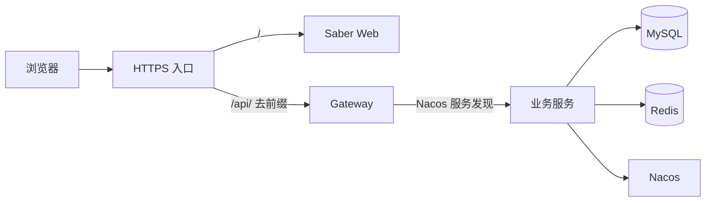

# 前后端容器部署规范化详细设计

## 1. 文档信息

| 项目 | 内容 |
| --- | --- |
| 设计编号 | DESIGN-REQ-2026-007 |
| 文档版本 | 0.5 |
| 关联需求 | [REQ-2026-007](../requirements/REQ-2026-007-deployment-standardization.md) |
| 关联测试 | [TEST-REQ-2026-007](../test/TEST-REQ-2026-007-deployment-standardization.md) |
| 关联教程 | [前后端容器部署教程](../guide/前后端容器部署教程.md) |
| 数据库设计 | 不涉及 |
| 文档状态 | 开发中 |
| 负责人 | Codex |
| 最后更新日期 | 2026-10-13 |

本轮script/docker/app和镜像CI已替换为blade-authorization-server并挂载外部只读JWK，Ingress提供同源HTTPS精确代理；App/Ingress Compose静态解析通过，镜像和发布演练未执行。原拓扑仅作通用部署背景。新认证采用七类固定业务 URL，网关默认关闭 Nacos 发现路由；授权服务/system 仍通过 Nacos 通信。新链路拓扑、SQL/密钥/客户端准备、Cookie/同源入口和安全停流/向前修复见 [DESIGN-REQ-2026-010](DESIGN-REQ-2026-010-production-authentication.md)，不能直接套用图中的网关发现路由假设。

## 2. 设计摘要与需求映射

| 需求 | 设计落点 | 验收标准 |
| --- | --- | --- |
| REQ-001 | 按服务的运行目录、连接地址规则、首次与日常流程 | AC-001、AC-002、AC-003 |
| REQ-002 | 所有 SpringBlade Compose 文件和脚本统一文件名 | AC-004 |
| REQ-003 | 端口绑定变量默认值、版本与回滚说明 | AC-005、AC-006 |

## 3. 范围和架构

教程采用 `/opt/springblade/app/<service>`、`/opt/springblade/middleware/<service>` 和 `/opt/saber` 三组运行目录，每个服务独立保存 `docker-compose.yaml` 与 `.env`。Saber 的入口路由 `/` 到 Web、`/api/` 到 Gateway。仓库已有的整体 `infra`、`app`、`ingress` 清单继续保留，但不作为本教程的运行目录示例。

对宿主机发布的端口采用 `0.0.0.0`。服务间连接使用实际可达的地址或同机 Docker 网络中的服务名；分主机部署时，各业务服务的发布端口及 Nacos 注册地址必须可供调用方访问。

## 4. 文件和配置设计

| 文件或目录 | 变化 |
| --- | --- |
| `script/docker/{infra,app,ingress}/docker-compose.yaml` | 从 `compose.yml` 改名；端口默认绑定全部网卡，`infra` 的 Nacos Console 默认端口改为 18080，避免与 Gateway 8080 冲突。 |
| `script/docker/middleware/*/docker-compose.yaml` | 从 `compose.yml` 改名，保持独立中间件部署模式。 |
| `script/docker/deploy.sh`、`app/deploy.sh`、`middleware/deploy.sh` | 引用新文件名；保留原有项目名、操作及探活逻辑。 |
| 各 `.env.example` | 与 Compose 默认绑定及 Nacos Console 端口一致，不保存真实密钥。 |
| Saber `src/docker/docker-compose.yaml` | 保持文件名，宿主机绑定默认值改为 `0.0.0.0`。 |
| `doc/guide/前后端容器部署教程.md` | 按服务运行目录、启动顺序、验证和回滚。 |

`0.0.0.0` 只用于端口监听。Nacos、数据库、Redis 和代理的连接目标仍使用容器服务名或可达地址。MySQL 与 Nacos 健康检查中的 `127.0.0.1` 是容器本地探测，不修改。

## 5. 契约与数据边界

- HTTP API：不新增路径或模型；Saber 生产构建使用 `/api`，入口代理应将 `/api/` 前缀去除后转给 Gateway。
- Feign：不改接口、Fallback 或服务名。跨主机部署时需核对 Nacos 注册地址可达性。
- 数据：不改表和 SQL。`infra` 的 MySQL 首次初始化只创建 `blade`、`nacos_config` 及 Nacos 表；`doc/sql/blade` 全量及升级脚本由部署人员按版本执行。
- Nacos：本需求不变更 Data ID 内容；教程补充新认证需导入 blade.yaml、blade-{profile}.yaml 和 blade-authorization-server-{profile}.yaml（DEFAULT_GROUP/对应 namespace），实际新配置与发布影响由 REQ-2026-010 承接，敏感值只在仓库外受控环境提供。
- 事务、缓存、认证、租户及数据权限：无行为变化。
- 审计、脱敏：不涉及，无需求依据。

## 6. 发布、验证与回滚

1. 记录现有 Compose 文件、变量文件、镜像标签和数据备份；修改安全组与端口规划。
2. 获取对应代码版本的部署文件。首次部署依次完成基础设施、Blade SQL、Nacos 配置、业务服务、Gateway、Saber 与 HTTPS 入口。
3. 日常升级先确认数据库/API 兼容，再部署后端和前端镜像；按 Compose 项目单独 `config --quiet`、`pull`、`up -d`。
4. 验证容器状态、健康检查、代理路由、Nacos 注册以及真实业务用例，分别记录结果。
5. 回滚时恢复已记录的镜像标签和配置版本；数据库不可逆升级使用预先评审的备份恢复方案。

## 7. 验证计划与风险

静态检查涵盖旧文件名残留、示例变量与 Compose 默认值、Markdown 链接、脚本语法；本任务不运行 Maven 测试或真实服务。人工验收需检查 80/443、Gateway 端口、业务服务注册、数据库与 Nacos 配置、镜像升级和回滚。详情见关联测试文档。

2026-09-29 已执行：七份 SpringBlade Compose 与一份 Saber 独立 Web Compose 使用示例变量执行 `config --quiet`，均退出 0；三个后端部署脚本经 `bash -n` 检查退出 0；变更文档的相对链接检查与两仓库 `git diff --check` 通过。渲染结果显示整体基础设施栈的 Nacos Console 为 `0.0.0.0:18080`、Gateway 为 `0.0.0.0:8080`、Saber 独立 Web 为 `0.0.0.0:8080`，符合文档所述的同机端口冲突条件。Docker CLI 对本机凭据配置文件发出权限警告，未影响配置解析。未启动容器、运行数据库脚本或访问接口；正式用例均待用户在目标环境执行。

| 风险 | 处理 |
| --- | --- |
| 全网卡绑定扩大可达面 | 安全组在服务启动前按端口用途设置；教程给出端口清单。 |
| 同机默认端口冲突 | 整体栈将 Nacos Console 默认端口设为 18080；独立 Saber Web 与 Gateway 同机时需覆盖其中一个 8080。 |
| 旧 Compose 文件留在服务器 | 按版本同步新文件，检查 `docker compose ls` 和项目名后再部署。 |
| 跨主机 Nacos 注册不可达 | 明确配置可达地址并在真实环境验证，不用 `0.0.0.0` 作为访问目标。 |

## 8. 变更记录

| 日期 | 版本 | 变更内容 | 修改人 |
| --- | --- | --- | --- |
| 2026-10-13 | 0.3 | 对照当前旧认证 Compose 和教程更新，关联新授权 Nacos/固定路由/独立回滚边界；保留原检查证据，本次不执行容器验收 | Codex |
| 2026-09-29 | 0.2 | 教程结构改为按服务目录，移除整体栈作为教程默认方案 | Codex |
| 2026-09-29 | 0.1 | 建立 Compose 命名、监听和通用部署流程设计 | Codex |
| 2026-10-13 | 0.4 | 同步新认证仅安全停流/向前修复边界，区分通用容器恢复与旧auth逆向恢复；保留旧栈证据，不增加运行结果 | Codex |
| 2026-10-13 | 0.5 | 同步REQ-010新授权服务镜像/Compose、外部JWK、TLS精确代理及网关仅本机探活绑定；两份Compose静态解析通过，运行演练未执行 | Codex |
