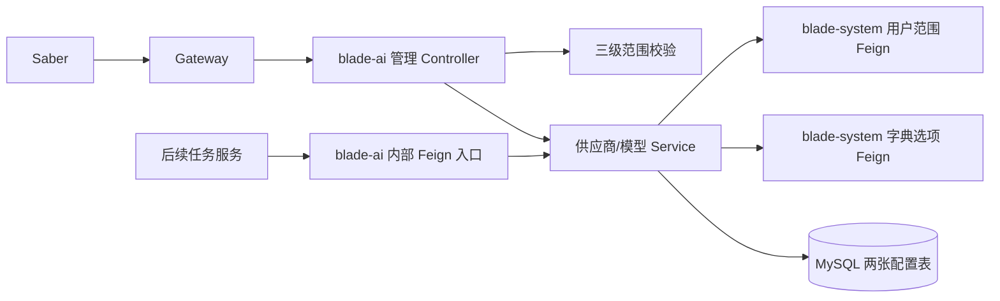
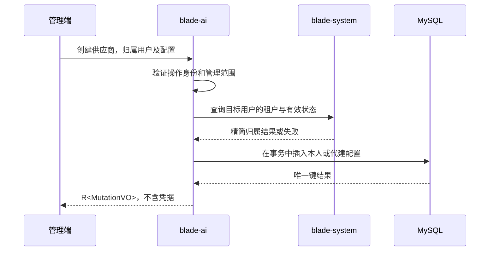
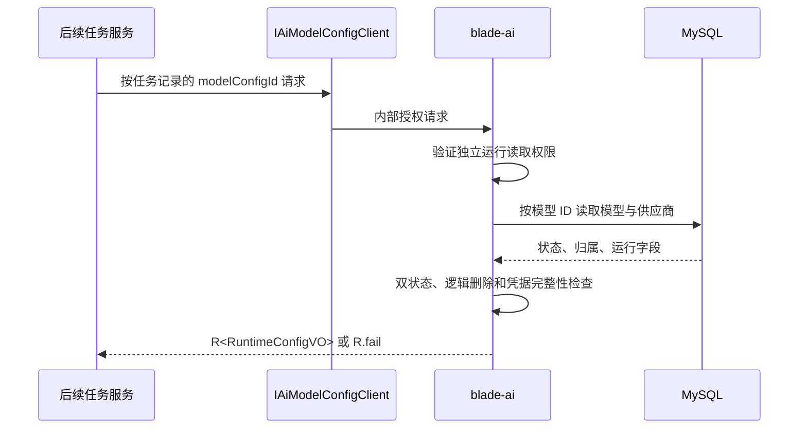

# 大模型供应商与模型配置管理详细设计

## 1. 文档信息

| 项目 | 内容 |
| --- | --- |
| 设计编号 | DESIGN-REQ-2026-008 |
| 关联需求 | [REQ-2026-008 大模型供应商与模型配置管理](../requirements/REQ-2026-008-ai-model-configuration.md) 0.9 |
| 关联数据库设计 | [DB-REQ-2026-008 大模型供应商与模型配置管理](../database/DB-REQ-2026-008-ai-model-configuration.md) 0.4 |
| 需求索引 | [需求文档索引](../requirements-index.md) |
| 文档版本 | 0.4 |
| 文档状态 | 草稿，待评审 |
| 技术负责人 | 待指定 |
| 创建/更新日期 | 2026-09-30 |

本设计仍处于待评审阶段；后端接口、权限种子、MySQL 脚本和 Nacos 配置已写入工作区，尚未执行数据库迁移、接口联调或整体验收。

## 2. 设计摘要

### 2.1 目标与边界

- `blade-ai` 提供用户级供应商及独立模型配置的管理 API，并以模型配置 ID 提供单独授权的内部运行读取。
- 管理接口按平台超级管理员、租户管理员、普通用户三级范围控制。仅平台超级管理员可查看跨租户列表，跨租户写入须明确目标租户并校验资源归属。包括平台超级管理员在内，管理响应都只返回凭据是否已配置；内部读取在独立授权且配置可用时才返回运行凭据。
- 模型与供应商为多对一；模型归属、状态和并发版本独立。业务任务存储模型配置 ID 的改造留待各调用方后续需求。
- Saber 管理界面同期交付，其页面需求、交互和验收在 Saber 仓库单独建档；本设计提供后端对接契约。
- `fast-staratlas-ai` YAML、现有图片反推和提示词接口保持原行为。本期不实现推理、连接测试、场景默认模型、审计或脱敏流程。

### 2.2 需求映射

| 需求/验收标准 | 设计落点 | 验证重点 |
| --- | --- | --- |
| REQ-001 / AC-001~003、AC-025~026 | 供应商管理 API、凭据替换、默认停用、编码不复用 | 归属、保留旧凭据、关联删除、重建冲突 |
| REQ-002 / AC-004~006、AC-024 | 模型管理 API、独立模型行、归属检查 | 越权引用、停用、只改目标模型 |
| REQ-003 / AC-007~013 | 三级访问范围与目标用户校验 | 跨租户、同租户代管、本人隔离、未登录 |
| REQ-004 / AC-014~016、AC-027 | `IAiModelConfigClient` 与运行读取服务 | 完整运行配置、最新有效配置、缺失 ID、授权和降级 |
| REQ-005 / AC-017~019 | 管理 VO 投影、状态校验和日志限制 | 凭据不回显、停用拒绝、敏感信息不泄露 |
| REQ-006 / AC-020~023 | 字典选项契约与写入校验 | 稳定值、失效项、预设及自定义 |

## 3. 改动范围与依赖

| 层次 | 模块 | 设计改动 |
| --- | --- | --- |
| 共享契约 | `blade-service-api/blade-ai-api` | 供应商与模型 Entity、管理 DTO/VO、运行 VO、错误码、权限常量、`IAiModelConfigClient` 和 Fallback |
| 服务实现 | `blade-service/blade-ai` | 管理 Controller、运行 Feign 服务端、访问范围/字典校验、Service、Mapper/XML、VO 转换 |
| 用户归属查询 | `blade-service-api/blade-user-api`、`blade-service/blade-system` | 增加只返回用户 ID、租户及有效状态的内部校验契约；现有 `userInfo` 含无关用户字段，不用于本功能 |
| 字典选项 | `blade-service-api/blade-dict-api`、`blade-service/blade-system` | 扩展返回字典项 ID、code、dictValue、有效状态的内部选项契约；现有 `getList` SQL 不返回 ID，不能校验 `preset_dict_id` |
| MySQL | `doc/sql/blade` | 设计确认后同步全量和升级脚本、三类字典种子及管理权限数据，字段和索引以数据库设计为准 |
| Nacos | `doc/nacos/blade.yaml` | 设计确认后将两表加入 `blade.tenant.tables`；不增加凭据配置项 |
| 调用方 | Saber；后续 SpringBlade 服务 | Saber 对接管理 API；后续任务服务才保存模型 ID 并调用新 Feign 契约 |

新依赖仅为 `blade-ai` 对 `blade-user-api` 和 `blade-dict-api` 的 API 模块依赖，不能依赖 `blade-system` 实现模块。公共权限或租户框架不在本期重构。

## 4. 架构与关键流程

## 5. 模块与数据模型

### 5.1 `blade-ai-api`

| 类型 | 建议名称 | 职责 |
| --- | --- | --- |
| Entity | `AiProviderConfig`、`AiModelConfig` | 分别映射两张表，继承 `TenantEntity`；Long ID 对外按现有字符串序列化约定处理 |
| DTO | `ProviderCreateDTO`、`ProviderUpdateDTO`、`ModelCreateDTO`、`ModelUpdateDTO`、`ConfigStatusDTO`、`ConfigRemoveDTO` | 明确可写字段，更新/状态/删除包含 `id` 和 `lockVersion`；不接受实体整体绑定 |
| VO | `ProviderListVO`、`ProviderDetailVO`、`ModelListVO`、`ModelDetailVO`、`ConfigMutationVO`、`AiConfigOptionsVO` | 管理响应；供应商只暴露 `credentialConfigured`，任何管理 VO 均不包含 `apiKeyValue` |
| 运行 VO | `AiModelRuntimeConfigVO` | `modelConfigId`、`providerId`、`tenantId`、`ownerUserId`、`baseUrl`、`apiKeyValue`、`upstreamModelId`、`apiProtocol`、`capabilityType` 和单模型参数 |
| Feign | `IAiModelConfigClient` | 独立于管理 API 的版本化按 ID 运行读取 |
| Fallback | `IAiModelConfigClientFallback` | 返回专用 `R.fail(SERVICE_UNAVAILABLE)`；不得返回 `null` 或空成功 VO |

`apiKeyValue` 仅存在于写入 DTO、Entity 和内部运行 VO。平台超级管理员创建供应商时必须提交目标 `ownerUserId` 和 `tenantId`；租户管理员可指定当前租户用户，未指定时归属本人；普通用户提交这两个字段时必须与当前身份一致，由服务端按当前身份赋值。平台超级管理员的所有写请求都必须提交 `tenantId` 作为目标租户断言，服务端检查它与目标用户、供应商或模型归属一致；其他角色提交时只能等于当前会话租户。更新、启停和删除 DTO 不允许改变租户、所有人或实际 `createUser/updateUser`。模型创建接收 `providerId` 和供超管校验的 `tenantId`，模型归属仍从已校验供应商复制。编码、所有人和所属供应商创建后不可更改。

| 管理响应 | 字段白名单 |
| --- | --- |
| `ProviderListVO` | `id, providerCode, providerName, presetDictId, baseUrl, tenantId, ownerUserId, status, credentialConfigured, lockVersion, updateTime` |
| `ProviderDetailVO` | 列表字段及 `createUser, createTime, updateUser`；不含凭据原值 |
| `ModelListVO` | `id, providerId, modelCode, modelName, upstreamModelId, apiProtocol, capabilityType, tenantId, ownerUserId, status, lockVersion, updateTime` |
| `ModelDetailVO` | 列表字段及 `contextWindow, inputTypes, reasoningEfforts, createUser, createTime, updateUser` |
| `AiConfigOptionsVO` | 三组有效选项：供应商预设 `{id, value}`、协议和能力 `{value}`；不含个人配置。`value` 为字典 `dictValue`，Saber 负责显示名称映射 |

### 5.2 `blade-ai` 实现

| 层 | 建议名称 | 职责 |
| --- | --- | --- |
| Controller | `AiProviderController`、`AiModelController` | `@PreAuth`、Bean Validation、OpenAPI、统一 `R<T>` |
| 内部入口 | `AiModelConfigClient` | `@Hidden`、独立运行权限、调用运行读取 Service |
| Service | `IProviderConfigService`、`IModelConfigService`、`AiConfigAccessService` | 写事务、归属、三级范围、版本与运行可用性 |
| Mapper/XML | `AiProviderConfigMapper`、`AiModelConfigMapper` | 分页投影、带范围条件的详情/写入、关联锁和跨租户专用查询 |
| Wrapper | `AiProviderConfigWrapper`、`AiModelConfigWrapper` | 只构造白名单管理 VO，不使用 Entity/通用 Bean copy 自动序列化敏感列 |

Entity 对应 `BaseService` / `BaseServiceImpl`。列表查询只投影管理需要的列，`credentialConfigured` 在 SQL 中由非空且非空串判断；详情同样不得将 Entity 直接返回。凭据写入后不在普通日志、错误信息或缓存中输出。

### 5.3 字段与校验

- 供应商 `providerCode`、模型 `modelCode` 分别在同一租户及所有人下唯一且不可改；相同上游模型 ID 可存在多个模型配置。名称、URL、协议和状态按数据库设计字段长度与值域校验。`baseUrl` 为合法 HTTP(S) 根地址，禁止 URL 内嵌用户信息；本期不由服务端访问该地址。
- 创建供应商时 `apiKeyValue` 可选，缺少凭据的配置仍可保存，但不能运行读取。更新时字段缺席或 `null` 表示保留旧凭据；提交非空新值才替换，空白串拒绝。首期不提供单独清除凭据操作。
- `apiProtocol` 和 `capabilityType` 保存有效字典项的稳定 `dictValue`。`inputTypes` 为非空、去重的能力值数组；`reasoningEfforts` 为可空的非空字符串映射。使用 JSON 解析与结构校验后序列化到各自模型行，不能把供应商的完整模型列表写入 JSON。
- 字典读取必须检查 Feign `R` 成功、结果完整及选项未删除；字典服务不可用时写入失败且事务回滚。预设 ID 可空；非空时须指向有效 `ai_provider_preset`，`providerName` 保存用户名称快照。已失效字典值的旧记录可管理查看，修改相关字段时仍需通过当前有效值校验；运行读取按已保存协议值返回，不声明后续调用方已支持它。
- 现有 `IDictClient.getList` 的 SQL 未返回 `id`，故需扩展内部字典选项接口并让 `blade-system` 返回有效项 ID、分类和稳定值。Saber 使用下述配置选项 API，不依赖受管理员权限限制的 `/dict/list`，也不直接猜测字典 ID。

## 6. 管理 HTTP API 契约

所有路径是 `blade-ai` 服务内路径，网关按现有服务路由转发，不额外拼接 Boot 版专属前缀。查询参数中的 ID、`ownerUserId` 和 `lockVersion` 在 JSON 中均使用字符串形式。列表为 `Query` 分页，按 `update_time DESC, id DESC` 排序。平台超级管理员可不传 `tenantId` 查看标明归属的全局列表；这一能力不授予其他角色。

| 方法 | 路径 | 权限 | 请求位置与模型 | 成功响应 | 写入语义 |
| --- | --- | --- | --- | --- | --- |
| GET | `/ai/config/options` | 已登录，由服务端检查当前身份 | 无 | `R<AiConfigOptionsVO>` | 只读，依赖字典有效项 |
| GET | `/ai/provider/list` | `ai:model:provider:view` | Query：`tenantId?`、`ownerUserId?`、`code?`、`name?`、`status?`、分页 | `R<IPage<ProviderListVO>>` | 只读 |
| GET | `/ai/provider/detail` | 同上 | Query：`id` | `R<ProviderDetailVO>` | 只读 |
| POST | `/ai/provider/create` | `ai:model:provider:create` | Body：`ProviderCreateDTO` | `R<ConfigMutationVO>` | 重复编码失败 |
| POST | `/ai/provider/update` | `ai:model:provider:edit` | Body：`ProviderUpdateDTO` | `R<ConfigMutationVO>` | `lockVersion` 条件更新 |
| POST | `/ai/provider/status` | `ai:model:provider:edit` | Body：`ConfigStatusDTO`，目标 `status=0/1` | `R<ConfigMutationVO>` | 版本条件更新；重复状态不静默跳过版本校验 |
| POST | `/ai/provider/remove` | `ai:model:provider:delete` | Body：`ConfigRemoveDTO` | `R<Boolean>` | 有未删除模型时拒绝；重复删除返回不存在 |
| GET | `/ai/model/list` | `ai:model:config:view` | Query：`providerId?`、`tenantId?`、`ownerUserId?`、`code?`、`status?`、分页 | `R<IPage<ModelListVO>>` | 只读 |
| GET | `/ai/model/detail` | 同上 | Query：`id` | `R<ModelDetailVO>` | 只读 |
| POST | `/ai/model/create` | `ai:model:config:create` | Body：`ModelCreateDTO` | `R<ConfigMutationVO>` | 重复编码失败 |
| POST | `/ai/model/update` | `ai:model:config:edit` | Body：`ModelUpdateDTO` | `R<ConfigMutationVO>` | 只修改目标模型行 |
| POST | `/ai/model/status` | `ai:model:config:edit` | Body：`ConfigStatusDTO` | `R<ConfigMutationVO>` | 版本条件更新 |
| POST | `/ai/model/remove` | `ai:model:config:delete` | Body：`ConfigRemoveDTO` | `R<Boolean>` | 逻辑删除，旧任务 ID 随即不可用 |

`ConfigMutationVO` 返回 `id` 和新的 `lockVersion`。创建 DTO 的供应商字段为 `providerCode/providerName/presetDictId?/baseUrl/apiKeyValue?/ownerUserId?/tenantId?/status?`；模型字段为 `tenantId?/providerId/modelCode/modelName/upstreamModelId/apiProtocol/capabilityType/contextWindow?/inputTypes/reasoningEfforts?/status?`。更新 DTO 只允许可变业务字段并要求 `id/lockVersion/tenantId?`；状态 DTO 只允许 `id/lockVersion/tenantId?/status`，删除 DTO 只允许 `id/lockVersion/tenantId?`。其中 `tenantId` 对平台超级管理员写入必填，其他角色可省略或仅提交当前租户；它只是归属断言，不是租户迁移字段。接口不提供批量删除，避免部分成功歧义。

未登录按现有认证链拒绝；无动作权限按 `@PreAuth` 拒绝；有动作权限但目标越权时返回资源不可见，不泄露目标租户、所有人或凭据。业务错误使用专用 `AiModelConfigResultCode` 的非成功 `R`，业务码见第 11 节。实际 HTTP 状态沿用统一异常处理；前端必须判断 `R` 业务码，不能只判断 HTTP 状态。新 API 不改变既有 `/prompt` 和图片反推路由。

## 7. 内部 Feign 契约

| 项目 | 设计 |
| --- | --- |
| API 模块/服务名 | `blade-ai-api` / `AppConstant.APPLICATION_AI_NAME` |
| `API_PREFIX` | `/feign/client/ai-model-config/v1` |
| Java 签名 | `R<AiModelRuntimeConfigVO> getRuntimeConfig(@RequestParam("modelConfigId") Long modelConfigId)` |
| HTTP | `GET /feign/client/ai-model-config/v1/runtime?modelConfigId={id}`，无模型 ID 时失败 |
| 鉴权 | 独立 `ai:model:runtime:read` 权限；仅授予任务执行服务的受控内部身份，不能复用管理查看权限 |
| Fallback/超时 | Sentinel 沿用 `doc/nacos/blade.yaml` 中的全局开关及现有 Feign 超时；降级返回 `R.fail(SERVICE_UNAVAILABLE)` |
| 调用方处理 | 先检查 `R` 成功和非空完整 VO，再使用凭据；业务失败、超时和降级都使任务失败，不猜测默认模型 |

网关 `InnerFilter` 已拒绝外部 `/feign/client` 路径；服务端仍须认证和独立权限校验，不能把网关阻断当成唯一授权。运行读取不要求最终用户的登录态，模型 ID 来自任务自身的明确关联；不能借用普通用户 Token 代替任务服务身份。现有认证链能否提供 `@PreAuth` 可识别的受限服务身份需先联调；若不能，认证方案须返回需求评审，内部凭据读取不得先行开放。按 ID 返回执行时最新有效配置，不做任务创建时快照；这一数据规则已确认。

管理访问所需的只读内部契约如下，服务端在 `blade-system` 实现，客户端在 `blade-ai` 使用。均复用全局 Feign/Sentinel 设置，Fallback 只返回 `R.fail`，调用方必须检查非成功结果。

| API 模块 / 服务名 | 路径与 Java 签名 | 返回字段与失败处理 |
| --- | --- | --- |
| `blade-user-api` / `AppConstant.APPLICATION_SYSTEM_NAME` | `GET /feign/client/user/owner-scope?userId={id}`；`IUserClient.ownerScope(@RequestParam("userId") Long userId): R<OwnerScopeVO>` | `id, tenantId, status, isDeleted`；无效用户返回业务失败，服务失败由 Fallback 返回非成功 |
| `blade-user-api` / `AppConstant.APPLICATION_SYSTEM_NAME` | `GET /feign/client/user/management-scope`；`IUserClient.managementScope(): R<ManagementScopeVO>` | 根据已认证的当前调用者查询有效用户及角色；返回 `userId, tenantId, platformAdmin, tenantAdmin`。平台管理员角色须属于平台租户，租户管理员角色须属于当前租户；角色失效或服务失败时不授予扩大范围 |
| `blade-dict-api` / `AppConstant.APPLICATION_SYSTEM_NAME` | `GET /feign/client/dict/options?code={code}`；`IDictClient.getOptions(@RequestParam("code") String code): R<List<DictOptionVO>>` | `id, code, dictValue, isDeleted`；仅返回有效项，服务失败由 Fallback 返回非成功 |

目标用户精简查询在 `blade-system` 也需验证平台管理员的跨租户读取能力；不能因调用方当前租户的自动过滤，把合法代建误判为用户不存在。普通用户创建本人配置仍以当前认证身份为准，不依赖客户端提供的用户字段。

## 8. 数据与查询设计

两表、字段、约束、索引、删除编码复用规则及 MySQL DDL 见[数据库设计](../database/DB-REQ-2026-008-ai-model-configuration.md)。本设计不复制 DDL。两表均为 `TenantEntity`，`status=0/1`、`is_deleted=0/1`。模型写入时校验 `providerId/tenantId/ownerUserId` 一致；运行查询按 ID 取模型，再取同归属供应商，要求双方未删除且启用、供应商有非空凭据。可选的 `presetDictId`、`contextWindow`、`reasoningEfforts` 更新时允许清空并持久化 `NULL`。

- 普通用户查询带 `tenant_id=当前租户 AND owner_user_id=当前用户 AND is_deleted=0`；租户管理员带 `tenant_id=当前租户 AND is_deleted=0`；平台超级管理员全局列表带 `is_deleted=0`，可选租户和所有人筛选，结果始终带租户及所有人。详情、关联检查和写 SQL 使用同样的范围，不能只在 Controller 判断。平台超管写 SQL 额外带已核对的目标 `tenant_id`，目标用户、供应商和模型必须同属该租户。
- 跨租户查询与内部读取走独立 Mapper 方法，只有确认平台超级管理员或内部运行权限后才能调用。仓库依赖提供 `TenantUtil.ignore` / `TenantIgnore`；实施时优先在授权之后仅围绕该次专用 Mapper 查询局部跳过自动租户过滤，并验证实际 SQL。全局列表显式检查 `is_deleted`；指定资源的详情和写入显式检查 ID、目标租户及归属。禁止全局关闭租户过滤。
- 列表和详情投影排除 `api_key_value`；`credentialConfigured` 由服务端生成。运行读取单独查询该字段；不将运行 VO、Entity 或完整 Feign 响应写入日志/缓存。
- 模型删除采用逻辑删除；供应商删除和模型创建在各自事务中锁定同一供应商行，删除检查未删除模型后再带版本更新。唯一键不含 `is_deleted`，删除后编码不复用。新供应商和模型默认停用；模型行内的 `input_types`、`reasoning_efforts` 使用受校验 JSON。DDL 已写入工作区，迁移与并发行为仍待真实环境验证。
- 正式脚本已写入 `doc/sql/blade/blade.mysql.all.create.sql` 和 `doc/sql/blade/blade.mysql.upgrade.5.0.1.ai-model-configuration.sql`；尚未执行迁移，实际表结构和重复执行行为待 MySQL 验证。

## 9. 事务、并发与缓存

| 主题 | 设计 |
| --- | --- |
| 本地事务 | 每个创建、更新、启停和删除是单个 `blade-ai` 本地事务；校验失败或数据库异常整体回滚 |
| 跨服务事务 | 用户和字典 Feign 是只读校验，先取得有效结果再写本地表；不使用 Seata。依赖失败时禁止写入 |
| 唯一性 | 先查用于友好提示，最终以数据库唯一键为准；并发重复插入统一转换为重复编码错误 |
| 乐观并发 | 更新、启停、删除以 `id + tenant/owner 范围 + is_deleted=0 + lock_version` 条件更新，影响行数为零返回冲突或不可见；成功递增版本 |
| 关联并发 | 创建模型与删除供应商都先在本地事务锁定同一供应商行，再检查其有效性或未删除模型；锁顺序固定为供应商后模型 |
| 幂等 | 本期无幂等键；重复创建返回唯一冲突，重复删除返回不存在，陈旧版本写入返回冲突；前端以结果和新版本恢复 |
| 缓存 | 新配置不引入业务缓存，避免凭据失效延迟；字典读取使用现有服务契约，不缓存本功能的凭据 |

## 10. 认证、租户、数据权限与敏感信息

三级范围按“平台超级管理员 > 当前租户管理员 > 本人”解析。`blade-system` 的 `managementScope` 核对当前用户有效、会话用户 ID/租户与数据库一致、角色未删除；平台身份的用户和 `administrator` 角色均须属于平台租户 `000000`，租户 `admin` 角色须属于当前会话租户。多角色按上述优先级取最高已验证范围，角色被撤销后不能继续凭旧 Token 代管。用户范围依赖失败时拒绝供应商及模型配置读写，不能沿用 Token 中可能失效的租户和用户状态；全局字典选项仍只检查登录。请求参数和前端菜单均不能提升范围。

管理员代建时调用 `blade-system` 的精简用户归属接口，要求用户存在、未删除、有效，且 `user.tenantId` 与明确选定的目标 `tenantId` 一致；普通用户只能使用本人 ID 和当前租户。平台超管的创建、修改、启停、删除必须提交目标 `tenantId`，与资源实际归属不一致时拒绝且不改变数据。模型所属租户与所有人从供应商读取，不能由请求覆盖。用户或字典 Feign 返回非成功、空体、空必要字段时均按依赖失败拒绝写入。实际 `create_user/update_user` 由框架当前身份写入，不等于代建配置所有人。

管理权限按供应商/模型的 view、create、edit、delete 分开配置，启停归 edit；运行权限单独配置。接口权限资源已写入 MySQL 脚本，菜单与角色授权仍须在目标环境核对。Controller 使用 `@PreAuth(permission = ...)`，选项接口使用 `@PreAuth` 校验登录。列表采用本功能显式的范围解析和 SQL 条件；租户拦截器实际效果待联调检查。

Saber首阶段只补齐资产管理下的`ai_provider`、`ai_model`页面菜单及各自`_view`按钮。
两个查看Scope分别绑定`category=1`的页面菜单，不能绑定`category=2`按钮，否则现有接口授权树无法组装页面父节点。
全量种子和[独立增量脚本](../sql/blade/blade.mysql.upgrade.5.0.1.ai-model-menu-permission.sql)
仅为平台种子超管增加这两项查看API及对应菜单授权，不创建写按钮、不授予写API或运行读取。
其他角色按需显式授权；多个顶部菜单不自动选择目标。ID复用、冲突零写入、缓存生效和精确回滚见
[部署说明](../guide/ai-model-menu-permission-deployment.md)。数据库尚未执行，不能据此宣称真实菜单和接口已可用。

审计与脱敏处理流程不涉及，依据为本期需求的明确非目标。通用安全底线仍要求不在管理响应、异常、普通日志、链路跟踪和 SQL 种子中输出凭据、Token 或完整敏感请求体。`apiKeyValue` 在当前数据库设计中为原值存储，落盘及备份访问属于待评估风险，不扩展为本期新安全产品。

## 11. 异常与可观察结果

实现使用 `48401~48409` 业务码；发布前仍须核对目标环境的编码占用。认证和权限错误沿用现有框架码。

| 业务码 | 名称 | 含义 |
| --- | --- | --- |
| 48401 | `NOT_FOUND` | 目标不存在、已删除或不可见 |
| 48402 | `OWNER_INVALID` | 目标用户或租户归属无效 |
| 48403 | `PROVIDER_UNAVAILABLE` | 供应商不存在、已删除或归属不符 |
| 48404 | `DUPLICATE_CODE` | 当前归属范围内管理编码重复 |
| 48405 | `HAS_MODELS` | 供应商下仍有未删除模型 |
| 48406 | `CONFLICT` | 乐观版本过期或写入状态冲突 |
| 48407 | `OPTION_INVALID` | 协议、能力、预设或模型参数无效 |
| 48408 | `CONFIG_UNAVAILABLE` | 运行配置停用或缺少凭据 |
| 48409 | `SERVICE_UNAVAILABLE` | 字典、用户或 `blade-ai` 依赖失败及 Feign 降级 |

| 场景 | 对外结果 | 数据影响 |
| --- | --- | --- |
| 未登录或动作权限不足 | 认证/权限拒绝，不返回数据 | 无 |
| 目标不在管理范围或已删除 | `NOT_FOUND`，不暴露目标归属 | 无 |
| 平台超管未提交目标租户或目标租户与资源不符 | 参数失败或 `NOT_FOUND`，不使用当前会话租户代填 | 无 |
| 目标用户或供应商无效、归属不一致 | `OWNER_INVALID` / `PROVIDER_UNAVAILABLE` | 无 |
| 字典值无效或 Feign 校验失败 | `OPTION_INVALID` / `SERVICE_UNAVAILABLE` | 回滚 |
| 重复编码或陈旧版本 | `DUPLICATE_CODE` / `CONFLICT` | 无 |
| 供应商仍有关联模型 | `HAS_MODELS` | 无 |
| 模型/供应商停用、删除或缺少凭据 | `CONFIG_UNAVAILABLE`，运行响应不含凭据 | 无 |
| 内部读取未授权、超时或降级 | 认证/权限错误或 `SERVICE_UNAVAILABLE`；调用方任务失败 | 无 |

日志只记录业务 ID、归属范围类别、错误码和必要堆栈；异常中不得拼接完整 DTO、Feign VO、URL 中用户信息或凭据。数据库异常由服务层转换为稳定业务错误，未知异常沿用项目全局处理。

## 12. 配置、发布与回滚

- Nacos Data ID 为现有 `blade.yaml`：两张新表已加入工作区中的 `blade.tenant.tables`，各环境发布与实际生效仍待验证。各环境沿用现有 Feign Sentinel 配置；不新增敏感值或环境专用密钥。
- 发布前确认剩余需求/数据库评审项、租户 `admin` 角色有效性与撤权行为、跨租户 Mapper 局部跳过自动过滤后的实际 SQL、服务身份运行权限和 Saber 接口字段。未验证其中任一安全边界时不开放对应入口。
- 发布顺序：备份和预检 -> MySQL 升级及字典/权限种子 -> Nacos 租户表清单 -> `blade-user-api`、`blade-dict-api`、`blade-ai-api` 契约 -> `blade-system` 精简查询实现 -> `blade-ai` 实现 -> Saber 管理界面。后续任务调用方在自身需求内另行发布。
- 存量业务库已完成建表时，只执行菜单增量脚本，不重跑单次业务建表脚本或含DROP TABLE的全量脚本。首阶段只读授权ready=1、相关缓存更新及重新登录后，再在目标环境核验菜单下发和查看接口。
- 新旧 `blade-ai` 实现可以在新增表未被旧版引用时短暂并存；新 Feign 调用方须在服务端能力可用后上线。`fast-staratlas-ai` 无发布动作。
- 回滚先关闭 Saber 新入口及新配置写入，回滚 `blade-ai`/`blade-system` 与 API 契约，再恢复 Nacos；新表和已保存配置默认保留。物理删表或删除字典行需先备份、确认无其他引用并按数据库设计先模型后供应商执行，不能作为普通应用回滚步骤。

## 13. 验证计划与当前进度

- 实现后先用 JDK 21 执行 `mvn clean package -DskipTests -pl blade-service/blade-ai -am`，再按跨模块改动范围决定父工程编译。AI 不运行 `mvn test`、MySQL、Nacos、服务或真实接口。
- 静态核对 Entity/DTO/VO/Feign 签名、Long 序列化、`blade.tenant.tables`、SQL 全量与升级一致性、字典返回 ID、Fallback 非空失败、管理 VO 不含凭据、超管写入目标租户断言、Mapper 逻辑删除及租户/所有人条件。
- 用户测试需覆盖 AC-001~AC-028、三级角色及多角色、角色撤销、全局列表与跨租户写入目标不匹配、未登录/无权限、凭据替换、默认停用、编码不复用、最新配置读取、字典失效、单模型独立修改、并发创建与删除、陈旧版本、Feign 降级、SQL 重复执行和回滚，以及既有图片反推回归。详细用例见[测试文档](../test/TEST-REQ-2026-008-ai-model-configuration.md)。
- 后端实现与脚本已写入工作区；JDK 21 下执行了 `mvn compile -DskipTests -pl blade-service/blade-ai,blade-service/blade-system -am -q` 并通过。`mvn clean compile` 无法删除 `blade-ai-api/target` 的 Maven 状态文件，`mvn package -DskipTests` 无法创建同模块的输出 JAR；尚未确认生成物写入失败的环境原因。未执行测试、数据库迁移、接口联调或业务验收；需求索引保持“开发中”。

## 14. 风险、评审与变更

| 编号 | 问题/风险 | 负责人 | 状态/结论 |
| --- | --- | --- | --- |
| DESIGN-ITEM-001 | 复用平台 `administrator` 与租户 `admin` 角色，按平台、本租户、本人顺序判定；需验证多角色、角色归属及撤权 | 权限负责人 | 后端判定已实现，待真实环境验证；用户范围服务失败时拒绝管理操作 |
| DESIGN-ITEM-002 | `TenantUtil.ignore` 作用于平台跨租户专用 Mapper 和无最终用户上下文的运行读取时，实际 SQL 是否符合范围条件 | 后端负责人 | 待验证；仅在授权后局部使用，不全局关闭租户隔离 |
| DESIGN-ITEM-003 | 服务身份如何获取独立 `ai:model:runtime:read` 权限需与现有 Feign 认证链联调 | 认证负责人 | 待验证；未完成前不开放运行读取 |
| DESIGN-ITEM-004 | 默认停用、删除后编码不复用、单模型 JSON 参数、任务执行时读最新配置分别对应数据库设计 `DB-ITEM-003/002/001` | 用户 | 已确认业务规则；DDL 与实现仍待整体评审 |
| DESIGN-ITEM-005 | 凭据原值落盘与备份访问按数据库设计 `DB-ITEM-004` 后续评估 | 安全/运维负责人 | 后续评估；不得在本期管理响应和日志泄露 |
| DESIGN-ITEM-006 | Saber 独立需求及详细设计尚未建档，须对齐本设计管理 API 和错误码 | 前端负责人 | 待建档；同期交付依赖 |

| 评审领域 | 结论 | 评审人 | 日期 |
| --- | --- | --- | --- |
| 需求与后端 API | 待评审 | 待指定 | 待指定 |
| 数据库与迁移 | 待评审 | 待指定 | 待指定 |
| 权限与租户 | 待评审 | 待指定 | 待指定 |
| Saber 契约 | 待评审 | 待指定 | 待指定 |
| 测试可行性 | 待评审 | 待指定 | 待指定 |

| 日期 | 版本 | 变更内容 | 修改人 |
| --- | --- | --- | --- |
| 2026-09-30 | 0.1 | 根据需求 0.6 和数据库设计 0.1 建立管理、内部读取、权限、事务及发布详细设计初稿 | Codex |
| 2026-09-30 | 0.2 | 明确平台超管跨租户写入断言、现有管理员角色复用、局部租户过滤策略及已确认的数据规则；保留认证联调风险 | Codex |
| 2026-09-30 | 0.3 | 同步已写入的后端与脚本、权限注解、访问失败处理、关联行锁及可选字段清空语义；保留待验收项 | Codex |
| 2026-09-30 | 0.4 | 补齐两页只读菜单、查看Scope页面绑定、种子超管最小授权及部署说明；目标环境验证待执行 | Codex |
