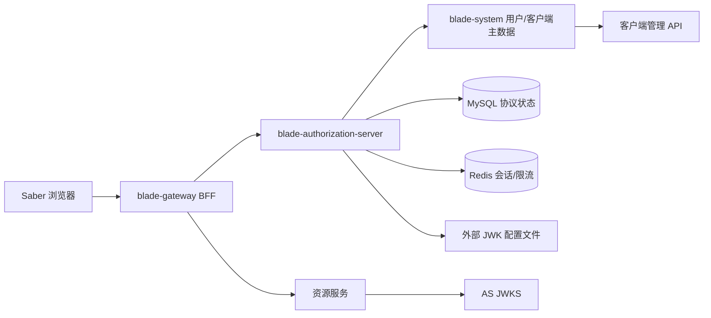
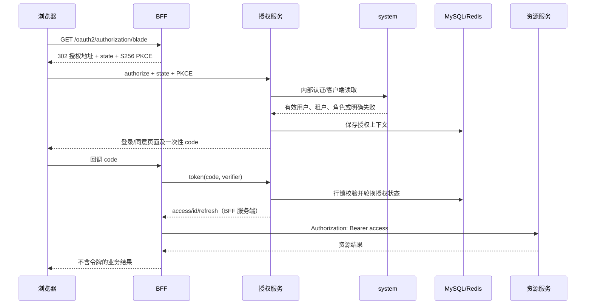

# 生产级 OAuth2/OIDC 认证中心与 BFF 详细设计

## 1. 文档信息

| 项目 | 内容 |
| --- | --- |
| 设计编号 | DESIGN-REQ-2026-010 |
| 关联需求 | [REQ-2026-010](../requirements/REQ-2026-010-production-authentication.md) |
| 关联数据库设计 | [DB-REQ-2026-010](../database/DB-REQ-2026-010-production-authentication.md) |
| 关联测试/索引 | [TEST-REQ-2026-010](../test/TEST-REQ-2026-010-production-authentication.md)；[需求索引](../requirements-index.md) |
| 文档版本 | 0.14 |
| 文档状态 | 开发中 |
| 技术负责人 | 待指定 |
| 创建/更新日期 | 2026-10-13 |

## 2. 设计摘要

### 2.1 目标

1. 在现有 Spring Authorization Server 验证基线上交付单实例生产候选方案，明确实际协议、存储、固定密钥和剩余发布要求。
2. 用标准 Bearer 与 BFF 会话承接既有业务路由、租户和权限；全量切入新认证体系，废除旧链路与逆向回滚负担。
3. 让 system 继续拥有用户和客户端主数据，承接公开注册业务端点并直存 BCrypt；授权服务只拥有协议状态和令牌生命周期。

### 2.2 非目标

- 不把业务服务直接依赖 `blade-service`；跨服务仍只经 API/Feign。
- 不把私钥、原始客户端密钥或用户密码放入代码、MySQL、普通日志或普通响应。
- 审计、脱敏、社交登录、MFA 不在本设计内。

### 2.3 本期最小标准流程边界

本期先交付单实例或明确单实例限制下的标准 OAuth2/OIDC 流程：浏览器授权码 + PKCE、BFF 会话、服务客户端凭据、Refresh Token、公共 Resource Server、TokenRelay、MySQL/Redis 持久化和租户复核。全服务接入属于目标，不等于已完成全服务验收。签名密钥从仓库/JAR 外部文件读取；启动检查存在、可读、`kid`、RS256/RSA 内容及长度，同时检查文件 ACL/POSIX 授权范围。在线轮换、KMS、mTLS、双活、多实例协调和动态客户端密钥版本后置。系统内部不使用自定义共享 header secret 或 HMAC 身份传播。

本期仍必须保留密码新哈希/一次迁移、精确回调、state/PKCE、JWT 声明不可伪造、HTTPS 生产约束、Token 不写日志、租户隔离和业务权限校验。密钥文件不允许放入仓库、JAR、数据库或普通 Nacos 配置；更换密钥需要受控替换文件并重启所有授权实例。

### 2.4 需求映射

| 需求/验收标准 | 设计落点 | 验证方式 |
| --- | --- | --- |
| REQ-001 / AC-001~003 | 客户端注册校验、SAS 端点、PKCE 和令牌族 | 协议负向用例、并发兑换 |
| REQ-002 / AC-004~006 | system 真实密码/JSON改密、内部服务Token、BCrypt迁移（含AC-005A） | 密码迁移、依赖故障、日志检查 |
| REQ-003 / AC-007~009、AC-009A | BFF WebSession、TokenRelay、资源 JWT、协议撤销内省 | 资源端、刷新、停用、会话恢复与403不重放（含AC-008A） |
| REQ-004 / AC-010~011、AC-010A | 固定业务路由、内部隔离、JWT 到 BladeUser、安全停流/向前修复 | 全服务/权限回归、新体系发布演练 |
| REQ-005 / AC-012~014 | 外部 JWK 文件、依赖失败和单实例恢复边界 | 启动校验、重启和故障注入 |
| REQ-006~007 / AC-015~017 | Actuator/指标、runbook、测试和上线门禁 | 观测、演练、测试归档 |

## 3. 当前基线与差距

| 级别 | 当前事实 | 影响 / 本轮处理 | 验证边界 |
| --- | --- | --- | --- |
| P0 | 新旧认证默认端口均为 8100 | 旧服务退出后由新SAS占用，生产仅单一新入口 | 当前旧Compose需改造，按TC-031验证停流/向前修复 |
| P0 | 用户桥 Bean 被 Servlet 自动注册，在 Bearer 认证前执行 | 禁用自动 Servlet 注册；桥接只在已验证 JwtAuthenticationToken 后执行；system 内部链也接入 | 真实 /user/info 从 500 恢复 200 |
| P0 | 原 JWT 未签发 role_id/dept_id | API VO、system 和签发方同步；只接受明确 user_id/tenant_id，不能把数字客户端 sub 当用户 | 身份与权限回归见测试文档 |
| P0 | 真实密码与旧摘要兼容混用 | 新 authenticateUser 拒绝摘要重放，旧入口单独兼容 | 正常/错误密码实际请求已执行，迁移夹具尚不完整 |
| P0 | 旧刷新摘要被覆盖，无法撤销后继令牌 | 新增摘要归属表并按同客户端真实刷新请求原子撤销授权族 | 真实重用后后继拒绝已执行 |
| P0 | BFF 原始 URL 属性在早期过滤器中未建立 | 原属性缺失时取当前未解码 URI，不放宽内部路径归一化 | BFF /messages 从 500 恢复 200 |
| P0 | 原套件有未执行动作直接 PASS 的分支 | 使用真实夹具、非零退出码和结构化证据；未覆盖步骤阻塞 | 原 25 PASS 与修正后结果并存 |
| P1 | 客户端每次经 Feign 读取 | 继续实时读取，不用旧缓存签发；缓存版本后置 | 故障与容量仍需隔离环境 |
| P1 | 资源全局链仅 authenticated | 最低 scope 默认 service.read，既有角色/租户/数据权限继续执行 | 全服务矩阵尚未执行 |
| P1 | 内部旧只读契约被 denyAll | 明确 GET 白名单 + service.read，认证三个端点仍需专用 scope | 真正后台 Feign/故障探针待准备 |
| P1 | 本地客户端仍是仅 demo 范围 | 已按本需求同步本地 gateway-bff scope/audience，保存无密钥回滚依据 | 正式部署必须单独核对客户端配置 |

以上是既有改造和复测归档中的问题，不表示当前仍存在对应运行缺陷。当前未落实的要求和需评审的契约差异统一见第 16 节；本轮仅编译与静态检查，没有重新运行服务。

## 4. 架构与流程

目标边界：system 是用户及普通客户端主数据源；授权服务通过标准服务 Token 和 API/Feign 读取并在签发时复核。为打破获取 system Token 时的循环依赖，授权服务本地构造一个固定 bootstrap 客户端，其身份、audience 和 scopes 由 API 契约定义，密钥由外部注入。BFF 保存令牌，浏览器只有会话 Cookie；资源服务当前离线验证 JWT，未实现资源端即时内省或黑名单。

### 4.1 关键时序

`/bff/me` 等受保护接口未登录时返回 HTTP 401 和 `R.fail(401, ...)`，由前端显式发起上述流程，不自动把 API 401 转成登录页面。

## 5. 改动范围

| 层次 | 模块/路径 | 主要改动 |
| --- | --- | --- |
| API 契约 | `blade-system-api`、`blade-user-api`、`blade-scope-api` | 受保护内部认证/客户端查询及 roleId/deptId；数据权限 Fallback 和空结果明确失败 |
| 公共安全 | `blade-common` | Servlet JWT 验证、认证后 BladeUser 请求属性桥、Feign 用户/服务 Token |
| 授权服务 | `blade-authorization-server` | SAS 端点、表单登录/同意、JDBC 状态、固定密钥、依赖错误、基础健康；分类指标和分批过期清理已实现、待运行验收 |
| 网关 | `blade-gateway` | 固定 BFF/业务路由、内部隔离、Redis WebSession、CSRF、TokenRelay、当前会话退出；旧鉴权过滤器不注册 |
| system | `blade-service/blade-system` | 新密码校验/迁移、客户端管理、Resource Server、scope/audience 校验、实时客户端读取和租户状态复核 |
| 资源服务 | `blade-service/*`、`blade-ops/*` | 全部配置 issuer/JWKS/audience/scope，统一 JWT 到 BladeUser 的上下文适配 |
| 调用方契约 | Saber [REQ-2026-015](../../../Saber/doc/requirements/REQ-2026-015-authorization-frontend-adaptation.md) | 已有认证验证页面及客户端管理调整；全站 Cookie/CSRF、菜单初始化、上传下载适配尚未交付 |
| 配置 | `doc/nacos`、仓库外受控配置 | issuer、Redis/MySQL、外部 JWK/加密密钥、标准服务客户端、代理；KMS 不涉及 |
| 数据库 | `doc/sql/blade` | 客户端、授权/同意、刷新摘要归属、密码列、索引与兼容迁移脚本 |

## 6. 模块设计

### 6.1 授权服务

保留 `AuthorizationServerApplication` 独立进程，使用 `@BladeCloudApplication`、`BladeApplication.run` 和公共 `LauncherServiceImpl`。Blade 公共运行时保留，但当前 `application.yml` 显式排除 common 的 `StandardTokenResourceServerAutoConfiguration`、`ServiceTokenFeignConfiguration`，并关闭其 enabled 属性：授权服务用自身协议链和 `SystemTokenFeignConfiguration`，避免与通用业务资源链冲突。不能将之前“取消所有排除”的记录视为当前配置事实。

`AuthorizationSecurityConfiguration` 的 Order 1 链负责 SAS/OIDC 协议，Order 2 链负责登录、只读 UI 上下文和健康入口；其他请求拒绝。凭据、客户端、JDBC 和密钥由独立组件承担。继续使用自定义 JDBC 表和 AES-GCM payload，刷新归属表补齐令牌族重用保护；不切换官方 JDBC schema。

必须修复或确认的现有点：

- `AuthorizationKeyConfiguration` 读取 `file:` JWK 集合，所有 key 必须为 RSA 且 kid 唯一；活动 key 含私钥、至少 2048 位，算法未声明或 RS256、用途未声明或签名。JWKS 仅发布公钥。可读、仓库外、非符号链接和POSIX/ACL授权范围检查已实现；更换文件后重启并验收。
- `AuthorizationCodec` 使用 Jackson 2 的 Spring Security/SAS 模块保存认证因子等属性；配置字符串至少 32 字节，经 SHA-256 派生 AES key，随机 12 字节 IV、AES-GCM，存储格式 `v1:`。没有独立加密 key ID 或在线轮换；`allow-legacy-payload=false` 时拒绝旧明文格式，受控迁移开关不是默认方案。
- `AuthorizationTokenCustomizer` 对 Access Token 再读当前客户端并复核 scope，`aud` 来自已登记 audiences；用户签发/刷新再查稳定 userId 并复核当前租户。用户 Token 包含 user_id/tenant_id，用户 Access Token 另含 role_id/dept_id/roles；profile 才增加 preferred_username/name。user_id/tenant_id仅存在于用户Access Token；service.read才带account/role_id/dept_id/roles，profile带姓名；ID Token不含业务身份字段，客户端凭据Token不生成用户声明。
- `SystemUserAuthenticationProvider` 不再生成 40 位摘要；认证成功的 `auth_time` 必须来自真实密码认证时间，刷新和授权码兑换不得补当前时间。
- 认证上下文桥只读取 Resource Server 已验证的 JWT，不使用网关自定义身份头。
- 依赖错误必须映射为标准错误；禁止使用 fallback 的空值或失败对象生成身份、客户端或权限。

### 6.2 BFF 与网关

- `BFF_SESSION` 为 HttpOnly、SameSite=Lax，Secure取`AUTHORIZATION_COOKIE_SECURE`；prod默认true且启动拒绝false，并校验issuer/前端/回调同源HTTPS。Redis namespace 为 `blade:gateway:session`。
- `/bff/me`、`/bff/csrf` 和统一错误/退出响应设置 `Cache-Control: no-store`；登录回跳缓存头需验收，不宣称已全部设置。
- `WebSessionServerOAuth2AuthorizedClientRepository` 按会话保存令牌，显式 exchange mapper 保证授权客户端管理器读写当前会话。刷新失败或缺失可转发 Token 时失效当前 WebSession 并返回 401；采用单实例会话队列，锁内重读Redis授权客户端并即时持久化；/bff/me共用管理器，竞争仍需真实验证。
- `RouterFunctionConfiguration` 注册通用 `GatewayFilter` WebFilter 和 `InnerFilter`；旧 `AuthFilter`、`RequestFilter`、`JwtConfiguration` 没有组件注册，新流量不使用旧 HMAC/Blade-Auth 鉴权。
- demo BFF 路由限定 GET；七类业务路由按前缀 StripPrefix(1)，当前未逐 HTTP 方法收窄。未登记路径默认无路由；开启旧发现路由后需重新核对开放面。
- 退出至少清理 BFF 本地会话和授权客户端；全局单点退出、OIDC back-channel logout 另立需求。

#### 6.2.1 标准 Token 下游传播

网关到所有下游统一透传原始 `Authorization: Bearer`。网关可以提前拒绝缺少 Token 的请求，但不能把网关校验当作下游唯一授权依据；每个资源服务都必须独立校验 issuer、签名、audience、有效期和 scope。

固定网关路由删除 Cookie 及 `X-User-Id`、`X-Tenant-Id`、`X-User-Roles`。公共资源桥不读取这些头，不对任意直连请求宣称已物理删除；身份只来源于已验证 JWT。Token 不进入日志、普通错误响应或普通业务缓存，协议所需服务端会话存储另按凭据边界保护。

业务前缀有 Bearer 时保留原头，由下游验签，错误 Bearer 不回退到 Cookie；无 Bearer 时从当前 BFF 会话 TokenRelay。仅七类业务 Bearer 路径免 CSRF，Cookie 写请求和 `/bff/logout` 仍检查 CSRF。`/bff/messages`、`/bff/restricted`、`/bff/identity` 始终使用会话，不接受外部 Bearer 替代登录。

当前 BFF 申请 demo.write，因此完成全部同意后 `/bff/restricted` 可返回 200；验证 scope 不足的 403 应使用未授予 demo.write 的独立客户端/授权。REQ-2026-009 仅 demo.read 的历史预期不能原样套到当前客户端。

服务间后台调用使用 `client_credentials`。Feign 统一由 OAuth2 client manager 获取短时服务 Token，调用方按客户端配置申请最小 scope；存在用户请求上下文时可传播已验证用户 Token，后台任务必须使用服务 Token。

### 6.3 认证上下文兼容桥

认证协议和现有业务安全上下文之间增加单一适配层，避免在各业务 Controller 中散落解析 Header 的代码：

1. `StandardTokenResourceServerAutoConfiguration` 按显式 enabled 属性接入 Servlet 服务；Nimbus decoder 校验签名、默认时间和 issuer，再叠加 `JwtAudienceValidator`。受保护资源最低 scope 默认 `service.read`；健康、API 文档和配置 skip-url 公开。
2. `TokenBladeUserFilter` 在 `BearerTokenAuthenticationFilter` 后执行，禁止自动 Servlet 注册；没有新增 `AuthContext` 类型、ThreadLocal 或额外身份头。
3. 只有正整数 `user_id`、相同字符串 `sub` 和非空 `tenant_id` 才建立 `_BLADE_USER_REQUEST_ATTR_` 的 `BladeUser`；数字机器客户端 sub 不生成用户身份。桥接 clientId/azp、account/preferred_username、user_name/name、role_id、dept_id、roles，现有 `AuthUtil` 等继续读取该属性。
4. 验签/时间/issuer/audience 错误返回 401，scope 不足返回 403；声明不能建立用户时没有 BladeUser，业务用户权限仍需由既有入口拒绝，不能把机器认证等同于用户认证。
5. system 内部安全链同样在 Bearer 认证后桥接；OAuth scope 与 Blade 角色/菜单/租户/数据权限分别执行，不能互相替代。

适配层应放在网关/公共安全基础设施边界，不放入菜单、业务 Controller、Mapper 或数据权限服务。这样本期只迁移认证入口和身份上下文，后续可以独立替换密钥和传播方式。

### 6.4 system 与内部契约

- `IUserAuthenticationClient` 的新契约只接受授权服务签发且带有明确 scope/audience 的标准 Bearer Token；不再把 SHA-1/固定摘要作为密码替代物。
- `authenticateUser` 使用真实密码，`PasswordEncoderFactories` 默认写 `{bcrypt}`；旧 SHA-1 成功后在事务内迁移。旧 `userInfo(...password)` 单独兼容摘要；公开注册、管理保存、导入、重置与JSON改密均写{bcrypt}；旧摘要只用于存量匹配且新认证拒绝摘要重放。迁移截止/存量比例由上线验收确定。
- `IClientRegistrationClient` 实时返回当前启用、未删除客户端及 `{bcrypt}` 摘要，不缓存、不返回密钥版本。`AuthClient.clientSecret` 为 WRITE_ONLY，普通管理响应不含密钥；管理员自备原始密钥提交，没有服务端一次性展示/生成接口。编辑未填写密钥时保留既有值，公共客户端清空密钥。
- 授权服务通过 Nacos Discovery 发现 `blade-system`，使用共享 API 契约中的内部客户端白名单获取 system 服务 Token；仅保留部署注入的内部客户端密钥。Feign 超时、重试和日志均按认证安全要求配置，不再支持自定义 secret header。
- `AuthClient extends BaseEntity`，配套 `BaseService/BaseServiceImpl`，实例级不加入租户表。保存/更新为本地事务，客户端 ID 不可改，保留 bootstrap ID 禁止管理端创建；活动客户端唯一键兜底重复。没有 `@Version`、密钥版本或失效事件，管理并发覆盖风险尚未验证，不写成已实现的乐观锁。
- 状态只允许 0/1；只支持 none/client_secret_basic、三种 grant、精确 HTTPS/回环 HTTP 回调，公共客户端只允许授权码。默认 Access/Refresh TTL=300/1800 秒，上限 86400/2592000 秒；授权码强制 PKCE、禁用刷新重用。机密客户端原始密钥至少 16 字符且至多 72 个 UTF-8 字节，保存为 `{bcrypt}`。

### 6.5 当前网关路由与注册边界

| 路径 | 下游/处理 | 方法与认证 |
| --- | --- | --- |
| `/bff/public` | demo `/authorization/public` | GET，公开，不转发 Cookie/Authorization |
| `/bff/messages`、`/bff/restricted`、`/bff/identity` | demo 对应 `/authorization/*` | GET，BFF 会话 TokenRelay |
| `/blade-system/**`、`/blade-desk/**`、`/blade-ai/**` | BffProperties 的 system/desk/ai URL | StripPrefix(1)，方法未限定，Bearer 或会话 TokenRelay |
| `/blade-log/**`、`/blade-resource/**` | log/resource URL | 同上 |
| `/blade-develop/**`、`/blade-report/**` | develop/report URL | 同上 |
| 含内部 `/feign/client` 前缀及编码/路径变体 | InnerFilter 规范化并拒绝 | 外部请求 403，路由配置不能覆盖 |
| `/blade-auth/**`、其他未登记服务前缀 | 默认无固定新路由 | 旧 token、注册等入口不能直接用于新链路 |

固定 URL 由 `BFF_*_URL` 注入，默认本地端口以配置为准；默认 `GATEWAY_LEGACY_ROUTING_ENABLED=false` 关闭网关 Nacos Config/Discovery 和发现路由。开启该环境变量只恢复框架/路由能力，不重新注册旧 AuthFilter，也不是新旧鉴权切换开关。授权服务/system 的 Nacos 服务发现与网关固定路由是不同路径。

## 7. HTTP API 契约

HTTP表和13.4定义已落实的后端契约（AUTH CSRF、401码、UserVO.roles、JSON改密及新注册）；前端适配与运行验收尚未完成。

| 方法 | 路径 | 权限/身份 | 请求 | 响应 | 幂等/并发 |
| --- | --- | --- | --- | --- | --- |
| GET | `/.well-known/openid-configuration` | 公开 | 无 | 标准 OIDC metadata | 只读 |
| GET | `/oauth2/jwks` | 公开 | 无 | 仅公钥 JWK Set | 只读/可缓存 |
| GET | `/oauth2/authorize` | 浏览器/会话 | OAuth2 参数 + PKCE | 重定向或标准错误 | `state` 唯一 |
| POST | `/oauth2/token` | 客户端认证 | code/refresh/client_credentials | 标准令牌响应 | code 一次性；refresh 轮换 |
| POST | `/oauth2/revoke` | 客户端认证 | token | RFC 撤销响应 | 幂等 |
| POST | `/oauth2/introspect` | 客户端认证 | token | 标准 active 响应 | 只读 |
| GET | `/userinfo` | Bearer | Access Token | OIDC UserInfo | 只读 |
| GET | `/bff/me` | BFF 会话 | Cookie | `R<Map>`，不含令牌 | 只读、no-store |
| GET | `/bff/csrf` | BFF 会话/公开 | Cookie | `R<Csrf>`，no-store | 只读 |
| POST | `/bff/logout` | BFF 会话 + CSRF | Cookie + CSRF header | `R` | 幂等 |
| GET | `/oauth2/authorization/blade` | 浏览器 | BFF 会话，框架生成 state/S256 PKCE | 302 至授权服务 | 新授权事务 |
| GET | `/login/oauth2/code/blade` | BFF 回调 | query: code/state 或 error | 成功 302 至 frontend-uri；失败失效会话并回固定错误页 | state/code 不重用 |
| GET | `/ui/login-context` | 授权服务公开会话入口 | Cookie | `R<LoginContext>`：authorizationPending/authenticated/defaultTenantId/csrf；200/503，no-store | 只读，按需建立会话/CSRF |
| POST | `/login` | 授权服务表单 | form: username/password/tenantId/CSRF 参数 | 302 继续授权；失败回 auth/login?error=credentials/service/csrf | 失败可能更新限流计数 |
| GET | `/ui/consent` | 授权服务已登录用户 | query: client_id/state | `R<ConsentContext>`：客户端/账号/scopes；目标新增csrf见13.4；200/400/401，no-store | 校验当前主体、客户端、待确认状态 |
| POST | `/oauth2/authorize` | 授权服务会话；目标另加AUTH CSRF | form: client_id/state/scope/decision | 同意签发 code；deny 由框架返回 access_denied | 清理本次同意，含已有同意 |

OAuth2/OIDC 端点使用协议错误语义；BFF 和页面上下文使用 `R<T>`。所有认证失败只返回必要的错误码和通用提示，不返回 Feign、SQL、Token 或堆栈。

## 8. Feign 契约

| 项目 | 内容 |
| --- | --- |
| API 模块 | `blade-service-api/blade-system-api`、`blade-user-api` |
| 服务名 | `AppConstant.APPLICATION_SYSTEM_NAME` |
| `API_PREFIX` | `/feign/client/client-registration`、`/feign/client/user-authentication` |
| Java 签名 | `byClientId(String clientId)`、`byId(String id)` → `R<ClientRegistrationVO>`；`authenticate(UserAuthenticationCommand command)`、`user(String userId)` → `R<UserAuthenticationVO>` |
| Fallback | 返回 `R.fail(503, ...)`，调用方必须区分 401/403/503，不返回 null |
| 参数 | 客户端查询/user 查询为 GET query；authenticate 为 POST JSON：tenantId/account/password，password 禁止日志/序列化普通响应 |
| 超时/Sentinel | 两个授权 Feign contextId 的 connectTimeout=3000ms、readTimeout=5000ms、loggerLevel=none；授权服务 `feign.sentinel.enabled=false`，未宣称 Sentinel 已接管；无额外无限重试 |
| scope/audience | authenticate=`system.user.authenticate`；user=`system.user.read`；注册读取=`system.client.read`；固定 bootstrap 客户端 audience=`blade-system`，scopes 为 API 白名单全集 |
| 调用方处理 | 用户业务失效为 R.fail(401)，注册不存在/停用为 R.fail(404)，降级为 503；协议调用方 fail closed，不能把 R<T> 业务码当 HTTP 状态 |

发布先更新 API 和 system 的 VO/端点，再更新授权服务签发和 common 消费方。system 内部 GET system/dict/data-scope/api-scope/tag-runtime 及明确用户归属查询允许 `service.read`；未登记写接口 denyAll。`DataScopeCache` 拒绝 null、Fallback 抛明确异常；真实失败不会当作“没有权限规则”继续访问。

普通服务 Feign 仅传播当前已认证 `JwtAuthenticationToken`；没有已验证上下文时用配置 scopes 集合申请 client_credentials，不能直接信任传入 Authorization 头。授权服务始终用专门的 system 服务客户端。后台客户端与 Token 缓存为进程内 OAuth2AuthorizedClientService，重启重新申请；不是动态客户端配置缓存。

## 9. 数据设计

数据库设计见 [DB-REQ-2026-010](../database/DB-REQ-2026-010-production-authentication.md)。实际采用客户端、授权、同意及刷新摘要归属四表，另扩容用户密码列；授权记录即令牌族。客户端唯一键、同意业务键/租户复核、摘要不可变归属及 AES-GCM payload 已定义；没有密钥版本表、乐观版本列或 KMS 元数据。

AUTH_SESSION/BFF_SESSION 在各自 Redis namespace 保存框架认证对象、授权客户端、state/PKCE 等协议状态；BFF 为刷新和 TokenRelay 保存可使用令牌，当前没有 Redis 会话应用层加密。MySQL payload 加密不能代替 Redis 的访问控制、网络/TLS、备份及静态保护检查。

## 10. 事务、并发与缓存

| 主题 | 设计 |
| --- | --- |
| 本地事务 | AuthorizationTransactionFilter 对 POST token/revoke/authorize 启动 30 秒事务并缓冲响应，协议查询在事务内 FOR UPDATE；JDBC save/remove/consent 与 system 密码迁移、客户端保存使用各自本地事务 |
| 跨服务事务 | 不使用 Seata；system 身份/客户端实时查询失败即拒绝。system 内的密码升级不能因后续授权服务失败自动跨库回滚 |
| 并发控制 | 授权行锁与 authorization_id 唯一键；刷新摘要唯一且不可变；客户端 active_client_id 唯一键；Redis Lua 原子 INCR/EXPIRE。没有客户端乐观版本；BFF新增单实例会话串行刷新与Redis重读/即时保存 |
| 幂等 | code 单次使用，refresh 轮换；同客户端真实刷新重用旧摘要撤销整个授权 status=0，错误客户端或内省不触发撤销；撤销和当前 BFF 退出幂等，管理并发覆盖仍待验证 |
| 缓存/清理 | 普通客户端配置不缓存，按请求读取当前启用数据；OAuth2 服务 Token 进程内缓存；Redis 会话按 namespace/TTL；数据库expires_at定时分批清理：默认30m间隔、到期后1d保留、每表1000行；可关闭，需授权两张状态表DELETE权限 |

## 11. 认证、租户与数据权限

- 认证方式：浏览器使用 OIDC 授权码 + PKCE；机器使用 client credentials；资源端当前使用离线 JWT，协议撤销后已签发 JWT 仍有 exp 边界。
- 操作权限：通用业务资源最低 scope 默认为 service.read，demo 和内部认证端点使用专用 scope；角色/菜单及数据权限继续由既有业务规则执行。
- 租户边界：登录租户由 system 校验，授权上下文保存 `tenant_id`；Refresh、同意和用户复核使用当前有效租户，客户端请求的租户头不能改变已认证上下文。
- 数据权限：OAuth 协议表为授权服务全局技术表，不启用业务租户拦截器；业务表继续遵守现有租户和逻辑删除规则。
- 敏感数据：密码、原始密钥、Token、JWK 私钥只在必要边界短暂存在；日志、普通响应、错误页和指标均禁止输出。

## 12. 异常与日志

| 场景 | 处理 | 对外结果 | 数据影响 |
| --- | --- | --- | --- |
| 参数、PKCE、回调非法 | 协议校验失败 | `invalid_request`/`invalid_grant` | 不改业务数据；协议状态可能消费/失效 |
| 用户或租户失效 | system 返回 401 | `invalid_grant`/登录失败 | 不签发 |
| system/Redis/MySQL 失败 | 依失败发生阶段拒绝，不返回异常正文 | 客户端查询异常可为 503/temporarily_unavailable；用户复核为 server_error；事务数据库失败为 500/server_error，登录依赖回 error=service | 本地事务异常回滚；跨服务已提交迁移不回滚 |
| Token 重用/撤销 | 行锁和令牌族状态更新 | `invalid_grant` 或撤销成功 | 状态失效 |
| 密钥加载/轮换失败 | 就绪失败或停止签发 | 503 | 不签发新令牌 |

当前客户端 Feign 错误日志只记录服务、状态码、异常类型和业务错误码；禁止密码、Token、密钥、连接串及完整请求体。未实现额外主体哈希、请求 ID 生成或脱敏流程，审计/脱敏不涉及。登录依赖失败回 `error=service`，用户复核依赖失败由协议返回 server_error；不能宣称所有依赖失败都统一为 HTTP 503。

## 13. 配置、发布与回滚

### 13.1 配置

| 配置类别 | 生产要求 |
| --- | --- |
| Nacos | 授权服务/system 使用同环境 namespace/DEFAULT_GROUP；公共启动器导入 blade.yaml、blade-{profile}.yaml、blade-authorization-server-{profile}.yaml，通过 Discovery 找 system。网关默认关闭 Nacos，使用固定 URL；缺失配置/故障启动需隔离验收 |
| issuer/回调 | 显式配置稳定 HTTPS 地址，不按请求 Host 推导；prod require-https 默认 true，仅校验 issuer。前端/BFF 回跳及代理部署必须另核对 HTTPS 与同源 |
| 密钥 | 仓库/JAR 外部只读 JWK；启动校验 kid、算法/RSA 长度及可读性，ACL 范围需部署检查；更换后重启 |
| Redis | namespace 隔离已实现；TLS、认证、持久化及备份由环境提供，不据配置样例宣称已验证；HA 后置 |
| MySQL | TLS、最小权限、备份、慢查询与锁等待监控；授权 payload 受保护 |
| 内部调用 | 标准 `client_credentials` Token、共享 API 固定 scope/audience 白名单、Nacos Discovery 和受控内网 ACL；Feign 禁止 full 日志；mTLS 后续增强 |
| Cookie/代理 | 生产必须显式 AUTHORIZATION_COOKIE_SECURE=true，两服务prod默认true且启动强制；HttpOnly/SameSite=Lax。Tomcat原生代理/BFF可信地址过滤已实现，需真实验收 |
| 限流 | 已有租户+规范化账号键及 remoteAddr 键，默认 5 次/30m，Redis 失败拒绝认证；协议限流默认120次/分钟/来源；管理限流默认60次/分钟/已验证主体，Redis失败返回503 |

dev/test/prod 授权 Data ID 对应环境 profile，pending-authorization-ttl=10m，登录/授权会话与 BFF 会话默认 30m。资源服务的 enabled/issuer/jwk-set-uri/audience/required-scope 和 Feign enabled/client-id/client-secret/scopes 由共享 blade.yaml 加环境覆盖；audience 默认 spring.application.name、最低 scope 和后台 scopes 默认 service.read。客户端 secret 默认空，服务启用时缺失将启动校验失败；每个服务需登记对应独立客户端。

签名文件、活动 kid、payload key、internal-client-secret、BFF client-secret 和数据库/Redis凭据只能从仓库外受控配置注入。dev/test/prod授权样例已去除凭据、JWK位置和活动kid默认值；prod的issuer、前端及BFF地址必须显式注入。

### 13.2 发布顺序

1. 备份客户端、用户密码、协议表及仓库外密钥/配置；按旧结构或已迁移结构选择升级路径，先建刷新归属表、回填当前摘要并授予 SELECT/INSERT，再发布授权代码。全量建库脚本不得用于存量库。
2. 发布 API 契约和 system 密码/客户端双读兼容版本。
3. 发布授权服务和新密钥公钥集合，先以非流量或灰度模式检查就绪与发现端点。
4. 配置 BFF 客户端与回调，发布固定路由及内部隔离；按实际入口注入七类下游 URL，不使用旧 HMAC 鉴权。当前 BFF 固定申请 openid/profile/demo.read/demo.write/service.read，登记 scopes 必须匹配，audiences 覆盖实际下游。
5. 逐资源服务发布 issuer/JWKS/audience/scope 和后台服务客户端；Saber 全站适配随其 REQ-2026-015 协同发布，不能以验证页替代。
6. 观察错误率、延迟、刷新重用、会话恢复、依赖和业务回归，完成上线准入后停止旧认证流量。

### 13.3 发布应急与向前修复（不设旧版逆向回滚）

- 架构已决策全量切入新认证体系，废止向旧 `blade-auth` 逆向回滚路线；重点保障发布期前置快照、渐进切流与向前修复（Roll-Forward Hotfix）。
- 发布前必须完成 `blade_user`、`blade_client` 以及刷新状态表的物理备份。
- 未产生流量前启动失败应急：若授权中心或 BFF 启动校验（如外部密钥文件非法、Nacos 配置错误）未通过，直接中止发布脚本，不切入新流量，在隔离环境排查。
- 已切流后的业务故障应急：发生缺陷或配置异常时，采用向前快速打补丁重新发布，不进行跨架构降级，避免引发已升级 BCrypt 密码用户的大面积认证阻断。

目标 runbook（待隔离演练；生产域名、恢复目标、负责人待指定）：

1. 切流前按数据库/密钥/配置备份清单取得快照，核对 SQL、scope/audience、客户端/回调和只读密钥；完成各新版本就绪、发现、代理、Cookie与验收检查，失败停止发布，不放新流量。
2. 新入口统一切流后，认证/CSRF/身份错误触发时立即在受控入口停流或维护页阻断依赖认证的业务写入，关闭注册；不得用旧 auth/旧网关恢复请求。
3. 保留当前数据库、会话 namespace、密钥与不含敏感数据的故障摘要，不恢复切流前快照覆盖新业务数据。隔离复制受影响状态验证修复，确需数据恢复须由维护窗口/备份方案另行批准。
4. 发布兼容当前新哈希、表结构和新 Cookie/Token 契约的修复版本；按 API/system、SAS、资源服务、BFF/代理、Saber 的依赖顺序核对，受影响会话要求重新登录。
5. 执行发现/JWKS、登录/同意、资料/权限、业务读写、注册、退出及内部接口拒绝验证；指标、数据一致性和必要 P0 项通过后再开放流量。失败保持安全停流。
6. 归档步骤、版本、耗时、数据完整性、精确清理及恢复证据。对应 TC-031；不以“可打补丁”代替可执行恢复验收。

### 13.4 已落实后端契约与调用方待验收项

本节后端DTO、CSRF仓库/过滤器、错误码、注册和生产约束已落实；代码验证见18节，17节仅保留历史运行证据，前端及业务验收仍待执行。

#### 13.4.1 用户资料与密码

`/bff/me` 保留 subject/issuer/clientId/scope/accessTokenExpiresAt 摘要。资料通过 `/api/blade-system/user/info`，system `UserVO` 新增 `List<String> roles`（role_alias，如 admin/user），由 UserWrapper 按当前用户角色组装；明确加入 `/info` 当前 JSON View，空角色为 []。ID/租户按项目字符串返回，密码不输出。前端 `roles.includes('admin')` 仅用于 UI，后端既有角色/菜单/数据权限仍为最终边界。

改密采用 blade-user-api 的 UserPasswordUpdateDTO（oldPassword/newPassword/confirmPassword），`POST /user/update-password` JSON Body；Controller 不再接收密码 query。旧 SHA-1 仅比较 `DigestUtil.encrypt(真实旧密码)`，禁止把旧摘要本身作为密码；新哈希由 PasswordEncoder.matches 校验。新密码编码 `{bcrypt}`，长度/复杂度及最多 72 UTF-8 字节均校验，本地事务失败保持原哈希。成功清理已有用户缓存；本期不新增全局会话撤销，当前及其他会话/离线 JWT 的有效期边界仍适用，后续真实密码登录使用新密码。管理新增、导入、重置等写密码入口也应列入统一编码回归，不允许上线后再次降级写 SHA-1；现有默认密码策略不在本轮重设计。

#### 13.4.2 BFF 与授权服务 CSRF

| 所属服务 | 仓库/会话 Cookie | CSRF Cookie / Header | 表单参数/来源 |
| --- | --- | --- | --- |
| BFF | CookieServerCsrfTokenRepository；BFF_SESSION | BFF-XSRF-TOKEN / X-BFF-XSRF-TOKEN | GET /bff/csrf 返回 R<{headerName,token}> |
| SAS | CookieCsrfTokenRepository；AUTH_SESSION | AUTH-XSRF-TOKEN / X-AUTH-XSRF-TOKEN | `_csrf`；LoginContext.csrf 与 ConsentContext.csrf 均为 {parameterName,headerName,token} |

两服务 CSRF Cookie 独立命名、Path=/、SameSite=Lax、生产 Secure=true；会话 Cookie 为 HttpOnly。CSRF Cookie 也可保持 HttpOnly，前端统一使用 JSON 上下文提供的 Token，不开启 Axios 自动读取默认 XSRF Cookie。使用与仓库配套的框架请求处理器/掩码机制，JSON 返回当前请求属性中的 Token，不能混用原始 Cookie 与框架掩码值。登录、退出及上下文失效后重新获取，Token 不进 Storage/日志/证据。

`GET /ui/consent` 在主体、client_id/state 校验通过后返回上述 csrf 字段；前端 approve/deny 原生表单均带当前 AUTH `_csrf`，不用 BFF Token 替代。SAS 默认协议链可能豁免协议端点，不能仅增加 hidden field 或 require matcher 就宣称完成校验。已对 **POST /oauth2/authorize** 显式安装一个仅匹配该方法/路径、独立OncePerRequest名称的CsrfFilter，共享 AUTH 仓库/请求处理器，位于 OAuth2AuthorizationEndpointFilter 之前，确认默认 ignore matcher 不会跳过该检查；缺失/错误 AUTH Token 返回 HTTP 403/R.fail(403)，不签发 code、不消费或修改该次同意状态。GET authorize 和 token/revoke/introspect 的客户端协议请求不进入浏览器 CSRF 检查，继续执行各自协议认证。

BFF 所有 Cookie 写请求（含注册、PATCH、上传、导入、logout）检查 BFF CSRF；只有明确登记的业务 Bearer 路由免 CSRF。前端任何 403 均不重放；明确 CSRF 拒绝后重新取上下文，只允许用户再次提交。

#### 13.4.3 自动刷新、401 分类与会话探测

TokenRelay 在转发前由服务端管理器自动刷新，前端无刷新 API、不取得 Refresh Token、不自动重放原业务请求（GET 也不作为静默刷新）。

| 来源 | HTTP/业务码 | 会话及前端处理 |
| --- | --- | --- |
| BFF 无登录上下文 | 401 / 40101 | 单飞清理本地身份，导航固定登录发起入口 |
| BFF 刷新失败/可用授权客户端缺失 | 401 / 40102 | 服务端 invalidate 当前 BFF 会话；前端单飞清理并重新登录 |
| 下游资源服务认证拒绝 | 401 / 原下游码 | 不能据此认定 BFF 已失效；仅单飞 GET /bff/me 探测 |
| 会话探测 200 | 200/成功摘要 | 保留 UI 会话，展示资源认证失败，不自动重放原请求；交用户/运维处理 |
| 会话探测 401 | 401/会话失败 | 清理并重新登录，一次探测不递归 |
| 会话探测 5xx/网络失败 | 5xx/未知 | unavailable，保留可恢复上下文，不把未知当注销或循环登录 |

40101/40102已分别在认证入口、路由和会话失效中实现，/bff/me自动刷新并复核授权客户端；需独立用例验证；不通过 msg 文案匹配。公开登录/注册、AUTH 上下文和 BFF 初始探测的 401由所属页面处理，不触发业务全站拦截器。单飞按会话代次隔离，迟到响应不得覆盖退出/新身份。前端单飞不能替代服务端刷新串行锁；TC-020 需增加同一 BFF 会话并发业务请求触发刷新验证，令牌族重用后不能被继续使用。

#### 13.4.4 完整同源代理表

issuer 使用根同源 HTTPS 地址，固定配置，不从任意 Host 推导。外部浏览器路径与已发布 metadata 必须一致。

| 浏览器/客户端路径 | 目标 | 改写与规则 |
| --- | --- | --- |
| /auth/login、/auth/register、/auth/consent、/auth/verify、其他前端页面 | Saber | SPA 路由/静态文件；不交给 SAS |
| /oauth2/authorization/blade、/login/oauth2/code/blade、/bff/ | BFF | 保留原路径；登录发起/回调精确 location，/bff/ 前缀 |
| /api/ | BFF | 仅去除 /api，再由固定业务路由去除 /blade-* |
| /auth-api/ | SAS | 去除 /auth-api；只放行 ui/login-context、ui/consent、login 和 oauth2/authorize 对应方法，其余拒绝 |
| /.well-known/openid-configuration、/.well-known/oauth-authorization-server | SAS | 原路径，发现端点 |
| /oauth2/authorize、/oauth2/token、/oauth2/jwks、/oauth2/revoke、/oauth2/introspect、/userinfo | SAS | 原路径，metadata 登记的协议端点 |
| /login | SAS | 原路径仅登录表单/上下文导航；不恢复旧 Saber /login |
| 未登记的 /oauth2/ 或 /auth-api/ 子路径 | 拒绝/404 | 不使用 SPA 或旧发现路由兜底 |

根协议端点使用精确 location，BFF 发起/回调优先；严禁将整个 /oauth2/ 泛代理给 SAS。不存在独立 `/oauth2/consent`；页面为 `/auth/consent`、上下文为 `/auth-api/ui/consent`、提交为 `/auth-api/oauth2/authorize`。代理保留 query、方法、302 Location 与 Set-Cookie；/api 不能二次去前缀；可信代理覆盖并透传 Forwarded/X-Forwarded-Proto，源地址仅从已配置可信代理解析。prod AUTH/BFF 会话和 CSRF Cookie 必须 Secure=true，Cookie/issuer/回调/前端地址的 HTTPS、域与路径一起验收。目标变量从仓库外注入，不在文档写生产地址/密钥。prod启动校验AUTH/BFF的cookieSecure必须为true；SAS从Nacos环境覆盖、默认关闭Nacos的网关从受控配置/环境变量注入，不能假定单改SAS Data ID会让BFF生效。

#### 13.4.5 新注册路由

按用户确认保留 Saber `/auth/register`，规则与流程由 [DESIGN-REQ-2026-003](DESIGN-REQ-2026-003-user-registration.md)定义。网关只为 GET `/blade-system/user/register/config`、GET `/blade-system/user/register/captcha`、POST `/blade-system/user/register` 配置优先匿名路由；无需登录但 POST 仍检查 BFF CSRF。三条路由绕过 TokenRelay，删除 Cookie、Authorization/身份头；system 独立按方法精确匿名放行，不能仅改网关白名单。未登记方法、管理及 Feign仍受原保护。新用户直接 `{bcrypt}`，成功后由用户主动 BFF 登录，不自动签发令牌。

## 14. 验证计划

- 编译：`mvn compile -DskipTests -pl blade-authorization-server,blade-service/blade-system,blade-gateway,blade-service/blade-demo -am`。
- 打包：同范围 `mvn clean package -DskipTests ...` 由用户在文件锁释放后执行；clean package 的历史限制以既有测试/构建归档为准，本次文档同步未重新尝试。
- 静态检查：Bean 注册、端口和路由清单、issuer/回调、Feign fallback、SQL、文档链接、敏感字段搜索。
- 用户执行：按 [TEST-REQ-2026-010](../test/TEST-REQ-2026-010-production-authentication.md) 执行真实服务、MySQL、Redis、Nacos、外部密钥、浏览器、并发和故障用例。
- 0.12文档阶段仅做源码/配置/SQL与既有证据对照，未运行构建或接口；本轮0.13已执行Maven编译和静态验证，见18节。第17节运行结果属于已有归档。

0.10阶段历史静态检查记录（不代表本轮0.12验证）：12 份文档的 Markdown 表格/代码围栏、占位符、文档编号、版本链接、变更记录和索引状态通过，185 条相对链接/锚点有效；REQ-2026-010 的 19 项验收编号保留，三份关联测试文档共 45 个用例的编号、逐项状态和汇总一致。十二份文档空白检查及已跟踪文档的 `git diff --check` 通过；这些结果仅证明文档一致性，不计为业务用例通过。

2026-10-13 本轮0.12修复已执行只读静态检查：16份文档、260条文件链接与其中2个锚点可达；修改范围的围栏、章节、表格列数、占位符、版本链接、变更记录、21项认证与32项前端验收映射及64个用例的逐项状态/汇总一致。Saber索引原有REQ-2026-013行列差异经修复前快照核对保持未改，不计作本轮新增问题。本轮不运行构建、测试套件或真实接口，所有新增用例未执行，历史证据不变。

## 15. 改造清单

| 编号 | 优先级 | 改造项 | 交付物 | 完成门槛 |
| --- | --- | --- | --- | --- |
| AUTH-P0-01 | P0 | 端口/域名/服务名和旧 `blade-auth` 退出方案 | 发布拓扑、停流/向前修复清单、端口矩阵 | 单一新入口可启动、旧入口停用、无 Cookie/Nacos 冲突 |
| AUTH-P0-02 | P0 | 网关标准 Token 路由和内部 Feign 隔离 | 路由清单、资源服务校验、回归证据 | 现有业务路由和权限回归通过 |
| AUTH-P0-03 | P0 | BCrypt 真实密码校验 + 旧摘要一次迁移 | 迁移与全部密码写入口BCrypt已实现；截止/存量比例/告警验收待执行 | 旧用户迁移与密码写入口回归通过 |
| AUTH-P0-04 | P0 | 内部 Feign 标准服务 Token 与 scope/audience | bootstrap 客户端、错误 Token、过期 Token 回归 | 伪造调用被拒、无敏感日志 |
| AUTH-P0-05 | P0 | JWK 外部文件读取和启动校验 | 外部文件、权限说明、启动校验 | 错误/缺失密钥不启动，JWKS 不泄露私钥 |
| AUTH-P0-06 | P0 | 授权 payload 和 Token 状态保护 | AES-GCM 信封密文、外部密钥和版本前缀 | DB 只读账号无法取得可用 Token |
| AUTH-P0-07 | P0 | 认证上下文兼容桥 | 公共适配器、BladeUser/AuthUtil 回归证据 | 现有 Controller 能取得正确用户和租户 |
| AUTH-P0-08 | P0 | 测试与上线门禁 | P0 测试报告、缺陷关闭、清理证据 | 无 P0 失败/阻塞/严重缺陷 |
| AUTH-P1-01 | P1 | 客户端实时读取及管理并发验证 | 无配置缓存/失效事件；数据库唯一键已实现，覆盖风险待验证 | 停用/回调变更新请求读取当前配置，重复/并发行为有证据 |
| AUTH-P1-02 | P1（后续） | 客户端密钥版本和无中断轮换 | 本期只做单值替换，不新增版本表/API | 独立需求，不作为本期已交付 |
| AUTH-P1-03 | P1 | BFF 会话、CSRF、no-store 和刷新竞争 | 安全回归、并发刷新测试 | 会话隔离、刷新单写、无 Token 泄露 |
| AUTH-P1-04 | P1 | 资源服务逐批接入 issuer/audience/scope | 服务接入矩阵 | 每个资源服务拒绝错误 issuer/audience/scope |
| AUTH-P1-05 | P1 | 必要健康/指标、清理/备份流程和容量验证 | 基础健康、分类指标与维护作业已实现；告警、维护执行与容量阈值待验收；专用看板后置 | 满足本期 REQ-006 与容量门槛，有故障和恢复证据 |
| AUTH-P2-01 | P2 | 旧 `blade-auth` 模块和旧 Token 配置下线 | 迁移公告、删除计划、最终备份 | 依赖方清零、旧入口关闭 |

后续增强清单：在线密钥轮换和 KMS、mTLS/工作负载身份、多实例 HA、客户端密钥版本、资源端即时内省/黑名单、全局退出和专用指标看板。本期容量、基础观测、故障恢复和发布应急/向前修复不能因后置增强而免验收。

## 16. 风险、评审与变更

| 编号 | 风险/问题 | 负责人 | 状态/结论 |
| --- | --- | --- | --- |
| DESIGN-ITEM-001 | 外部密钥文件与生产反向代理 | 待指定 | 文件方式已确认；生产 ACL/域名/代理待指定；KMS/mTLS 不涉及本期 |
| DESIGN-ITEM-002 | 密码迁移及旧写入口 | 待指定 | BCrypt 一次迁移已实现；截止/告警、存量比例及旧注册/重置兼容待验证 |
| DESIGN-ITEM-003 | 网关路由来源 | 待指定 | 当前七类固定 URL；默认关闭 Nacos 发现路由，开关不是旧鉴权恢复；全站路由验收未完成 |
| DESIGN-ITEM-004 | 资源端撤销实时性和 SLO | 待指定 | 当前离线 JWT 至 exp，即时失效后置；生产 TTL/恢复/容量阈值待指定 |
| DESIGN-ITEM-005 | BladeUser/AuthUtil 接入 | 待指定 | 方案已落实为认证后请求属性桥；全服务租户/数据权限回归待执行 |

需求第 11.1 节的 SYNC-010 编号与本节共享，不另建重复问题编号：

| 差距编号 | 代码证据 | 待完成/评审与测试落点 |
| --- | --- | --- |
| SYNC-010-001 | AuthorizationTokenCustomizer / SystemRegisteredClientRepository | 采用固定登记目标契约：无目标参数时按客户端 audiences 签发；显式 resource/audience 集合必须等于完整登记集合，否则 400/invalid_target；不实现动态裁剪。TC-003/008 待用户执行。 |
| SYNC-010-002 | AuthorizationTokenCustomizer | ID Token 不再包含用户、租户、角色或部门业务字段；用户 Access Token 带 user_id/tenant_id，service.read 才带 account/role_id/dept_id/roles，profile 才带姓名资料。UserVO.roles 输出当前租户角色编码。TC-008/025 待用户执行。 |
| SYNC-010-003 | AuthorizationKeyConfiguration | 启动检查 POSIX owner-only 或 Windows ACL，拒绝仓库内、符号链接、不可读或授权过宽的文件；Windows允许文件所有者、运行账号、SYSTEM和Administrators。错误权限夹具待TC-017。 |
| SYNC-010-004 | SystemUserAuthenticationProvider / application.yml | 已加入可信代理地址限制、Redis原子协议/客户端管理限流、分类指标、依赖/行锁耗时与分批过期清理。部署告警和容量阈值需按runbook配置与演练；TC-007/015/018/020/021未执行。 |
| SYNC-010-005 | doc/nacos 的授权 dev/prod 配置 / 网关 application.yml | 已移除授权配置中的凭据/活动kid默认值，prod默认Secure=true且代码拒绝false；prod同源HTTPS与必要地址为显式配置。TC-002/017/018/028待执行。 |
| SYNC-010-006 | BffConfiguration / script/docker/app / Saber permission.ts | 默认reactor和镜像CI移除旧blade-auth；Compose替换新授权服务并只读挂载外部JWK，入口按方法精确代理，旧路由410。Compose静态解析通过；真实镜像、TLS代理及全服务验收待TC-028/031。 |
| SYNC-010-007 | UserServiceImpl / blade-system 注册实现 | system公开注册、验证码/原子限流、普通角色、唯一账号和BCrypt落库已实现；BFF三条精确匿名路由仍检查写CSRF，system独立按方法放行。管理新增/导入/重置均写BCrypt；Saber页面和业务验收由关联需求完成。 |
| SYNC-010-008 | BffConfiguration / WebSessionServerOAuth2AuthorizedClientRepository | BFF在单实例内按会话串行授权，锁内重读Redis最新授权客户端并立即持久化；/bff/me走同一管理器，刷新失效40102并清会话。并发与取消待TC-020；Redis应用层加密不涉及本期，访问/TLS/TTL/备份保护仍须独立验收。 |

客户端乐观锁/密钥版本/配置缓存事件为早期设计描述，当前没有对应模型；本次删除“已存在”的假设，不新增依赖或抽象。架构决策已明确全量切入新架构、废弃逆向回滚，并由 `blade-system` 直存 BCrypt 承接注册去向。固定登记目标和service.read/profile字段最小化已落实；不提供动态目标裁剪。

| 评审领域 | 结论 | 评审人 | 日期 |
| --- | --- | --- | --- |
| 后端/API | 待评审 | 待指定 | 待指定 |
| 数据库 | 待评审 | 待指定 | 待指定 |
| 测试可行性 | 待评审 | 待指定 | 待指定 |

| 日期 | 版本 | 变更内容 | 修改人 |
| --- | --- | --- | --- |
| 2026-10-09 | 0.1 | 根据当前代码和 REQ-2026-009 验证基线建立生产改造设计与 P0/P1/P2 清单 | Codex |
| 2026-10-09 | 0.2 | 收敛一期最小标准流程和后续增强边界，明确外部 JWK 文件、单实例和两种下游传播模式 | Codex |
| 2026-10-09 | 0.3 | 落实 P0 实现边界：AES-GCM payload、密码一次迁移、网关旧过滤器条件化恢复和 IDENTITY 示例路由 | Codex |
| 2026-10-10 | 0.4 | 取消双传播模式和旧共享内部凭据；新增统一 Resource Server、JWT 到 BladeUser 适配、Feign client_credentials 和 system bootstrap 客户端 | Codex |
| 2026-10-10 | 0.5 | 授权服务接入 Nacos Config/Discovery，Feign 改为发现 `blade-system`，内部客户端 ID、audience 和 scope 收敛为共享 API 白名单，仅保留外部密钥 | Codex |
| 2026-10-10 | 0.6 | 启动方式统一为 `@BladeCloudApplication`、`BladeApplication.run` 和公共 `LauncherServiceImpl`，按 profile 使用标准 Nacos Data ID；Fallback 改由公共扫描注册，授权服务改为完整接入 Blade 公共自动配置 | Codex |
| 2026-10-10 | 0.7 | 删除协议专用自动配置排除和测试隔离约定，授权服务 POM 改为完整微服务运行时依赖 | Codex |
| 2026-10-13 | 0.8 | 按实际重跑修复桥接顺序、身份字段、密码校验边界、最低 scope、旧只读 Feign、路由/原始路径、刷新整族撤销和套件误判；同步新表与本地配置、真实结果和未执行边界 | Codex |
| 2026-10-13 | 0.9 | 记录用户重启后完整复测，客户端管理及 BFF 退出修复生效，关闭两项运行缺陷；同步实际 4/0/21、清理与剩余验收边界 | Codex |
| 2026-10-13 | 0.10 | 按当前源码重核启动排除、JWT 直接桥接、BCrypt、固定路由、HTTP/Feign、行锁及会话存储；去除未落地方案假设，关联历史注册/部署及 Saber 需求，保留差距和既有验收结果 | Codex |
| 2026-10-13 | 0.11 | 明确全量切入新体系、废除逆向回滚与双版本运维；固化用户资料/角色分层契约、CSRF 隔离与 403 阻断、JSON 改密直存 BCrypt、同源代理与发布应急向前修复 | Codex |
| 2026-10-13 | 0.12 | 修复完整同源代理、角色 View、JSON 改密/编码、独立 CSRF 与 Consent 校验、401 分类探测、注册方法白名单和停流向前修复；明确均为目标契约并关联新增用例 | Codex |
| 2026-10-13 | 0.13 | 落实后端最新契约、注册与BCrypt、独立CSRF、BFF串行刷新/401、固定目标/最小声明、JWK权限、限流/指标/清理及新容器；编译通过，运行验收待用户执行 | Codex |
| 2026-10-13 | 0.14 | 使用框架预登记过滤器修复SAS启动排序，记录客户端认证与协议处理时序；编译通过，用户启动/CSRF复测待执行 | Codex |

## 17. 历史实现与运行证据（本轮不重新执行）

- common 的 TokenBladeUserFilter 禁止自动 Servlet 注册，在 Bearer 认证后桥接；热加载期间未认证时跳过，不占用 OncePerRequest 标记。用户桥需要明确 user_id、匹配 sub 和 tenant_id；数字服务客户端 sub 不产生用户身份。
- UserAuthenticationVO 增加 roleId/deptId；先发布 API/system 身份结果，再发布授权签发方。新 authenticateUser 校验真实密码，旧摘要兼容不进入新认证端点。
- blade.authorization.resource.required-scope 默认 service.read；Nacos 共享 blade.yaml 可通过 AUTHORIZATION_RESOURCE_REQUIRED_SCOPE 覆盖。按资源服务发布配置，不改变既有业务角色和数据权限。
- system 的 GET system/dict/data-scope/api-scope/tag-runtime 和 user 只读归属契约使用 service.read；用户认证/注册读取专用 scope 不放宽。未登记内部写接口仍拒绝，旧密码入口不加入新流量。
- Feign 一次登记完整 scopes 集合；只从已验证的 Spring Security JwtAuthenticationToken 传播用户令牌，后台仍使用 client_credentials。
- 标准 Feign 拦截器按名称判缺失并设为 Primary，避免既有通用头拦截器使其不注册；数据权限 Fallback 和空结果明确抛出失败，不能当作没有数据权限规则继续执行。
- 普通业务路由保留 Bearer；缺少 Bearer 的浏览器请求从 WebSession TokenRelay。只有明确业务 Bearer 路由免 CSRF，BFF 会话写操作继续 CSRF，不将错误 Bearer 回退为 Cookie 身份。
- BFF 授权客户端管理器显式保留当前 exchange；退出先完成框架安全上下文/CSRF 清理，再失效会话。用户重启全部服务后，退出 200、退出后访问 401、重复退出及另一会话继续访问已实测，清理顺序修复生效。
- RequestProvider 对尚未建立 gatewayOriginalRequestUrl 的 BFF 路由使用当前原始 URI；内部接口规范化与拒绝规则继续由 InnerFilter 实现。
- demo identity 使用明确 String 类型读取租户声明，避免泛型 getClaim 与 String.valueOf 的 char[] 重载产生 500。该验证样例不新增业务数据能力。
- 网关不再有固定客户端/Redis 密码；默认 desk/ai/develop 端口与源码服务一致。生产 Cookie/HTTPS、域名和回调仍按发布环境核对。
- 刷新摘要归属表、最小 SELECT/INSERT 权限与回填先于授权服务发布；启动时检查新表可读。同客户端重用旧 Refresh Token 撤销整个授权族；内省或错误客户端不能触发撤销。离线 JWT 保留 exp 边界。
- 本轮本地仅同步 gateway-bff 的 scope/audience 并准备新表/权限，未执行旧客户端停用、未知授权删除或共享基础设施停机。密码/密钥和连接串没有写入证据。
- 编译和真实复测见[最终构建](../test/evidence/REQ-2026-010/2026-10-13-final-build.log)、[复测摘要](../test/evidence/REQ-2026-010/2026-10-13-retest-summary.md)、[测试文档](../test/TEST-REQ-2026-010-production-authentication.md)。部分断言通过不能替代全部用例验收。
- 数据库设计采用 [0.8 实际方案与验证记录](../database/DB-REQ-2026-010-production-authentication.md)，不并列未选定的官方表、密钥版本表或 KMS 元数据方案。审计、脱敏不涉及。
- 用户重启后，客户端管理 HTTP 200 且业务成功，证明代表性数据权限依赖调用恢复；不替代完整客户端 CRUD、跨租户或后台 Feign 验收。完整套件再次执行目标模块离线编译，结果为 4 通过、0 失败、21 阻塞、退出码 2，见[重启后归档](../test/evidence/REQ-2026-010/2026-10-13-after-restart-summary.md)。

以上为已有运行证据摘要。2026-10-13的0.12文档阶段只进行静态核对；本轮0.13代码交付与编译见18节，未追加业务通过结果，需求保持开发中。关联数据库 0.9/测试 0.13/索引与旧注册、部署说明同步维护，新增差距不会改写原日志或清理证据。

## 18. 2026-10-13 本轮后端交付

- AUTH/BFF Cookie CSRF独立，HttpOnly、Path=/、SameSite=Lax，JSON返回框架掩码Token；同意过滤器独立名称避免与默认CsrfFilter的OncePerRequest标记冲突，POST authorize缺失/错误AUTH Token返回403，GET/机器端点继续协议认证。
- BFF刷新、退出和失效共用会话串行队列，只适用于单实例；授权前重读Redis框架原格式客户端，保存后立即持久化再放行下一项；订阅后兑换不因浏览器取消而中断，15秒刷新超时要求重新登录。不是分布式锁，不宣称多实例协调或Redis加密。
- /bff/me保持最小摘要；无登录40101，授权客户端丢失/刷新协议失败40102并失效会话，未知依赖异常5xx。下游401原样返回，不自动重放；403前端阻断由Saber关联需求验证。
- /user/info沿用动态BladeView，roles标注Summary确保所有正常用户视图可见；password WRITE_ONLY并排除toString。JWT业务字段按service.read最小化，资料字段按profile，ID Token保持OIDC声明。
- UserPasswordUpdateDTO绑定POST JSON；新旧真实密码匹配、72字节/复杂度、tenant/status和旧哈希条件更新；迁移同样条件更新避免并发覆盖。管理/导入/重置/注册全部新写BCrypt。默认密码策略不在本次重设计。
- system独立RegistrationController与编排服务，复用图形验证码库，注册/验证码来源、租户/账号Redis Lua限流，验证码5m且一次性消费，公开配置和结果no-store；失败返回固定RegisterResultCode。两GET一POST精确匿名，无TokenRelay和身份头，POST仍由BFF检查CSRF，system仅在受控内网可达。
- AUTH/system使用Tomcat native且只信任AUTHORIZATION_TRUSTED_PROXY_PATTERN；BFF代理转换器剥离非可信来源Forwarded头。入口必须覆盖代理头，不从任意Host推导issuer。
- 固定目标参数必须匹配客户端完整audiences，否则invalid_target；令牌范围仍经框架和实时配置复核。协议默认120次/分钟，管理默认60次/分钟，Redis计数异常fail closed。
- JWK启动检查仓库外/非链接/可读、owner-only POSIX或明确NTFS ACL及密钥内容。授权健康readiness含db/redis，metrics仅允许服务本机；采集登录、协议、注册依赖、刷新重用、行锁查询耗时、清理失败/数量和连接池指标。环境告警和容量阈值按runbook配置验收。
- 定时清理仅处理expires_at早于保留截止的授权/刷新摘要状态表，默认30m/1d/1000行。要授予两表DELETE权限；授权同意和业务表不删除，可用cleanup-enabled=false关闭作业。
- 默认Maven/镜像CI及Compose退役blade-auth，保留旧源代码供历史检索；新Dockerfile非root，JWK只读挂载，资源服务各用独立后台客户端。HTTPS入口按13.4.4精确代理，公开旧路径410；部署、安全停流、恢复与告警见[runbook](../../script/authorization/RUNBOOK.md)。

本轮JDK21离线clean compile（13模块）成功，App/Ingress Compose占位配置静态解析成功；未打包、未运行测试套件/真实接口/容器/Nginx。测试结果与历史缺陷不变，开发完成待真实验收；证据见[实现摘要](../test/evidence/REQ-2026-010/2026-10-13-implementation-summary.md)。

## 19. 安全链构建顺序修复

SAS专属过滤器在configure阶段通过addFilter注册，不能在http.build前以它们作为相对排序锚点。本轮将Consent CsrfFilter放在LogoutFilter之前，将AuthorizationProtocolGuardFilter放在BasicAuthenticationFilter之后；框架FilterOrderRegistration预先登记两者，安全链可以构建。当前Spring Security7.1.0将SAS客户端认证放在AbstractPreAuthenticatedProcessingFilter之后，将授权/Token/撤销/内省处理放在AuthorizationFilter之后，修复保持Consent CSRF在授权处理前、协议校验在客户端认证后及协议处理前。独立OncePerRequest名称继续保留，不关闭CSRF，不改变客户端认证方式。

依据用户日志记录AUTH-010-STARTUP-001：修复前启动失败，Nacos关闭错误为连带日志；JDK21.0.12.1离线编译6模块成功，尚未执行修复后启动、Consent缺失/错误CSRF及机器Token回归。无API/数据库/配置或发布顺序变化，数据库设计0.10保持；用户重启授权服务完成TC-032后再关闭缺陷。[证据](../test/evidence/REQ-2026-010/2026-10-13-filter-order-fix.md)。
