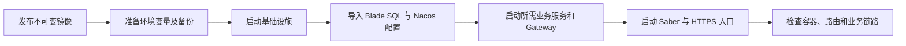

# 前后端容器部署规范化需求文档

## 1. 文档信息

| 项目 | 内容 |
| --- | --- |
| 需求名称 | 前后端容器部署规范化 |
| 需求编号 | REQ-2026-007 |
| 文档版本 | 0.2 |
| 所属模块 | SpringBlade Docker 部署、Saber 部署协同 |
| 目标版本/迭代 | SpringBlade 5.x 部署文档 |
| 文档状态 | 开发中，待验收 |
| 产品负责人 | 用户 |
| 技术负责人 | Codex |
| 创建日期 | 2026-09-29 |
| 最后更新日期 | 2026-09-29 |
| 关联事项 | [需求索引](../requirements-index.md)；[详细设计](../design/DESIGN-REQ-2026-007-deployment-standardization.md)；[测试文档](../test/TEST-REQ-2026-007-deployment-standardization.md)；数据库设计不涉及；Saber REQ-2026-008 |

## 2. 摘要与目标

### 2.1 摘要

当前仓库同时存在整体 Compose 栈和按中间件拆分的 Compose 栈，文件名及监听默认值不统一；现有部署形态还包含 Saber 和独立 HTTPS 入口。维护人员需要按服务组织运行目录的前后端部署教程。

### 2.2 目标

1. 以 `app/<service>` 和 `middleware/<service>` 为部署结构，提供首次部署、日常发布、验证和回滚流程。
2. 仓库内 Docker Compose 文件统一命名为 `docker-compose.yaml`，脚本引用同步生效。
3. 对宿主机发布的端口默认监听 `0.0.0.0`；安全组承担入站访问控制，操作者可以在变量文件或 YAML 中调整。
4. 区分监听地址与连接目标，避免将 `0.0.0.0` 误用为 Nacos 注册地址或服务访问地址。

### 2.3 非目标

- 不规定三台或其他固定数量的服务器，也不迁移现有服务器上的 Compose 文件和运行容器。
- 不修改 Java 服务、HTTP/Feign 契约、数据库结构或 Nacos 业务配置。
- 不建设审计或脱敏能力；本需求只使用配置项名称和示例占位值，不采集或记录敏感值。

## 3. 用户故事与范围

| 故事编号 | 优先级 | 用户故事 | 场景 | 依赖 |
| --- | --- | --- | --- | --- |
| US-001 | Must | 作为部署人员，我希望按一份教程准备并启动前后端，以便复现完整调用链。 | 首次部署 | Docker Compose、镜像、数据库与 Nacos 配置 |
| US-002 | Must | 作为维护人员，我希望统一 Compose 文件名与脚本，以便按组件更新和回滚。 | 日常发布 | GHCR、版本标签 |
| US-003 | Must | 作为运维人员，我希望监听和入站控制职责明确，以便为实际环境配置安全组。 | 网络配置 | 可达的服务目标地址 |

范围内：SpringBlade 两组现有 Compose 清单及其脚本、绑定地址示例、Saber 部署协同说明和通用教程。范围外：服务器侧即时改造、真实镜像发布、数据库执行与接口验收。

## 4. 部署流程

异常与重复流程：配置缺失或端口冲突时停止部署并保留旧版本；重复执行配置检查和镜像拉取不应修改业务数据；升级失败时按记录的旧镜像标签回滚。数据库升级如不兼容旧应用，应先完成兼容性与恢复方案评审。

## 5. 功能需求与验收标准

### 5.1 REQ-001 可执行部署教程

- `AC-001`：Given 维护人员取得各服务的 Compose 清单、变量及已发布镜像，When 按教程准备首次部署，Then 能按 `app/<service>`、`middleware/<service>` 目录启动服务，并找到数据库、Nacos 和入口代理的执行顺序。
- `AC-002`：Given 同机部署 Gateway 和独立 Saber Web，When 阅读端口规划，Then 教程识别两者默认宿主机端口冲突，并给出改端口或使用容器化入口的做法。
- `AC-003`：Given 服务分布在不同主机，When 参考教程配置连接，Then 教程要求使用实际可达地址，并明确 `0.0.0.0` 不能作为连接目标。

### 5.2 REQ-002 Compose 命名与脚本

- `AC-004`：Given 使用任一仓库内 SpringBlade Compose 栈，When 运行对应部署脚本，Then 脚本读取同目录 `docker-compose.yaml`，不再引用旧文件名。

### 5.3 REQ-003 监听边界与发布

- `AC-005`：Given 未覆盖监听变量，When 渲染对宿主机发布端口的 Compose 清单，Then 绑定地址为 `0.0.0.0`；容器内健康检查仍使用 `127.0.0.1`。
- `AC-006`：Given 维护人员准备升级或回滚，When 阅读教程，Then 可找到镜像标签、配置检查、容器状态、路由验证、数据库兼容与回滚顺序，且不会把构建成功写成业务验收通过。

## 6. 规则与访问边界

| 编号 | 规则 |
| --- | --- |
| BR-001 | `0.0.0.0` 仅表示绑定所有宿主机网卡，不是回环地址或远端服务地址。 |
| BR-002 | 安全组在服务启动前按端口用途设置入站规则；教程不写入具体服务器地址或凭据。 |
| BR-003 | 版本标签与配置版本需记录；正式发布使用可追溯且不覆盖的标签。 |
| BR-004 | 首次启动 MySQL 初始化脚本只创建库、用户及 Nacos 表结构；Blade 业务 SQL 另行执行。 |

认证、租户和数据权限：不改变现有业务逻辑；入口仍将 `/api/` 转发至 Gateway，服务端权限校验继续生效。审计、脱敏：不涉及，需求未提出相关能力。

## 7. 影响与风险

| 领域 | 影响 |
| --- | --- |
| HTTP API / Feign | 无契约变化。 |
| MySQL | 无结构变化，不创建数据库设计；教程引用已有全量和升级脚本。 |
| Nacos | 无 Data ID 内容变化；教程要求按环境准备命名空间与配置。 |
| Docker / 网络 | Compose 文件名、脚本路径及默认宿主机监听地址变化。 |
| Saber | 独立 Web Compose 监听默认值及部署说明同步，沿用既有 REQ-2026-008。 |
| 发布风险 | 改名后服务器旧文件不会自动迁移；绑定全部网卡要求安全组先行配置。 |

## 8. 评审与变更记录

评审关注点：教程命令是否对应服务目录中的文件、同机端口是否冲突、连接目标是否可达、回滚是否依赖未备份数据。真实服务器迁移及接口验收待部署人员执行。

| 日期 | 版本 | 变更内容 | 修改人 |
| --- | --- | --- | --- |
| 2026-09-29 | 0.2 | 教程主线改为按服务组织的简洁运行目录 | Codex |
| 2026-09-29 | 0.1 | 建立通用前后端部署教程、Compose 命名及监听默认值需求 | Codex |
