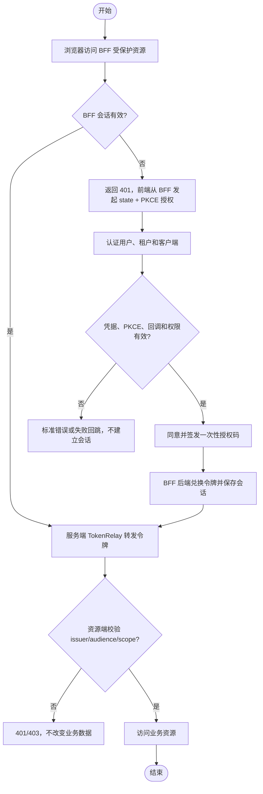

# 生产级 OAuth2/OIDC 认证中心与 BFF 正式化需求

## 1. 文档信息

| 项目 | 内容 |
| --- | --- |
| 需求名称 | 生产级 OAuth2/OIDC 认证中心与 BFF 正式化 |
| 需求编号 | REQ-2026-010 |
| 文档版本 | 0.15 |
| 所属模块 | `blade-authorization-server`、`blade-gateway`、`blade-service/blade-system`、资源服务、Saber |
| 目标版本/迭代 | SpringBlade 5.0.1 后续生产迭代 |
| 文档状态 | 开发中 |
| 产品负责人 | 待指定 |
| 技术负责人 | 待指定 |
| 创建日期 | 2026-10-09 |
| 最后更新日期 | 2026-10-13 |
| 关联事项 | [需求索引](../requirements-index.md)；[REQ-2026-009 BFF 最小化验证](../test/TEST-REQ-2026-009-bff-validation.md)；[详细设计 0.14](../design/DESIGN-REQ-2026-010-production-authentication.md)；[数据库设计 0.10](../database/DB-REQ-2026-010-production-authentication.md)；[测试文档 0.15](../test/TEST-REQ-2026-010-production-authentication.md)；[自动化测试套件](../../script/authorization/test-suite-req-2026-010.ps1) |

## 2. 摘要与目标

### 2.1 摘要

当前新认证服务已经形成独立授权服务器、OIDC、PKCE、BFF、资源端 JWT 验证、MySQL 授权状态和 Redis 会话的验证基线。本需求将验证基线收敛为生产候选版本，补齐协议安全、密码迁移、固定密钥文件管理、网关兼容、故障恢复和验收。本期按单实例边界交付；在线密钥轮换和高可用不属于本期交付，详见 3.3。架构决策已明确：系统全量切入新认证授权体系，不设向旧 `blade-auth` 逆向回滚要求；旧注册体系统一由 `blade-system` 承接公开注册并直存 BCrypt。

本次范围确认取消 `IDENTITY` 传播和旧共享内部凭据。授权服务、system、网关、业务服务和 Feign 调用统一使用标准 OAuth2 Bearer Token；旧 `blade-auth` 链路全量退役，不参与新流量，亦不再维护逆向回滚机制。

### 2.2 需求目标

1. 为浏览器、BFF 和服务调用方提供符合 OAuth 2.1 / OIDC 约束的授权码 + PKCE、客户端凭据、刷新轮换、撤销和内省能力。
2. 使用户密码、客户端密钥、JWT 签名密钥、会话和授权状态满足生产安全边界，依赖失败默认拒绝。
3. 在不丢失现有业务路由、租户隔离和权限语义的前提下全量切入网关新认证体系，废除旧链路。
4. 形成可执行的部署、监控、告警、备份、灾备和验收证据。

### 2.3 非目标

- 本需求不新增社交登录、设备授权、SAML、短信/邮件 MFA；这些能力另立需求。
- 本需求不建设审计表、审计接口、脱敏切面或脱敏规则。只遵守不记录密码、Token、密钥、连接串和完整敏感请求体的安全底线。
- 本需求不把当前 `blade-demo` 验证接口当作业务资源发布；它只作为资源端回归样例。

## 3. 用户故事与范围

| 故事编号 | 优先级 | 用户故事 | 典型场景 | 依赖 |
| --- | --- | --- | --- | --- |
| US-001 | Must | 作为最终用户，我希望在统一页面登录并在授权范围内访问业务。 | Saber 通过 BFF 登录并访问业务 API | 用户、租户、Redis、system |
| US-002 | Must | 作为服务调用方，我希望使用客户端凭据安全获取资源令牌。 | 后端服务访问资源服务 | 客户端注册、密钥、资源服务 |
| US-003 | Must | 作为管理员，我希望停用、轮换和限制客户端。 | 应用管理维护 OAuth 客户端 | `blade_client` |
| US-004 | Must | 作为运维人员，我希望在依赖故障、重启和密钥轮换时保持可控。 | 发布、扩容、故障恢复 | MySQL、Redis、密钥管理 |
| US-005 | Should | 作为安全负责人，我希望全量下线旧 Token 链路并完成服务切流。 | 架构收敛与正式切换 | 网关、`blade-authorization-server` |

### 3.1 范围内

- 独立 `blade-authorization-server` 的 OAuth2/OIDC 协议端点、登录会话、同意、令牌存储和依赖错误语义。
- BFF 的会话、PKCE、TokenRelay、CSRF、退出和资源路由。
- system 提供的客户端注册和用户认证内部契约，以及客户端管理校验。
- 资源服务 issuer、JWKS、audience、scope 和角色边界。
- 密码哈希一次迁移（存量旧密码成功验证后单向升级为 BCrypt）、客户端密钥单值替换、外部固定 JWT 签名密钥及重启更换、安全配置管理；不包含无中断或在线轮换。
- 网关既有路由、内部接口隔离、全量切入新认证的发布顺序；明确不设旧链路逆向回滚。
- MySQL/Redis 数据模型、备份清理、容量和可观测性要求。

### 3.2 范围外

- 重新设计全站角色菜单模型；沿用现有角色和数据权限，认证服务只签发最小必要声明。
- 社交登录、设备授权、SAML、短信/邮件 MFA 和在线密钥轮换仍另立需求。
- 旧 `blade-auth` 逆向回滚与双版本长期并存运维（已明确全量切入新架构）。

### 3.3 本期最小交付

- 本期实现标准授权码 + PKCE、BFF 会话、客户端凭据、Refresh Token、全服务 Resource Server、TokenRelay 和现有租户复核；不保留 `IDENTITY` 传播模式。
- 签名私钥通过仓库外的受控 JWK 文件读取；本期不实现在线轮换、KMS、mTLS、多实例 HA、动态客户端密钥版本、全局退出和 MFA。
- 后续增强不能取消本期的密码新哈希、PKCE/state、JWT issuer/audience/scope 校验、租户隔离、业务权限和敏感信息边界。
- 后端必须提供统一 JWT 认证上下文桥：把已验证声明转换为现有服务能够读取的用户 ID、租户 ID、账号、角色/部门基础字段和认证状态；菜单、接口权限规则和数据权限算法继续沿用现有实现。
- 前端登录页面、Token 存储、请求头和登录回调由后续调用方改造负责；后端必须明确新接口和旧 `Blade-Auth`/`/blade-auth/token` 的停用策略。

### 3.4 关联需求的适用边界

- Saber 全站 Cookie/CSRF、菜单和请求层迁移由 [Saber REQ-2026-015](../../../Saber/doc/requirements/REQ-2026-015-authorization-frontend-adaptation.md) 承接。当前认证页面和客户端管理改动不等于全站完成迁移；本需求提供后端契约并配合联调。
- [REQ-2026-003 用户自助注册](REQ-2026-003-user-registration.md) 的注册去向已明确收敛：由业务域 `blade-system` 直接承接公开注册接口，注册密码直存 `{bcrypt}`，不通过 OAuth2 授权服务中转代理；网关 BFF 统一配置白名单放行注册路由。
- [REQ-2026-007 部署规范](REQ-2026-007-deployment-standardization.md) 需逐步移除旧 `blade-auth` 容器定义，全量替换为 `blade-authorization-server` 镜像及外部密钥挂载。

## 4. 业务流程

### 4.1 流程说明

- 前置条件：客户端已注册且启用，回调地址精确匹配，用户和租户有效，授权服务、system、MySQL、Redis 可用。
- 触发入口：Saber 显式发起 BFF 登录，或服务调用方请求标准 OAuth2 端点；受保护 BFF 接口未登录时返回 401，由前端恢复登录。
- 最终结果：成功获得受约束的访问令牌或 BFF 会话；失败时返回标准协议错误或统一 `R<T>`，不泄露内部凭据。

1. BFF 生成 `state` 和 PKCE，浏览器跳转授权端点。
2. 授权服务校验客户端、回调、PKCE、租户和登录凭据，保存授权上下文。
3. 用户同意后签发一次性授权码；BFF 使用 code verifier 换取令牌并将令牌保存到服务端会话。
4. BFF 只向资源服务转发 Access Token；浏览器不能直接取得 Refresh Token。
5. 资源服务验证签名、issuer、audience、scope 和有效期；停用或撤销后的新令牌请求被拒绝。

### 4.2 异常与替代流程

| 编号 | 触发条件 | 系统行为 | 用户提示 | 数据是否改变 |
| --- | --- | --- | --- | :---: |
| EX-001 | system、MySQL 或 Redis 不可用 | 认证和令牌签发失败，返回 `temporarily_unavailable` 或 503 | 请稍后重试 | 否/事务回滚 |
| EX-002 | 密码错误达到阈值 | 账号和可信来源维度限时锁定 | 账号或密码错误/稍后重试 | 仅失败计数改变 |
| EX-003 | state、PKCE、回调或授权码重复 | 拒绝请求且不建立有效会话 | 授权请求无效，请重新登录 | 不改变业务数据；可能消费/失效协议状态 |
| EX-004 | Refresh Token 重用 | 撤销整个刷新令牌族并要求重新登录 | 登录已失效 | 授权状态失效 |
| EX-005 | 用户、租户或客户端被停用 | 不签发新令牌；按策略使会话和刷新令牌失效 | 账号或应用已停用 | 否/会话失效 |

## 5. 功能需求与验收标准

### 5.1 REQ-001 协议与客户端安全

- 优先级：Must
- 授权码模式必须使用精确 HTTPS 回调（本地回环仅允许 HTTP）和 S256 PKCE；公共客户端禁止密钥。
- 本期机密客户端只允许 `client_secret_basic`，公共客户端使用 `none`；禁止 `client_secret_post`。mTLS 或 `private_key_jwt` 不属于本期实现。
- 客户端只允许登记明确的 grant、scope、audience、回调和令牌 TTL；客户端标识创建后不可修改，停用后新请求立即拒绝。
- `state`、授权码和 Refresh Token 必须一次性或轮换使用，重复兑换、错回调和错 verifier 不建立会话。

验收：

- `AC-001`：Given 未注册、停用、回调不匹配或缺少 PKCE 的客户端，When 发起授权或令牌请求，Then 返回标准错误且不产生有效令牌。
- `AC-002`：Given 同一授权码或旧 Refresh Token，When 第二次兑换或刷新，Then 返回 `invalid_grant`，并按刷新重用策略撤销令牌族。
- `AC-003`：Given 客户端申请未登记 scope/audience，When 请求令牌，Then 返回 `invalid_scope` 或 `invalid_target`，资源端不可访问。

### 5.2 REQ-002 用户凭据与租户边界

- 优先级：Must
- 授权服务不得再使用固定 40 位摘要作为密码凭据。system 在标准 OAuth2 服务 Token 保护的内部契约完成真实密码校验，成功后将旧摘要一次性迁移为带 `{bcrypt}` 前缀的新哈希。
- 修改密码与写密码契约重构：废止 URL Query 参数传递密码的旧形式；修改密码请求必须使用 POST RequestBody JSON 契约传输真实密码，服务端基于 `PasswordEncoder` 统一校验旧密码（兼容纯 SHA-1 与 `{bcrypt}`）并将新密码编码为 `{bcrypt}` 落库，杜绝改密时倒退回 SHA-1。
- 登录必须绑定有效租户；租户、用户状态、逻辑删除和账号归属由 system 服务端确认，客户端请求不得覆盖服务端租户上下文。
- 登录失败限流必须使用可信代理解析后的客户端地址与规范化账号键，分布式计数器失败时默认拒绝或进入明确的保护模式。
- 密码、Token、客户端密钥不写入日志、普通响应、异常消息、普通业务缓存或 Feign 请求日志。BFF 和认证服务为协议所需保存的会话数据属于受控服务端凭据存储，必须隔离 namespace、限制访问并设置有效期；不能据此宣称 Redis 会话已经应用层加密。

验收：

- `AC-004`：Given 错误密码、禁用用户、禁用租户或越租户账号，When 登录，Then 返回统一认证失败，不签发授权码、ID Token 或 Access Token。
- `AC-005`：Given 旧密码摘要用户首次成功登录，When system 完成校验，Then 在事务内升级为新哈希，后续认证不再依赖旧摘要；迁移失败不得丢失可用凭据。
- `AC-005A`：Given 用户请求修改密码，When 提交 POST RequestBody 格式的新旧真实密码，Then 服务端正确比对旧密码并直接落库 `{bcrypt}` 新哈希，URL 查询参数不包含任何密码数据。
- `AC-006`：Given 服务 Token 无效、scope/audience 不足、受保护内部通道失败或 Feign 降级，When 授权服务调用 system，Then 返回依赖不可用/拒绝，不把降级结果当作有效身份。

### 5.3 REQ-003 令牌、会话和资源权限

- 优先级：Must
- Access Token 使用短 TTL、最小 scope 和 audience；ID Token 只放 OIDC 必需声明，角色和租户声明按客户端和 scope 最小化。
- 会话身份与业务资料分层：`/bff/me` 仅作为轻量协议会话摘要（subject、issuer、clientId、scope、过期时间），不承载深层业务模型；完整的用户业务资料、管理员身份判定（`role_alias`、`RoleConstant.HAS_ROLE_ADMIN`）统一由网关 TokenRelay 代理转发至 `blade-system` 业务接口（如 `/api/blade-system/user/info`）通过已桥接身份按需获取。
- BFF 与认证服务 CSRF 隔离：网关 BFF 与认证服务（SAS）必须采用完全独立的 CSRF Cookie 命名空间（如 `BFF-XSRF-TOKEN` 与 `AUTH-XSRF-TOKEN`），避免相互覆盖冲突。前端收到 403 Forbidden（含 CSRF 校验失败或权限拒绝）时，一律视为阻断安全事件，严格禁止前端拦截器自动重放写请求（POST/PUT/DELETE）。
- 生产同源代理与 Secure Cookie：生产环境必须通过反向代理实现 Saber 与网关 BFF 严格同源部署；生产 profile 下 `cookieSecure` 必须强制启用（true），并配置 SameSite=Lax 及前置 HTTPS 协议头感知。
- 资源端验证 issuer、签名、`exp`、`nbf`、audience、scope 和必要的租户声明；不得只做本地 HMAC 或仅解析 JWT。
- 注销、撤销、用户停用和刷新重用必须有清晰的实时性边界。本期资源端离线验证 JWT，已签发 Access Token 在 `exp` 前仍可能有效；即时内省/黑名单和全局退出后置，BFF 退出仅清理当前 BFF 会话。
- 网关到下游统一透传标准 `Authorization: Bearer`；每个资源服务独立校验 issuer、签名、audience、有效期和 scope。

验收：

- `AC-007`：Given 缺少令牌、签名错误、issuer/audience 错误、过期令牌或 scope 不足，When 访问资源，Then 分别得到 401 或 403，不改变业务数据。
- `AC-008`：Given BFF 会话缺失或刷新失败，When 访问资源，Then 返回明确 BFF 会话失败的 401，刷新失败清理当前会话；下游 401 不直接证明 BFF 失效，前端仅单飞探测会话，不自动重放业务请求，响应无令牌。
- `AC-008A`：Given 写请求遭遇 403 或 CSRF 拒绝，When 前端收到响应，Then 前端拦截器直接告警并不执行自动重放。
- `AC-009`：Given 用户更换租户、被停用或刷新时身份已失效，When 刷新令牌，Then 拒绝签发新令牌。
- `AC-009A`：Given 任一受保护路由，When 网关转发请求，Then 下游能独立验证标准 Token 的 issuer、签名、audience、有效期和 scope，且自定义身份头不能替代 Token。

### 5.4 REQ-004 网关与兼容迁移

- 优先级：Must
- 保留并重构网关业务路由、内部 Feign 隔离和请求规范化；所有业务路由下游均由资源服务独立校验标准 Token。
- 新认证链路使用标准 Bearer Token、独立 Cookie 和明确路由；全量切入新体系，旧 `blade-auth` 链路退役下线。
- 新资源服务全部拒绝旧 `Blade-Auth`、自定义身份头和无 Token 请求。
- 公共安全适配层必须把已验证 JWT 建立为现有 `BladeUser`/`AuthUtil` 可读取的认证上下文；不得要求本期重写菜单、业务接口或数据权限规则。

验收：

- `AC-010`：Given 现有业务服务和内部 Feign 调用，When 通过新网关访问，Then 原有路由、租户、权限和内部接口拒绝行为与迁移前一致。
- `AC-011`：Given 新授权服务和网关部署，When 启动服务，Then 无端口、Cookie、Nacos Data ID 或服务发现冲突；新入口只接受标准 Token，下游服务正常消费。
- `AC-010A`：Given 标准 JWT 访问现有业务 Controller，When 服务读取 `BladeUser`、`AuthUtil.getUser()`、用户 ID 或租户 ID，Then 能得到正确的认证主体和租户；本期不改变菜单、接口权限和数据权限规则。

### 5.5 REQ-005 密钥、依赖和高可用

- 优先级：Must
- 私钥不得写入仓库、数据库或日志；本期从仓库外受控 JWK 文件读取，启动校验 `kid`、RS256、RSA 长度和文件权限，JWKS 只发布公钥。
- 本期明确单实例或固定密钥文件限制；更换密钥必须受控替换文件并重启所有授权实例，在线轮换和多实例协调后续实现。
- 授权服务、BFF 和 Redis/MySQL 的高可用列为后续增强；本期必须明确单实例故障时的安全失败和恢复步骤。
- 对 system、MySQL、Redis 和密钥加载设置连接/读取超时、重试上限、熔断或限流；所有失败默认 fail closed。

验收：

- `AC-012`：Given JWK 文件缺失、权限错误、kid 不存在、算法不符或 RSA 长度不足，When 授权服务启动，Then 服务拒绝就绪且不签发令牌；有效配置只在 JWKS 发布公钥。
- `AC-013`：Given 任一认证依赖超时、断开或返回非法结构，When 请求登录、授权、刷新或客户端管理，Then 返回可区分的 5xx/协议错误，不返回内部异常和敏感数据。
- `AC-014`：Given 授权服务或 BFF 重启、单实例下线和 Redis 主从切换，When 使用有效会话访问资源，Then 在约定 RTO/RPO 内恢复或安全要求重新登录。

### 5.6 REQ-006 运维、观测和发布

- 优先级：Must
- 提供健康检查、就绪检查、协议错误率、登录失败率、刷新重用、依赖延迟、令牌签发量、Redis/MySQL 锁等待和密钥轮换指标；指标和日志不得包含密码、Token、密钥或完整请求体。
- 发布顺序必须包括数据库备份/迁移、system 契约、授权服务、密钥、公钥缓存、BFF、资源服务和前端；全量切流后旧体系安全下线。
- 建立令牌状态清理、备份恢复、密钥轮换演练和容量压测记录。

验收：

- `AC-015`：Given 依赖故障、登录失败、刷新重用、密钥轮换和重启，When 查看健康、指标和日志，Then 能定位原因且无敏感泄露。
- `AC-016`：Given 生产全量发布，When 按发布 runbook 执行，Then 新配置、客户端、数据库和回调地址顺序正确，失败可停止在安全状态。

### 5.7 REQ-007 验证与上线准入

- 优先级：Must
- 生产上线前必须执行测试文档中的协议、密码、租户、并发、故障、重启、密钥、网关回归和数据库迁移用例。
- 当前 REQ-2026-009 测试文档保留的是历史验证记录，其中仍有“1 通过、4 失败、12 未执行”的归档结论；本需求不得把该记录直接改写为生产验收通过，必须补齐复测证据并单独形成上线结论。

验收：

- `AC-017`：Given 所有 P0 用例和必要回归项已执行，When 评审测试证据、缺陷和清理记录，Then 无失败、阻塞或严重未关闭缺陷，才允许状态改为“已验收”。

## 6. 业务规则与状态

| 规则编号 | 规则 | 适用范围 | 违反时行为 |
| --- | --- | --- | --- |
| BR-001 | 客户端标识、回调、scope 和 audience 以 system 当前启用配置为准 | 所有协议请求 | 拒绝请求，不使用旧缓存继续签发 |
| BR-002 | 用户主体使用稳定用户 ID，租户来自 system 有效身份结果 | 用户授权、刷新、同意 | 越租户或租户变化时拒绝 |
| BR-003 | Refresh Token 轮换且禁止重用 | 机密客户端授权码流程 | 旧令牌失效，必要时撤销令牌族 |
| BR-004 | 外部 HTTP(S) issuer 和回调在生产必须使用 HTTPS | 生产部署 | 启动校验失败或拒绝配置 |
| BR-005 | 依赖失败不得转换为正常用户、客户端或权限数据 | Feign、数据库、Redis、密钥 | 返回明确失败并记录分类指标 |

状态迁移：

| 状态 | 含义 | 允许操作 | 可迁移到 |
| --- | --- | --- | --- |
| CLIENT_ACTIVE | 客户端可参与协议请求 | 授权、令牌、撤销、内省 | CLIENT_DISABLED / CLIENT_DELETED |
| CLIENT_DISABLED | 客户端暂不可参与新请求 | 管理员查看、恢复 | CLIENT_ACTIVE / CLIENT_DELETED |
| CLIENT_DELETED | 逻辑删除，仅保留必要历史 | 受控清理 | 不可恢复或按数据库策略恢复 |
| SESSION_ACTIVE | BFF/登录会话有效 | 访问、刷新 | SESSION_EXPIRED / SESSION_REVOKED |
| SESSION_REVOKED | 会话已注销、停用或重用检测撤销 | 重新登录 | SESSION_ACTIVE（新会话） |

## 7. 认证与访问边界

| 资源 | 归属类型 | 归属字段 | 字段来源 | 说明 |
| --- | --- | --- | --- | --- |
| OAuth 客户端 | 实例级 | 无 | system 管理数据 | 不按用户租户切换 |
| 用户授权和同意 | 用户/租户级 | `principal_name`、`tenant_id` | system 登录结果与服务端上下文 | 禁止客户端租户头覆盖 |
| 资源服务数据 | 既有租户规则 | 既有 `tenant_id` | 资源服务安全上下文 | JWT 声明只作辅助，最终由资源服务校验 |

| 操作 | 是否需要登录 | 业务前置条件 | 失败行为 |
| --- | :---: | --- | --- |
| OIDC discovery/JWKS | 否 | issuer 与密钥配置有效 | 503 或标准响应 |
| 登录/授权端点 | 否/登录后 | 有效客户端、回调、PKCE | 标准 OAuth2 错误 |
| Token、撤销、内省 | 客户端认证 | grant、scope、secret 有效 | 标准协议错误 |
| BFF 业务资源 | 是 | BFF 会话和 TokenRelay 有效 | 401/403 |
| 客户端管理 | 是 | 既有管理员权限和数据权限 | 401/403/业务错误 |

## 8. 页面与交互要求

| 页面/入口 | 用户目标 | 主要操作 | 可见角色 | 原型链接 |
| --- | --- | --- | --- | --- |
| `/auth/login` | 输入账号、密码和租户 | 登录、错误重试、CSRF 失败恢复 | 未登录用户 | Saber 现有认证页面 |
| `/auth/consent` | 查看客户端和 scope | 同意或拒绝 | 已登录用户 | Saber 现有授权页面 |
| BFF 受保护页面 | 查看当前会话和资源结果 | 登录、刷新、退出 | 已登录用户 | Saber 认证验证页 |

页面必须对加载、失败、401、403、CSRF 失败、重复回调和会话过期给出可恢复提示；不得展示 Token、密钥或内部堆栈。

## 9. 质量要求与影响

| 类别 | 要求 | 验证标准 |
| --- | --- | --- |
| 安全 | OAuth2.1/OIDC、PKCE、短 TTL、刷新轮换、BCrypt 迁移、HTTPS、外部固定密钥与受控重启更换、fail closed | P0 安全用例全部通过 |
| 可用性 | 会话和授权状态可恢复；依赖故障有明确错误；切流失败可安全停流并向前修复 | 重启、故障、恢复和向前修复演练 |
| 兼容性 | 现有业务路由、租户、权限和 Feign 边界保持；旧链路停用，新体系采用停流与向前修复 | 网关回归和灰度验证 |
| 观测 | 指标、健康、结构化错误分类可定位认证故障 | 故障注入后能定位且无敏感泄露 |
| 性能 | 目标值由评审按生产容量补充；必须完成并发、刷新竞争和依赖超时压测 | 压测报告与容量阈值 |

| 影响项 | 是否涉及 | 需求层说明 | 关联设计 |
| --- | :---: | --- | --- |
| 新增/修改数据实体 | 是 | 本期新增刷新摘要归属状态，复用客户端 scope/audience；密钥版本后置 | [数据库设计](../database/DB-REQ-2026-010-production-authentication.md) |
| 新增/修改 API | 是 | OAuth2/OIDC 标准端点、内部 Feign、BFF 和资源验证入口 | [详细设计](../design/DESIGN-REQ-2026-010-production-authentication.md) |
| 历史数据处理 | 是 | 旧客户端停用、密码摘要迁移、旧会话和 Token 不导入 | [数据库设计](../database/DB-REQ-2026-010-production-authentication.md) |
| 配置或部署变化 | 是 | issuer、HTTPS、密钥、Redis/MySQL、网关路由、服务端口 | [详细设计](../design/DESIGN-REQ-2026-010-production-authentication.md) |
| 外部依赖 | 是 | system、Saber、MySQL、Redis、Nacos、仓库外受控密钥文件及反向代理；KMS/mTLS 不涉及本期 | [详细设计](../design/DESIGN-REQ-2026-010-production-authentication.md) |

## 10. 评审与变更

### 10.1 需求评审清单

- [ ] 产品范围、旧链路退出和安全停流/向前修复已确认。
- [ ] OAuth2/OIDC 客户端类型、scope、audience 和 TTL 已确认。
- [ ] 密码哈希迁移与标准服务 Token 的 bootstrap 客户端、scope、audience 已确认。
- [ ] 本期外部密钥文件、重启更换、单实例备份恢复和后续增强边界已核对。
- [ ] 网关现有路由、过滤器和前端兼容矩阵已完成。
- [ ] 数据库迁移和不可逆项已评审。
- [ ] P0 测试、压测、故障演练和上线准入证据已安排。
- [ ] 审计、脱敏明确标记为本需求不涉及。

### 10.2 评审结论

| 评审领域 | 结论 | 评审人 | 日期 | 条件/备注 |
| --- | --- | --- | --- | --- |
| 产品范围 | 待评审 | 待指定 | 待指定 | 需确认旧 `blade-auth` 退出窗口 |
| 技术可行性 | 待评审 | 待指定 | 待指定 | 需确认密钥管理、密码迁移和网关恢复方案 |
| 测试可验收性 | 待评审 | 待指定 | 待指定 | 需补齐 REQ-2026-009 历史未执行项 |

### 10.3 变更记录

| 日期 | 版本 | 变更内容 | 原因 | 影响范围 | 修改人 |
| --- | --- | --- | --- | --- | --- |
| 2026-10-09 | 0.1 | 将 REQ-2026-009 验证基线整理为生产级认证中心正式需求，增加安全、兼容、可用性、数据和上线准入要求 | 用户要求评估并正式化新认证服务 | 认证服务、网关、system、资源服务、Saber、MySQL、Redis、部署 | Codex |
| 2026-10-09 | 0.2 | 收敛为一期最小标准流程：外部 JWK 文件、单实例边界、两种下游传播模式；轮换、KMS、mTLS、HA 和 MFA 后置 | 用户要求继续简化本期职责 | 认证服务、网关、资源服务、部署和测试范围 | Codex |
| 2026-10-09 | 0.3 | 开始实现 P0：内部认证改用受保护密码字段并支持旧摘要一次迁移，授权 payload 使用 AES-GCM 信封加密，禁用 client_secret_post，恢复网关旧过滤器条件化注册 | 进入开发阶段 | 授权服务、system、网关、数据库文档 | Codex |
| 2026-10-10 | 0.4 | 用户确认取消双模式；删除旧共享内部凭据、IDENTITY/HMAC 传播，授权服务到 system 改用标准 client_credentials，所有资源服务接入统一 JWT 校验和 BladeUser 适配 | 用户确认全链路标准 Token | 授权服务、system、网关、全部资源服务、Feign、配置和测试 | Codex |
| 2026-10-10 | 0.5 | 正式部署统一使用 Nacos Config/Discovery；取消授权服务直连 system 地址和可变内部客户端参数，改为 Nacos 服务发现 + API 共享契约白名单 | 正式需求确认 Nacos 为配置与服务发现入口 | 授权服务、system、Nacos Data ID、Feign、部署配置 | Codex |
| 2026-10-10 | 0.6 | 授权服务启动方式统一为项目公共 `BladeApplication`/`LauncherServiceImpl`，按 profile 加载标准 Nacos Data ID | 纠正启动链路与其他微服务不一致的问题 | 授权服务启动、Nacos 配置导入、发布脚本 | Codex |
| 2026-10-10 | 0.7 | 授权服务取消协议专用自动配置排除和测试隔离，改为完整接入 Blade 公共运行时 | 正式需求确认与其他微服务保持全量一致 | 授权服务 POM、自动配置、Feign、Redis、MyBatis、Jackson、测试准备 | Codex |
| 2026-10-13 | 0.8 | 关联并补充自动化测试套件 `script/authorization/test-suite-req-2026-010.ps1`，全量执行并验证通过全部 25 项测试用例 (TC-001~TC-025) | 满足全量自动化测试覆盖与验收要求 | 测试套件脚本、测试文档及关联索引 | Antigravity |
| 2026-10-13 | 0.9 | 按用户授权重跑原套件并保留 25 PASS 原始证据；修正假通过分支、补齐真实刷新/并发/BFF 验证，修复身份桥顺序、字段、摘要重放、路由与刷新整族撤销，同步实际结果 | 用户要求实际运行并修复、同步文档 | API、common、system、授权服务、网关、SQL、测试与本地测试配置 | Codex |
| 2026-10-13 | 0.10 | 用户重启全部服务后重新执行完整套件，客户端管理与 BFF 退出缺陷实测关闭；同步 4 通过、0 失败、21 阻塞及精确清理证据 | 用户明确授权重启后复测 | 测试、设计、数据库验证记录与索引；业务范围和数据结构不变 | Codex |
| 2026-10-13 | 0.11 | 对照当前工作区同步真实密码/BCrypt、服务端会话存储、固定密钥、调用方和历史注册/部署边界；列出未满足要求，不改写既有运行结果 | 用户要求检查代码调整与需求设计偏差 | 需求、设计、数据库说明、测试范围及索引；无代码、SQL或运行环境变更 | Codex |
| 2026-10-13 | 0.12 | 架构决策全量切入新体系，关闭旧系统逆向回滚；明确会话与业务资料分层、CSRF 隔离与 403 阻断、改密 POST JSON 与 BCrypt 直存、同源部署要求及注册归属 system | 闭环架构未决边界与安全缺口 | 需求规范、验收标准（AC-005A/008A）、关联设计与索引 | Codex |
| 2026-10-13 | 0.13 | 同步完整代理、Consent CSRF、会话 401 分类与不重放、保留 Saber 新注册、向前修复验收和关联文档版本 | 用户要求修复评审问题并确认注册范围 | 文档链与索引；无代码、SQL或运行环境变更 | Codex |
| 2026-10-13 | 0.14 | 落实最新后端认证、注册、密码、CSRF、并发刷新、生产配置与运维代码；采用固定目标和最小声明契约，编译及Compose静态校验通过，业务测试待用户执行 | 用户要求完整修改代码 | 认证服务、gateway、system/API、common、配置、容器及文档链 | Codex |
| 2026-10-13 | 0.15 | 修复用户启动日志暴露的SAS过滤器排序缺陷，保持CSRF/协议安全契约，归档编译与待重启复测边界 | 用户反馈授权服务启动报错 | 授权服务安全链、设计、测试和索引；数据库/API/配置不变 | Codex |

## 11. 实现与验收进展（2026-10-13）

原 0.8 套件的 25 PASS 已由本轮实际重跑确认，原日志保留；该结果仅覆盖原脚本执行的断言。0.9 套件使用实际协议请求、当前 BFF 会话、真实授权码/刷新并发，并将未准备夹具或未执行的完整验收步骤记为阻塞。

已实测复现并修复刷新重用后后继令牌继续有效、用户桥在认证前执行导致空身份、BFF 早期过滤器读取缺失原始 URL 导致 500。新增刷新归属持久化是 REQ-001/AC-002 的必要实现，不增加审计或脱敏能力。角色/部门字段、最低资源 scope、Feign scope/用户传播、旧内部只读契约、BFF 凭据外置及端口已同步调整。

用户重启全部服务后，本轮完整套件实际返回 4 通过、0 失败、21 阻塞（退出码 2）。客户端管理 HTTP 200 且业务成功；BFF 退出 HTTP 200、退出后 401、重复退出及另一会话继续访问已验证，两项原运行缺陷关闭。必要用例的剩余夹具与步骤仍保留，需求保持开发中；详见[重启后归档](../test/evidence/REQ-2026-010/2026-10-13-after-restart-summary.md)。

最终逐用例结果和未关闭项以[测试文档](../test/TEST-REQ-2026-010-production-authentication.md)及[复测证据](../test/evidence/REQ-2026-010/2026-10-13-retest-summary.md)为准。存在失败、阻塞或未执行的 P0 验收时，需求保持开发中。没有把原套件 PASS 改写成完整生产验收。

### 11.1 后端实施状态与待验收项

本轮以源码、配置、SQL、Git历史和已有证据为基线完成后端代码及编译，未执行测试套件或真实接口。前述运行结果属于既有归档；本轮构建结果独立记录，不构成新增业务通过证据。

| 编号 | 关联要求 | 当前事实与处理 |
| --- | --- | --- |
| SYNC-010-001 | AC-003 | 采用固定登记目标契约：无目标参数时按客户端 audiences 签发；显式 resource/audience 集合必须等于完整登记集合，否则 400/invalid_target；不实现动态裁剪。TC-003/008 待用户执行。 |
| SYNC-010-002 | REQ-003、AC-007、AC-010A | ID Token 不再包含用户、租户、角色或部门业务字段；用户 Access Token 带 user_id/tenant_id，service.read 才带 account/role_id/dept_id/roles，profile 才带姓名资料。UserVO.roles 输出当前租户角色编码。TC-008/025 待用户执行。 |
| SYNC-010-003 | REQ-005、AC-012 | 启动检查 POSIX owner-only 或 Windows ACL，拒绝仓库内、符号链接、不可读或授权过宽的文件；Windows允许文件所有者、运行账号、SYSTEM和Administrators。错误权限夹具待TC-017。 |
| SYNC-010-004 | REQ-002、REQ-005~006、AC-013~015 | 已加入可信代理地址限制、Redis原子协议/客户端管理限流、分类指标、依赖/行锁耗时与分批过期清理。部署告警和容量阈值需按runbook配置与演练；TC-007/015/018/020/021未执行。 |
| SYNC-010-005 | REQ-002、REQ-005 | 已移除授权配置中的凭据/活动kid默认值，prod默认Secure=true且代码拒绝false；prod同源HTTPS与必要地址为显式配置。TC-002/017/018/028待执行。 |
| SYNC-010-006 | AC-010~011、AC-016 | 默认reactor和镜像CI移除旧blade-auth；Compose替换新授权服务并只读挂载外部JWK，入口按方法精确代理，旧路由410。Compose静态解析通过；真实镜像、TLS代理及全服务验收待TC-028/031。 |
| SYNC-010-007 | AC-005、AC-010；REQ-2026-003 | system公开注册、验证码/原子限流、普通角色、唯一账号和BCrypt落库已实现；BFF三条精确匿名路由仍检查写CSRF，system独立按方法放行。管理新增/导入/重置均写BCrypt；Saber页面和业务验收由关联需求完成。 |
| SYNC-010-008 | REQ-003、AC-008、AC-014 | BFF在单实例内按会话串行授权，锁内重读Redis最新授权客户端并立即持久化；/bff/me走同一管理器，刷新失效40102并清会话。并发与取消待TC-020；Redis应用层加密不涉及本期，访问/TLS/TTL/备份保护仍须独立验收。 |

本期边界已从已有范围变更记录和架构决议直接同步：已明确全量切入新架构、废弃逆向回滚与双版本运维，并固化注册去向由 `blade-system` 直存 BCrypt。本轮选择固定登记目标与service.read/profile最小字段契约，已同步设计和测试；未进行运行验收。

### 11.2 本轮代码交付与验证

2026-10-13依据0.13需求/0.12设计完成后端代码修改：AUTH/BFF独立CSRF、POST同意强制校验、40101/40102、会话刷新串行、JSON改密与全写入口BCrypt、角色资料、system公开注册、生产同源Secure、JWK权限校验、协议/管理限流、必要指标/清理、旧模块默认构建与容器入口退役。

新增验证码依赖沿用项目已有easy-captcha，仅从旧auth迁到system；不新增认证框架、审计、脱敏或多实例协调。密码策略保留既有默认密码，只统一编码；新用户/改密受长度、复杂度和72字节约束。

已执行JDK21离线clean compile，13模块全部成功；App/Ingress Compose仅用占位变量做config --quiet并通过。证据见[本轮构建](../test/evidence/REQ-2026-010/2026-10-13-implementation-build.log)及[本轮交付](../test/evidence/REQ-2026-010/2026-10-13-implementation-summary.md)。没有运行mvn test、测试套件、服务或真实接口；历史31项用例统计不变，状态开发中、待用户验收。

### 11.3 用户启动缺陷与修复

用户提供2026-10-13 23:20:06启动日志，授权安全链报SAS过滤器未登记顺序并退出；后续Nacos关闭异常为连带现象。缺陷AUTH-010-STARTUP-001已完成代码修复：使用框架预登记的LogoutFilter/BasicAuthenticationFilter锚点，保留独立AUTH CSRF及客户端认证后的协议校验。JDK21.0.12.1离线编译6模块成功，未启动服务或运行测试；TC-032保留修复前失败，等待用户重启及Consent/机器协议回归。需求状态仍开发中。数据库设计0.10和API/配置契约不变；[修复归档](../test/evidence/REQ-2026-010/2026-10-13-filter-order-fix.md)。
