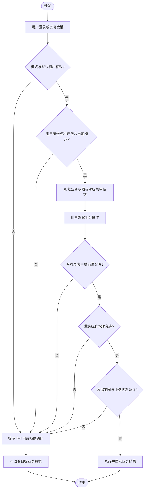

# 默认租户运行与业务权限统一需求文档

## 1. 文档信息

| 项目 | 内容 |
| --- | --- |
| 需求名称 | 默认租户运行与业务权限统一 |
| 需求编号 | REQ-2026-011 |
| 文档版本 | 1.0 |
| 所属模块 | blade-authorization-server、blade-gateway、blade-common、blade-system 及关联 API、资源服务、内部 Feign、Saber |
| 目标版本/迭代 | SpringBlade 5.x / 待指定 |
| 文档状态 | 已确认 |
| 产品负责人 | 用户 |
| 技术负责人 | 待指定 |
| 创建日期 | 2026-10-21 |
| 最后更新日期 | 2026-10-21 |
| 关联事项 | [需求索引](../requirements-index.md)；[用户自助注册](REQ-2026-003-user-registration.md)；[提示词数据权限](REQ-2026-005-prompt-scope-and-publishing.md)；[模型配置管理](REQ-2026-008-ai-model-configuration.md)；[生产级认证与 BFF](REQ-2026-010-production-authentication.md)；[Saber 认证前端适配](../../../Saber/doc/requirements/REQ-2026-015-authorization-frontend-adaptation.md) |
| 详细设计 | 待编写；依据本需求 1.0 确认范围定义运行模式、契约、授权映射、分阶段发布及回滚方案 |
| 数据库设计 | 待设计评估；默认租户业务数据不合并、不迁移，权限元数据、角色授权及客户端与服务账号绑定的持久化影响待确定 |
| 测试文档 | 待编写；业务验收由用户执行，本次没有执行服务、接口或数据库测试 |

本文按[需求模板](../templates/requirements-template.md)编写，覆盖前后端共同的业务要求。用户于 2026-10-21 明确“评审通过”，本需求以 1.0 作为确认基线；本阶段只交付需求及索引，不代表详细设计、实现或业务验收已完成。

## 2. 摘要与目标

### 2.1 摘要

当前业务不需要面向多个租户运营，但租户选择和菜单、按钮、接口的多处授权增加了配置成本。本需求使系统默认只在租户 `000000` 下运行，用户无需理解或选择租户；同时统一业务操作授权，让页面按钮和后端接口使用同一份业务权限。现有租户基础能力、角色、组织、数据范围和 OAuth2/OIDC 认证能力继续保留，以支持后续受控开放多租户。

### 2.2 需求目标

1. 登录、注册和日常管理不再要求选择租户，服务端统一确定默认租户。
2. 所有当前业务访问受默认租户约束，包括超级管理员，不能通过直接请求绕过。
3. 同一业务操作只授权一次；界面展示和接口许可依据一致，数据范围仍独立控制。
4. 保留现有用户、角色、部门、岗位、业务数据、功能及安全边界，避免权限自动扩大或功能无故丢失。
5. 保留多租户基础能力，并在隔离环境验证重新开放；不在当前业务环境创建第二个运营租户。
6. 分阶段交付默认租户运行和业务权限统一，分别验收并提供可执行的恢复依据。
7. 内部 Feign 通过客户端绑定的正式服务账号复用现有角色和业务权限；具有服务角色的账号禁止交互登录，用户委托调用不因身份丢失自动转为权限更高的服务账号调用。

| 指标 | 当前情况 | 目标 | 统计口径 |
| --- | --- | --- | --- |
| 登录、注册所需租户选择 | 当前可输入租户编号 | 单租户模式下为 0 次 | 两条流程的可见表单和实际服务端处理 |
| 同一业务操作的日常授权 | 菜单按钮、接口分别配置 | 一个业务授权项完成配置 | 角色授权界面及前后端实际访问结果 |
| 历史业务数据租户合并 | 用户确认均为默认租户 | 0 次合并、0 次租户批量改写 | 发布前盘点与发布后数据归属核对 |

### 2.3 非目标

- 不移除租户字段、联合索引、SQL 隔离、租户缓存键、身份声明和已有多租户实现。
- 不把所有用户合并为一个角色，不把单租户解释为所有用户共享全部数据。
- 不以 OAuth scope 替换全部业务操作和数据权限，不为每个菜单、按钮重复建立 OAuth scope。
- 不恢复旧 blade-auth 认证链路，不改变已确定的 OAuth2/OIDC、BFF、密码和会话安全要求。
- 不做跨租户历史数据合并、账号去重或既有数据的自动拆分。
- 审计、脱敏能力不涉及：用户未提出相关要求，不增加表、接口、规则或预留字段；继续避免记录和泄露敏感信息。
- 不引入新的外部权限服务、审批流程、租户计费或运营平台。
- 本轮不引入通用授权主体模型、独立服务权限体系、通用任务平台、异步任务授权记录或任务生命周期治理。
- 系统提示词现有独立权限校验本轮不改，保留原有保护；迁移到统一框架不纳入本轮交付，也不作为本轮完成的前置条件。

### 2.4 已确认事实与当前实现

| 编号 | 事实或现状 | 来源与适用边界 |
| --- | --- | --- |
| FACT-001 | 当前业务不需要多租户，要求默认使用一个租户并保留以后开放的能力 | 用户当前会话明确要求 |
| FACT-002 | 现有数据全部属于默认租户 `000000` | 用户当前会话确认；不是本次代理执行数据库盘点的结果 |
| FACT-003 | 系统已有默认租户配置和前端租户显示开关 | 当前源码；显示开关不构成服务端单租户限制 |
| FACT-004 | 登录、注册目前仍可接收显式租户，部分超管管理操作允许跨租户 | 当前源码；本需求将增加单租户模式约束 |
| FACT-005 | 菜单按钮与接口权限存在独立编码和授权关系 | 当前源码；例如标签新增分别使用 `tag_add` 和 `system:tag:create` |
| FACT-006 | 新认证服务已有身份适配，业务权限和数据范围仍由现有业务机制执行 | 关联认证需求及当前源码；本需求不以此推断完整回归已通过 |
| FACT-007 | 当前 Feign 拦截器按是否存在已验证请求身份决定传播令牌或申请服务 Token；部分内部运行入口仍使用依赖 BladeUser 的权限处理器 | 当前源码；REQ-2026-008 已要求内部配置读取独立于最终用户登录态，实际服务授权与资源约束仍需打通，未执行真实调用验证 |
| FACT-008 | 本轮采用正式服务账号并新增服务角色，复用既有账号、角色和业务权限；只要拥有服务角色即禁止从前端及其他交互入口登录 | 用户当前会话已确认采用该方案并授权修订需求，不采用通用授权主体方案 |
| FACT-009 | 系统提示词独立权限本轮不改，继续保留现有校验 | 用户已明确“本轮不改”；后续是否及如何统一另行确认 |

## 3. 用户故事与范围

### 3.1 用户故事

| 故事编号 | 优先级 | 用户故事 | 典型场景 | 依赖 |
| --- | --- | --- | --- | --- |
| US-001 | Must | 作为普通用户，我希望直接使用账号登录和注册，无需填写租户 | Saber 登录、注册 | 默认租户有效、新认证链路 |
| US-002 | Must | 作为管理员，我希望管理用户和组织时无需反复选择租户 | 用户、角色、部门、岗位管理 | 当前用户管理权限 |
| US-003 | Must | 作为角色维护者，我希望一次配置某项业务操作，同时决定界面入口和接口许可 | 角色授权 | 统一业务操作语义和旧授权映射 |
| US-004 | Must | 作为用户，我希望简化后仍只能访问获准的数据 | 提示词、模型配置及其他业务访问 | 原有数据范围和归属规则 |
| US-005 | Must | 作为运维人员，我希望当前只运行默认租户，未来仍可受控开放多租户 | 配置发布、隔离环境回归 | 完整配置、权限及默认租户状态 |
| US-006 | Must | 作为既有用户和服务调用方，我希望原有合法业务调用与授权在切换后可追溯地保留 | 发布前后回归、内部 Feign | 权限基线、契约和发布验证 |
| US-007 | Must | 作为内部服务，我希望通过绑定的服务账号取得现有角色和业务权限，以便调用获准的 Feign 接口，且该账号不能交互登录 | 模型运行读取、提示词运行、标签等内部 HTTP 调用 | OAuth 客户端、有效服务账号、服务角色及明确业务授权 |

### 3.2 范围内

- 后端统一运行模式及默认租户规则，以及前端展示与后端约束的一致性。
- 登录、注册、用户令牌、会话恢复、管理接口和内部用户归属调用的默认租户边界。
- 隐藏日常界面中的租户选择、所属租户字段和租户管理入口；限制对应管理操作。
- 统一业务操作授权、前后端权限依据、角色授权交互和旧授权关系的兼容处理。
- 保留各模块已确认的数据范围、归属、保护资源和业务状态规则。
- 保留 OAuth scope 的客户端范围控制；交互登录和机器凭证分别建立真实账号身份，业务权限统一复用既有角色机制。
- 新增服务角色、客户端与服务账号绑定、服务账号可信身份适配及 Feign 账号使用规则；接口操作鉴权与必要数据检查保持分层。
- 单租户发布、权限切换、回滚，以及多租户恢复能力的隔离验证。

### 3.3 范围外

- 当前业务环境的多租户运营、多租户批量开户，以及对历史默认租户数据的拆分。
- 删除用户自定义角色、部门、岗位，或将管理员身份自动下放给普通用户。
- 未经核对直接删除旧权限表、旧权限编码或全部历史授权。
- 改造 fast-staratlas-ai 的模型档案、推理调用和业务配置；相关系统仅核对既有调用兼容性。
- 详细设计、DDL、实现代码和测试结果的本次交付；其文档按后续阶段建立。
- 系统提示词独立权限校验的迁移、取消或服务账号豁免；本轮保持现状。
- 通用授权主体、独立定时任务权限、任务授权凭据和异步任务撤权/取消策略；不要求在所有 Service 方法新增权限注解。

### 3.4 与既有需求的关系

- 本需求形成独立增量范围，不把历史需求改写为已经实现的新行为。本需求已评审确认，后续关联设计和实施文档必须依据 1.0 基线同步适用边界。
- REQ-2026-003 的注册开关、验证码、限流、普通角色和账号唯一性继续有效；单租户模式下，其“允许选择其他已有租户”由本文固定默认租户规则替代。多租户模式保留原有选择规则。
- REQ-2026-005 的本人/全部范围、系统提示词保护、版本和写操作规则继续有效；“全部”在单租户模式下指默认租户内全部。系统提示词现有独立权限明确作为本轮统一授权的例外保留，不迁移、不取消、不因服务角色而豁免。
- REQ-2026-008 的用户归属、管理员管理范围及凭据访问边界继续有效；单租户模式下超级管理员同样不能跨租户，恢复多租户后按既有授权恢复相应管理范围。
- REQ-2026-008 的“内部运行读取无需最终用户登录态”通过客户端绑定正式服务账号实现，账号仍需满足服务角色、业务权限及既有资源约束。原有模型配置 ID 选择、可用状态和凭据边界保留，不新增任务授权层；实施时同步相关身份与接口设计，不以服务 Token 直接取得任意用户权限。
- REQ-2026-010 与 Saber REQ-2026-015 仍提供唯一新认证和会话基线；本文新增其原范围之外的租户运行方式与业务授权简化，不降低协议安全要求。

## 4. 业务流程

### 4.1 流程说明

- 前置条件：运行模式和默认租户配置一致，默认租户有效；业务操作已定义，授权与数据范围可获取。
- 触发入口：登录、注册、角色授权、业务页面或受保护 API。
- 最终结果：用户在默认租户内按业务操作权限和数据范围使用功能；被拒绝的请求不改变业务数据或角色授权。

1. 用户进入登录或注册页面，不选择租户；服务端确定默认租户并完成既有认证或注册校验。
2. 登录后系统恢复用户身份、业务权限和菜单；不把 OAuth scope 当作管理员或业务按钮权限。
3. 管理员选择角色，按业务模块一次配置允许的操作，并另行选择该模块支持的数据范围。
4. 用户发起操作，系统验证身份、客户端范围、运行模式、业务操作许可、数据归属和业务状态。
5. 所有条件满足时执行原有业务；失败时明确拒绝，并保留可恢复的页面状态。

下图展示普通用户访问路径。内部服务通过机器凭证和可信绑定建立服务账号上下文，再按相同角色权限机制访问 Feign HTTP 入口；不经过前端交互登录，具体要求见 REQ-010。

### 4.2 业务流程图

### 4.3 异常与替代流程

| 编号 | 触发条件 | 系统行为 | 用户提示 | 数据是否改变 |
| --- | --- | --- | --- | --- |
| EX-001 | 请求显式指定非默认租户，包括多个参数或头部来源冲突 | 拒绝，不静默改写为默认租户执行 | 当前模式不支持该租户 | 否 |
| EX-002 | 默认租户缺失、停用或配置不一致 | 不建立新用户业务会话、不注册或执行受影响业务 | 当前服务暂不可用 | 否；限流及必要会话技术状态按原规则处理 |
| EX-003 | 未登录、令牌失效或用户令牌租户不符合模式 | 拒绝，提供既有重新登录路径 | 需要重新登录或访问被拒绝 | 目标业务数据不变 |
| EX-004 | 角色权限或数据范围依赖不可用 | 拒绝，不能按全部权限或全部数据继续 | 权限暂不可用，可重试 | 否 |
| EX-005 | 旧按钮权限与后端操作权限不一致或无法映射 | 列出差异；阻止对应角色或操作切入统一授权 | 需要核对授权差异 | 不自动修改授权 |
| EX-006 | 授权重复提交或保存失败 | 重复提交不累积权限；失败不留下部分授权 | 保存结果或明确失败，可重试 | 成功为相同授权结果，失败不改变有效授权 |
| EX-007 | 前端运行配置或权限加载失败 | 禁止依赖未知权限的操作，不以空表单覆盖既有授权 | 加载失败及重试入口 | 否 |
| EX-008 | 发布盘点发现非默认租户业务数据 | 阻止按本需求假设直接切换；保留原数据并记录差异 | 发布前提不满足 | 否，不自动合并或删除 |
| EX-009 | 要求用户委托的调用丢失用户身份、用户令牌无效或目标服务不匹配 | 拒绝，不自动改用更高权限服务身份重试 | 身份或授权不满足 | 否 |
| EX-010 | 服务 Token 有效，但账号绑定无效、账号无服务角色、业务权限不足或数据范围不符 | 拒绝，不返回运行凭据或其他未获准内容 | 服务账号或业务访问未授权 | 否 |
| EX-011 | 账号具有服务角色，包括同时具有其他角色 | 在服务端拒绝交互登录及继续取得新的用户授权，不依赖前端隐藏入口 | 该账号不支持交互登录，沿用不泄露角色细节的认证失败提示 | 不建立新的交互会话或用户授权 |

## 5. 功能需求与验收标准

### 5.1 REQ-001 统一运行模式与默认租户

- 关联用户故事：US-001、US-002、US-005；优先级：Must。
- 触发入口：服务配置生效、登录、注册和业务请求；输入为运行模式、默认租户及可信身份。
- 处理规则：当前交付默认按单租户运行，唯一有效业务租户为字符串 `000000`。租户留空或明确等于默认值可以继续；显式非默认值、不同来源冲突均拒绝。默认租户由服务端确定，不依赖浏览器隐藏字段建立信任。
- 单租户规则对普通用户、管理员、超级管理员、直接 API 和内部用户归属调用一致适用。已有全局共享资源不因此改造成租户业务表。
- 输出为明确的默认租户上下文或拒绝；运行模式由受控配置发布，普通业务用户不能在线修改。

- `AC-001`：Given 单租户模式和有效默认租户，When 请求未携带租户或携带 `000000`，Then 两者使用相同默认租户上下文，不要求用户补填租户。
- `AC-002`：Given 单租户模式，When 通过参数、请求体或身份相关头部显式指定非默认租户或提供冲突来源，Then 拒绝，目标数据和授权不改变，不把请求改写后继续执行。
- `AC-003`：Given 默认租户不存在、停用或必要运行配置无效，When 建立身份或执行受影响业务，Then 不使用任意租户兜底，不绕过租户校验完成操作。
- `AC-004`：Given 普通用户、管理员和超级管理员分别访问，When 请求按 ID 访问非默认租户资源或指定跨租户范围，Then 单租户模式均拒绝，不能因超管身份绕过。

### 5.2 REQ-002 登录、注册与身份兼容

- 关联用户故事：US-001、US-006；优先级：Must。
- 触发入口：Saber 登录/注册、新认证中心、BFF 会话恢复及用户令牌刷新；前置条件为默认租户有效和原有认证依赖可用。
- 用户无需选择租户即可完成原有流程；注册仍受开关、验证码、限流、密码和账号唯一性约束，只分配既定普通角色，成功后按既有流程主动登录。
- 用户身份及用户令牌继续携带真实默认租户声明，保留角色和部门等既有资料及最小声明策略。旧默认租户用户不因本改造重建账号或重置密码。
- 不把其他租户的旧身份、会话或令牌改写为默认租户身份。模式不符时拒绝；默认租户内符合既有有效性规则的会话可继续使用。
- 具体 HTTP/业务错误码、会话处置和端点兼容由详细设计定义，须沿用关联认证需求已有的可识别错误语义。

- `AC-005`：Given 有效默认租户用户，When 不选择租户并使用正确凭据登录，Then 完成新认证及 BFF 流程，恢复原账号 ID、角色、组织和业务归属。
- `AC-006`：Given 注册已开启且默认租户普通角色有效，When 提交合法注册信息且不选择租户，Then 仅在 `000000` 创建普通用户，不分配管理角色、部门或岗位，不自动登录。
- `AC-007`：Given 默认租户内账号已存在或已逻辑删除，When 重复或并发注册同一账号，Then 仍遵守既有唯一性规则，不因租户输入隐藏而重复创建用户。
- `AC-008`：Given 登录或注册显式携带非默认租户，When 提交，Then 不创建用户、不建立该身份的新授权会话、不签发用户令牌。
- `AC-009`：Given 已签发的用户令牌或会话属于非默认租户，When 在单租户模式恢复、刷新或访问资源，Then 拒绝，不把其用户 ID 或租户归属改写为默认租户；默认租户有效身份按原规则处理。

### 5.3 REQ-003 管理入口简化与原有组织能力保留

- 关联用户故事：US-002、US-005；优先级：Must。
- 单租户模式隐藏租户管理入口，以及用户、角色、部门、岗位等页面中的所属租户输入、筛选和非必要显示；既有业务账号、组织关系和自定义角色继续保留。
- 创建、查询、导入、导出、批量授权及按 ID 管理均由服务端使用默认租户，保持原有管理权限和字段校验。
- 单租户模式禁止新增其他租户、跨租户切换，以及删除、停用或改写默认租户编号。必要的默认租户内部读取和系统资料管理按既有授权保留，不能因隐藏管理入口破坏登录、注册或业务调用。

- `AC-010`：Given 单租户模式，When 进入登录、注册及用户、角色、部门、岗位日常管理页面，Then 不要求选择租户；拥有原权限的操作者仍可完成既有合法业务。
- `AC-011`：Given 授权管理员，When 创建用户、分配角色、调整组织或执行导入导出，Then 结果只涉及默认租户，原用户 ID、角色和组织关联不因本改造批量重建。
- `AC-012`：Given 单租户模式和超级管理员，When 绕过界面直接请求新增其他租户、跨租户管理或破坏默认租户状态，Then 服务端拒绝，默认租户及目标业务数据不变。
- `AC-013`：Given 未登录或无管理权限的用户，When 直接请求被隐藏的管理入口，Then 仍按身份与业务权限拒绝，不能因单租户模式降低原有门槛。

### 5.4 REQ-004 统一业务操作授权

- 关联用户故事：US-003、US-006；优先级：Must。
- 触发入口：角色授权、权限初始化、页面操作和业务接口；输入为角色、业务操作和独立数据范围。
- 同一业务操作拥有一个有效授权依据，角色维护者只配置一次。前端页面、按钮和后端一个或多个相关接口引用该业务操作；如已有稳定业务权限编码，应优先保持其语义和调用兼容。
- 系统提示词现有独立权限不在本轮统一迁移范围内；通用业务权限配置不能替代、取消该校验，也不授予服务账号绕过该校验的资格。
- 日常角色授权不再要求为同一操作分别勾选菜单按钮和接口权限。导航的名称、图标、顺序、目录、外链等展示配置继续独立存在；展示配置不能授予接口权限。
- 不强制菜单、按钮与接口一一对应：纯导航、多个接口组成的操作及无前端按钮的内部能力均需保持明确边界。
- 撤销某项操作应按设计明确的生效边界同时作用于界面与后端；生效边界不得弱于迁移前，并须在详细设计与测试中定义，不能只隐藏按钮。
- 重复授权不累加权限；保存失败不允许出现前后端有效授权各自更新一半的状态。

- `AC-014`：Given 角色无某项业务操作权限，When 管理员仅在一个业务授权项中授予该操作并成功保存，Then 在约定生效边界内，角色成员可见对应入口且可执行对应接口，无需第二次接口授权。
- `AC-015`：Given 角色已获某项操作，When 撤销并达到约定生效边界，Then 对应受控入口隐藏或禁用，直接调用接口也被拒绝，数据不改变。
- `AC-016`：Given 某项业务操作没有前端页面，When 内部调用方按其获准账号和原契约访问，Then 无需虚构菜单即可执行获准能力；新增菜单或外链本身不会扩大业务操作权限。
- `AC-017`：Given 同一份角色业务授权，When 重复保存，Then 最终权限集合相同，不产生重复授权或额外能力；清空可撤销操作集合时不意外清空独立数据范围。
- `AC-018`：Given 授权保存过程中发生依赖或持久化失败，When 请求结束并重新读取，Then 保留保存前有效授权，不出现部分业务操作已生效、部分未生效的结果，页面明确失败。

### 5.5 REQ-005 数据范围与业务保护规则保留

- 关联用户故事：US-004、US-006；优先级：Must。
- 业务操作授权和数据范围分别配置、共同判断；获得某项操作不自动获得全部数据范围。
- 提示词保留本人和默认租户内全部范围，并覆盖列表、详情、版本及写操作。模型配置保留所有者归属和原有管理员管理能力，管理查询、内部运行读取及凭据边界不被放宽。
- 部门、岗位及其他模块已有数据范围和业务状态规则继续保留，不以简化为由全部归并为本人/全部两类。
- Controller 或相应 HTTP 安全入口负责操作权限校验，Service 保留必要的数据归属、业务状态和现有条件保护。本轮不清除已有 Service 检查，也不要求在每个 Service 方法新增通用权限注解。
- 系统提示词现有独立权限本轮不改，不迁移到统一框架、不取消、不赋予服务账号豁免；保留编码、发布状态、版本和并发规则继续执行。后续统一需重新确认范围，本轮不预设迁移实现。

- `AC-019`：Given 仅具有本人数据范围的普通用户，When 查询或按 ID 访问他人的提示词、版本及受保护配置并尝试写入，Then 不返回未获准内容、不改变目标数据。
- `AC-020`：Given 管理员具有相关业务操作及全部数据范围，When 访问默认租户内他人资源，Then 维持既有合法管理能力；“全部”不能越过当前模式的默认租户边界。
- `AC-021`：Given 普通账号或服务账号拥有普通编辑权限但不满足系统提示词独立权限、保护资源、发布、版本或并发条件，When 操作对应资源，Then 现有独立校验及拒绝语义继续生效，不因统一权限或服务角色而迁移、取消或绕过。
- `AC-022`：Given 业务操作权限或数据范围依赖超时、降级或返回无效结果，When 查询或写入，Then 拒绝，不返回全部数据、不执行写入，目标业务数据不变。

### 5.6 REQ-006 OAuth 客户端范围与业务权限分工

- 关联用户故事：US-001、US-003、US-006；优先级：Must。
- OAuth scope 继续限定客户端通过当前令牌获准使用的能力；普通账号与服务账号的业务操作均通过现有角色权限机制判断，数据范围继续判断目标资源。
- 普通角色授权不重复维护 OAuth scope；客户端接入由获授权的客户端维护者按现有规则管理。授权确认页继续展示本次申请且需要确认的客户端能力，不逐项展示内部菜单和按钮。
- 不把现有 `service.read` 名称解释为自动只读。资源端按实际登记和校验规则执行 scope，保留 issuer、签名、audience、时间及必要用户声明验证。
- 机器凭证和交互凭证保持区分：仅经认证中心核验的客户端绑定可建立对应正式服务账号上下文，业务侧据此复用角色和权限，不接收调用方自报的用户 ID，不临时冒充管理员。服务角色本身不由 scope 推导，具体绑定、声明和身份适配由 REQ-010 及后续设计承接。

- `AC-023`：Given 用户具有某项业务操作但令牌缺少该入口要求的 scope 或目标服务不匹配，When 访问，Then 按新认证基线拒绝，业务数据不改变。
- `AC-024`：Given 普通用户获得有效客户端 scope，When 访问未获业务授权的管理操作，Then 拒绝，不因同意 scope 而获得角色、菜单操作或全部数据范围。
- `AC-025`：Given 有效服务 Token 已可信绑定有效服务账号，When 访问获准的内部能力，Then 通过同一角色权限机制执行；访问未获准操作或仅允许交互会话的入口时拒绝，不通过自报用户或管理员身份放行。
- `AC-026`：Given 客户端授权确认和角色授权两种流程，When 分别配置，Then 前者处理客户端能力，后者处理业务操作及数据范围，不要求为同一业务按钮重复配置 OAuth scope。

### 5.7 REQ-007 旧权限兼容与无扩大切换

- 关联用户故事：US-003、US-006；优先级：Must。
- 以当前有效用户、角色、菜单、按钮、接口、数据范围和直接角色限制形成迁移前基线，覆盖业务接口及必要内部调用；基线证据只记录必要标识和授权结果，不包含凭据。
- 旧编码与统一业务操作必须有明确对应关系，不能根据名称相似或路径前缀自动认定等价。
- 不一致项逐项说明影响并在对应角色或操作切换前解决：只有按钮不能据此新增后端能力；只有接口不能静默撤销已有后端能力；纯导航和有意隐藏的入口不得无条件自动展示。
- 不能为了形成统一配置直接取全部旧授权的并集，也不能未经核对统一取交集导致功能丢失。歧义未消除时保留原有效校验并阻止该项切换。
- 保留旧权限能力与必要兼容路径，待设计明确迁移、依赖与恢复条件后再收敛重复管理入口和记录。本需求不授权直接删除旧表或全部角色授权。

- `AC-027`：Given 已记录的权限基线及明确操作映射，When 某角色切入统一授权，Then 原有合法业务操作和数据范围可按清单复核，没有新增未授予操作、无故丢失后台能力或重建用户。
- `AC-028`：Given 只有按钮权限、只有接口权限或多个旧项对应冲突的角色，When 尝试切换，Then 提供逐项差异及处理结果；未解决的对应项不切换、不自动增加或删除有效权限。
- `AC-029`：Given 既有纯导航、外链、多个按钮共用接口及无菜单内部能力，When 统一映射，Then 分别保留展示与调用边界，不通过创建导航获得业务能力，不遗漏无界面能力。
- `AC-030`：Given 一阶段已固定默认租户、二阶段权限切换出现问题，When 按恢复方案退回该阶段变更，Then 可恢复切换前授权及必要配置，默认租户业务数据和账号归属不改变；不恢复旧 blade-auth 链路。

### 5.8 REQ-008 配置一致性与页面失败处理

- 关联用户故事：US-001、US-002、US-003、US-005；优先级：Must。
- 授权服务、system、网关、资源服务和 Saber 对运行模式与默认租户应保持一致；前端不能仅靠本地显示开关决定实际租户策略。
- 配置缺失或冲突时不得静默恢复多租户或忽略服务端限制；配置发布与生效边界由详细设计明确，不要求实时在线切换。
- 页面继续覆盖加载、空数据、失败、重试、未登录和提交中状态。权限加载失败时不将空集当作有效授权保存；没有实际权限时不展示成功操作。
- 保持既有 BFF Cookie、CSRF、会话失效与写请求不自动重放规则。

- `AC-031`：Given 前端配置显示多租户、后端为单租户，When 直接提交非默认租户或访问管理操作，Then 后端仍拒绝；配置错误不会成为绕过途径。
- `AC-032`：Given 认证、注册或资源服务必要配置缺失或互相冲突，When 发布生效或调用受影响功能，Then 明确暴露不可用，不静默使用其他租户或放宽校验。
- `AC-033`：Given 角色权限或运行配置加载失败，When 打开授权页并尝试保存，Then 禁止依赖失败数据的提交，提供重试，既有授权不被空结果覆盖。
- `AC-034`：Given 授权提交中、会话失效或请求被拒绝，When 重复点击、刷新或收到安全拒绝响应，Then 保留既有防重复提交、重新登录与 CSRF 行为，不自动重放写操作，不出现虚假成功。

### 5.9 REQ-009 保留并验证多租户恢复能力

- 关联用户故事：US-005、US-006；优先级：Must。
- 保留现有租户归属、索引、缓存命名、用户身份声明及权限隔离能力。当前业务环境持续仅运营默认租户，不为本需求主动新增第二个运营租户。
- 多租户模式重新开放通过受控配置、租户初始化及必要权限准备完成；不要求删除再重建业务表、不要求从代码历史恢复已删能力。
- 本期在隔离环境验证模式恢复和再次收敛，覆盖普通用户、管理员、超级管理员及相应原有租户边界。非默认租户验证数据必须明确归属及精确清理范围。
- 重新开放不自动把默认租户历史数据拆分给其他租户，也不自动给已有普通用户新增跨租户权限。当前业务未来实际开放需单独发布和回归，不能以本需求声称生产已启用。

- `AC-035`：Given 当前数据均属 `000000`，When 完成单租户阶段发布，Then 用户、角色、组织和业务数据的 ID、归属保持，未执行租户合并或批量改写，既有租户字段与隔离基础能力保留。
- `AC-036`：Given 隔离环境具备默认租户和独立非默认租户测试夹具，When 受控开放多租户并完成初始化，Then 原有租户选择、管理及按角色授权的跨租户能力可用，普通用户无法越租户读取或写入，无需重建业务表。
- `AC-037`：Given 隔离环境已开放多租户，When 再次切回单租户，Then 非默认租户的用户访问和管理操作被拒绝，已有测试数据不被自动合并、删除或改写，默认租户合法业务继续可用。
- `AC-038`：Given 发布前只读盘点出现非默认租户有效业务数据或未解决的授权映射差异，When 准备切换，Then 记录受影响项并阻止对应阶段发布，不以用户确认的历史前提替代实际发布核对。

### 5.10 REQ-010 服务账号与 Feign 权限统一

- 关联用户故事：US-004、US-006、US-007；优先级：Must。用户已确认本轮采用服务账号、新增服务角色、具有该角色即禁止前端交互登录，并明确系统提示词独立权限本轮不改；本节随需求 1.0 评审通过，不代表已实现或业务验收完成。
- 服务账号是现有账号体系中的正式账号，保留账号状态、租户、角色和必要数据范围。新增服务角色识别账号的机器调用性质；稳定角色标识在详细设计中确定，不能仅按可修改的显示名称或客户端自报角色识别。
- 每个逻辑服务使用独立服务账号，OAuth 客户端通过可信服务端配置绑定服务账号。本期使用标准 `client_credentials` 认证机器，不能使用个人管理员密码、浏览器会话或用户刷新令牌获取机器调用身份。
- 认证中心核验客户端、绑定关系、账号有效性和服务角色后，才能为其签发可建立该服务账号上下文的机器令牌。客户端和账号之间的关联必须由服务端确定，不能按请求参数或普通身份头临时选择任意用户。
- 资源端验证令牌后，根据可信绑定建立正式服务账号上下文，复用现有角色、业务权限和数据范围读取。不能直接把客户端 ID 当作用户 ID，也不能未经核验临时填充一个管理员账号。Token 声明、`sub` 兼容、身份适配和绑定变更的发布顺序交由详细设计。
- 服务角色用于账号识别及交互登录限制，不自动赋予超级管理员、全部业务操作或全部数据。需要的内部运行、读取或写操作仍需通过现有角色授权明确赋予，OAuth scope 继续提供客户端范围约束；不另建一套独立服务业务权限体系。
- 只要账号具有服务角色，就在认证服务端禁止账号密码等交互登录；即使同时具有普通用户、管理员等角色，服务角色仍具有否决作用。直接提交登录请求与前端页面遵守相同限制，不能仅在 UI 隐藏按钮，也不能按 User-Agent 判断是否属于前端登录。
- 登录、继续浏览器授权及交互用户令牌刷新需考虑服务角色的当前有效关系，避免已有浏览器会话在账号转为服务账号后继续取得新的用户授权。角色变更生效和会话处置在设计中明确；存量 Access Token 仍需说明既有离线验证及过期边界，不以本要求声称已实现全局即时撤销。
- 未具有服务角色的普通用户沿用现有登录规则。公开注册不得分配服务角色；账号停用、删除、移除服务角色或解除客户端绑定后，不得继续基于该关系签发新的服务账号机器令牌，存量令牌处置按设计明确的兼容与失效边界执行。
- 每个 Feign 契约明确使用当前用户账号还是绑定服务账号。要求用户委托时沿用用户权限，缺少身份、令牌无效、scope 不足或 audience 不匹配应失败，不能自动改用权限更高的服务账号重试；要求机器调用时明确使用绑定服务账号，不因当前线程恰好存在用户身份而换成该用户。
- Controller 或对应 HTTP 安全入口校验账号业务操作权限及必要的调用方式，Service 保留现有数据归属、资源启停、发布、版本和其他业务检查。仅具有服务角色不能绕过这些规则；系统提示词独立权限继续执行，迁移至统一框架明确不在本轮。
- 数据范围按真实服务账号及已授予规则判断。“本人”仅表示该服务账号按现有业务定义拥有的数据，不表示任意请求传入的用户；没有适用的数据许可不能自动扩大为全部。单租户模式限默认租户，恢复多租户不自动扩大服务账号范围。
- 模型运行配置、提示词渲染、标签等既有 Feign 契约按上述账号权限打通。模型配置 ID 选择、资源可用性及凭据边界继续遵守 REQ-2026-008；不因知道某个配置 ID 就越过已设账号数据范围，也不向前端管理查询返回运行凭据。
- 本轮不设计独立定时任务、异步任务授权或任务生命周期框架。进程内直接调用 Service 不经过 Controller，不能因此宣称所有 Service 都无身份依赖；保留既有检查并记录受影响调用。本需求的服务账号能力针对需要经过 HTTP 入口鉴权的内部 Feign 调用，调用方如何调度不新增独立验收范围。

| 调用方式 | 认证方式 | 业务身份与权限 | 本轮边界 |
| --- | --- | --- | --- |
| 普通用户交互登录及其委托 Feign | 既有用户登录与有效用户令牌 | 当前正式用户账号的角色、业务权限和数据范围 | 失败不自动换成更高权限服务账号 |
| 内部服务 Feign | 客户端凭证及可信服务账号绑定 | 正式服务账号的角色、业务权限和数据范围 | 具有服务角色、账号有效，不要求自然人保持登录 |
| 进程内直接调用 Service | 沿用现有调用方式 | 保留当前必要数据与业务检查 | 不新增独立任务权限、自动赋权或统一任务模型 |

- `AC-039`：Given 无自然人登录上下文，且客户端已可信绑定有效服务账号、账号具有服务角色及必要业务权限和数据范围，When 使用有效机器令牌访问 Feign，Then 正常建立该正式账号上下文并通过现有角色权限机制执行，不要求人工保持登录。
- `AC-040`：Given 某契约要求用户委托且当前服务账号权限更高，When 用户上下文丢失、用户令牌失效或 scope/audience 不足，Then 调用失败，不改用服务账号重试，不执行用户原本无权的操作。
- `AC-041`：Given 某契约要求服务账号调用，When 后端在带有普通用户请求上下文的线程中调用，Then 使用可信绑定的服务账号；浏览器提供用户 Token 或伪造服务账号/所有人头部不能替代机器认证。
- `AC-042`：Given 机器令牌有效但绑定服务账号缺少对应业务操作、入口要求的 scope 或正确 audience，When 访问受限 Feign 能力，Then 拒绝，不返回未获准运行数据或执行写入，不以内部路径或服务角色本身放行。
- `AC-045`：Given 服务账号具有默认租户内对应操作及数据范围，When 单租户模式下访问允许资源并尝试指定其他租户，Then 前者按账号权限执行，后者拒绝；恢复多租户也不自动获得全部租户数据。
- `AC-046`：Given 机器令牌获取、绑定账号核验、角色权限或必要资源依赖失败，When 发起或重试 Feign 调用，Then 明确失败，不改用管理员、无认证、任意账号或无限制范围继续，不向浏览器响应或普通日志输出运行凭据。
- `AC-047`：Given 新建服务角色并赋予一个正式账号，When 尚未授予对应业务操作或数据范围，Then 该账号仅被识别为服务账号，不自动获得管理、运行或全部数据权限。
- `AC-048`：Given 账号仅具有服务角色，或同时具有服务角色及普通用户/管理员角色，When 从前端页面或直接向服务端提交交互登录，Then 均被服务端拒绝，不建立新的交互会话或用户授权，其他角色不能抵消该限制。
- `AC-049`：Given 有效普通用户未具有服务角色，When 按既有流程登录或执行合法公开注册，Then 登录行为保持；公开注册仍只得到既定普通角色，不能通过请求参数取得服务角色。
- `AC-050`：Given 某账号原有有效浏览器会话，随后被赋予服务角色，When 达到设计明确的角色生效边界后继续取得浏览器授权或刷新用户令牌，Then 不再取得新的交互用户授权；已签发 Access Token 的有效性按明确的既有离线校验边界验证，不把其存在当作全局即时撤销已经完成。
- `AC-051`：Given 客户端未绑定账号、账号无服务角色、账号已停用/删除、服务角色已移除或绑定已解除，When 请求签发对应服务账号机器令牌，Then 拒绝，不使用调用方传入的替代用户 ID、不退回默认管理员；正常绑定的有效账号可以按原客户端范围取得令牌。
- `AC-052`：Given 服务账号已有接口操作权限但未获目标资源数据范围，When 更换目标配置 ID 或自报其他用户为所有人，Then 继续按真实账号的原有数据和业务规则拒绝；服务角色与机器令牌不会把“本人”改为任意用户，也不豁免系统提示词独立校验。

| 撤回编号 | 原范围 | 当前结论 |
| --- | --- | --- |
| AC-043 | 通用任务绑定及任务执行状态授权 | 随 0.3 撤回，不计入本轮有效验收，编号保留且不复用；原有资源规则按 AC-019~022、052 验证 |
| AC-044 | 用户异步任务在退出后执行及任务生命周期 | 随 0.3 撤回，不计入本轮有效验收，编号保留且不复用；本轮只验证服务账号 Feign 能力 |

## 6. 业务规则与状态

### 6.1 业务规则

| 规则编号 | 规则 | 适用范围 | 违反时行为 |
| --- | --- | --- | --- |
| BR-001 | 单租户模式的唯一有效业务租户为字符串 `000000`，保留前导零 | 身份、查询、写入、用户归属 | 拒绝非默认值及冲突，不静默改写 |
| BR-002 | 前端隐藏不代替服务端模式和权限校验，超管也不能绕过当前单租户边界 | 全部受影响入口 | 拒绝，不改变目标数据 |
| BR-003 | 同一通用业务操作只维护一份有效授权，界面和接口共同引用；系统提示词独立校验本轮明确保留 | 角色、业务页面、接口 | 不允许通用授权相互矛盾，也不能借统一之名取消既有例外保护 |
| BR-004 | 操作许可、数据范围和业务状态必须共同满足；单租户不代表数据共享 | 用户业务访问 | 拒绝越范围操作 |
| BR-005 | scope 不产生业务角色；机器令牌只有经可信客户端绑定才能建立对应正式服务账号上下文 | OAuth、资源服务、Feign | 不接收自报账号或临时冒充管理员，按真实账号及入口契约校验 |
| BR-006 | 旧授权歧义不自动取并集或交集，映射未明确不得切换对应项 | 权限迁移 | 保留原有效校验并列出差异 |
| BR-007 | 注册规则、账号唯一性和普通角色分配继续有效 | 默认租户注册 | 既有错误语义，不创建额外账号或管理权限 |
| BR-008 | 运行模式发布不合并、拆分或删除业务数据，不重建用户和角色 | 发布与恢复 | 发现不满足前提则停止对应阶段 |
| BR-009 | 默认租户、权限或数据范围依赖失败不得退化为无限制 | 登录、授权和业务调用 | 明确失败，不放宽访问 |
| BR-010 | 审计、脱敏不涉及，凭据和完整敏感请求体不进入文档或日志 | 本需求全部阶段 | 避免不必要采集和输出，不建设新处理流程 |
| BR-011 | 普通账号和服务账号复用现有角色、业务权限和数据范围；客户端或目标所有人 ID 本身不是账号认证凭证 | Feign 与业务访问 | 校验可信账号关联、真实权限和既有数据规则 |
| BR-012 | Feign 契约决定使用当前用户还是绑定服务账号，用户授权失败不得自动换为更高权限账号重试 | 内部 HTTP 调用 | 明确失败，不形成身份切换或权限提升 |
| BR-013 | 只要拥有服务角色即禁止交互登录，混合其他角色也不抵消；机器凭证路径按绑定及账号状态单独核验 | 服务账号登录与授权 | 服务端拒绝交互路径，不能仅隐藏前端入口 |
| BR-014 | 系统提示词独立权限保持原状，本轮不统一迁移、不取消、不对服务账号豁免 | 提示词管理与关联内部调用 | 继续执行原有保护及失败语义 |

### 6.2 状态与迁移

| 状态 | 含义 | 允许操作 | 可迁移到 |
| --- | --- | --- | --- |
| 单租户运行 | 当前目标模式，仅默认租户参与业务 | 默认租户内按原业务和统一权限访问 | 满足配置、初始化和回归条件后开放多租户 |
| 多租户运行 | 保留能力的恢复模式 | 按原租户及角色范围访问 | 受控切回单租户，非默认租户数据不改写 |

模式变更是运维发布行为，不是普通业务界面的开关。用户、角色、资源启停、逻辑删除、业务发布和版本状态不因运行模式变化而自动迁移。业务授权的生效边界和切换状态在详细设计确定，不新增未确认的业务状态机。

## 7. 认证与访问边界

### 7.1 资源归属

| 资源 | 归属类型 | 归属字段 | 字段来源 | 说明 |
| --- | --- | --- | --- | --- |
| 用户、角色、部门、岗位及既有租户业务数据 | 租户级 | 原有 `tenant_id` | 单租户模式由服务端确定默认值 | 不删字段，不接受客户端改变归属 |
| 提示词、版本、用户供应商和模型配置 | 租户及用户级 | 原有租户和创建人/所有人字段 | 原有可信身份及业务规则 | 继续执行本人、管理和保护资源边界 |
| 菜单展示元数据、操作定义及角色授权 | 按现有资源模型 | 原有资源及角色关联 | 获授权管理员配置 | 普通账号与服务账号共同使用；不把全局元数据强制加租户字段，持久化模型由设计评估 |
| 用户令牌、授权与会话 | 用户身份级 | 原有用户与租户关联 | 已验证认证结果 | 非默认用户身份在单租户模式拒绝 |
| 服务账号 | 既有账号与租户级 | 账号 ID、租户及角色关系 | 获授权管理员维护，单租户模式归默认租户 | 具有服务角色；不自动成为管理员，不改变资源实际所有人 |
| 机器令牌、客户端及账号绑定 | 服务或应用级 | 客户端身份、范围及正式账号关联 | 服务端登记、OAuth 认证和绑定核验 | 建立真实服务账号上下文，不按请求自报账号；具体持久化由设计评估 |

### 7.2 当前访问规则

| 操作 | 是否需要登录 | 业务前置条件 | 失败行为 |
| --- | --- | --- | --- |
| 登录与公开注册 | 否；按各自既有入口规则 | 模式、默认租户和依赖有效，原有验证码/密码/CSRF 等要求满足 | 不建立新会话或创建用户，返回既有可识别失败 |
| 角色业务授权 | 是 | 既有角色管理资格，目标角色归属默认租户，完整授权可读取 | 拒绝或保存失败，原授权不变 |
| 普通业务操作 | 是 | 用户身份、客户端范围、操作许可、数据归属和状态均有效 | 认证失败 401、访问拒绝 403 或既有明确业务错误；不改变目标数据 |
| 单租户模式的跨租户及租户生命周期操作 | 原入口要求仍适用 | 当前模式不允许执行 | 即使超管也拒绝，不隐藏错误后继续执行 |
| 用户委托 Feign | 需要可信用户认证 | 用户操作、数据范围及目标契约的 scope/audience 满足 | 不满足即拒绝，不自动切换为服务身份 |
| 服务账号 Feign | 客户端机器认证，无需自然人登录 | 有效绑定、账号及服务角色，账号业务权限、audience、scope 和原有数据规则满足 | 明确失败，Fallback 不当作正常身份或无限制授权 |
| 具有服务角色账号的交互登录 | 无论仅服务角色或混合其他角色均禁止 | 服务端识别当前服务角色关系 | 拒绝新交互登录与用户授权；既有会话及令牌按明确生效边界处理 |
| 进程内直接调用 Service | 沿用原有调用方式 | 原有必要数据与业务检查满足 | 本轮不新增独立任务授权，不因直接调用自动赋权或跳过已有检查 |
| 运行模式发布及多租户恢复 | 受控运维权限 | 配置、数据前提、初始化、回归和恢复方案准备完成 | 不通过业务页面放宽，不满足条件停止切换 |

接口层的具体错误码和 HTTP 映射在详细设计中逐项明确，不在本需求中推测未确定的端点签名。资源不可见时继续遵守原模块的不存在/无权限语义，避免泄露资源内容。

### 7.3 后续权限影响

通用业务权限统一及服务账号复用角色机制属于本期，覆盖现有前后端业务操作及必要的无界面能力。系统提示词现有独立校验明确保留；后续迁移到统一框架需另行确认范围，本轮不预设或预留该实现。后续新增模块应复用统一操作语义和独立数据范围，不重新建立同一操作的两份日常授权。未来新增数据范围或对外 scope 属于明确业务变化，再评估其访问边界；本期不为未提出的审计、脱敏、通用授权主体或新权限引擎预留模型。

## 8. 页面与交互要求

### 8.1 页面与操作

| 页面/入口 | 用户目标 | 主要操作 | 可见角色 | 原型链接 |
| --- | --- | --- | --- | --- |
| Saber 登录、注册 | 不选择租户即可使用默认系统 | 登录、注册、失败重试 | 按既有匿名访问规则 | 待准备 |
| 用户、角色、部门、岗位管理 | 不选择所属租户完成现有管理 | 查询、维护、组织关联和既有批量操作 | 具备相应管理权限的用户 | 待准备 |
| 角色授权 | 一次配置业务操作，另选数据范围 | 按模块授权、撤销、保存及失败重试 | 既有角色授权管理者 | 待准备 |
| 业务菜单与按钮 | 看到并使用获准能力 | 查看、编辑、发布等既有操作 | 具备对应业务权限的用户 | 待准备 |
| 租户管理 | 单租户日常使用无需该入口 | 单租户模式不展示；恢复多租户后按原权限开放 | 当前模式不对日常用户展示 | 不新增原型；保留原能力 |
| 既有账号与角色管理中的服务账号 | 通过既有角色机制维护服务调用账号 | 分配服务角色、明确业务权限和数据范围，提示具有服务角色不能交互登录 | 具备相应账号及角色管理权限的用户 | 待准备；复用现有管理能力 |
| OAuth 客户端管理与授权确认 | 管理应用范围、服务账号绑定或确认本次授权 | 既有客户端配置及可信账号绑定；普通用户同意或拒绝授权，服务账号不进入交互同意流程 | 按原有客户端维护权限及新增服务角色登录限制 | 待准备；不展示全部内部业务权限 |

角色授权的目标交互以“业务模块、允许操作、独立数据范围”表达。例如提示词模块配置查看、新建、编辑等操作，并选择本人或默认租户内全部；不要求第二次勾选同名接口权限。具体布局、批量选择、授权依赖和编码兼容交由详细设计，不能以界面勾选联动替代服务端授权一致性。

### 8.2 页面状态

| 状态 | 展示与行为 |
| --- | --- |
| 加载中 | 明确加载状态，禁止依赖未知配置或权限的保存 |
| 空数据/无授权 | 展示无数据或无权限；不视为依赖加载失败，不自动赋权 |
| 请求失败 | 保留必要输入、明确失败和重试；不将失败结果覆盖为有效空授权 |
| 未登录/会话失效 | 沿用新认证入口恢复，不保存密码或浏览器 Token，不自动重放写操作 |
| 资源不存在或越范围 | 沿用原资源拒绝语义，不显示未获准内容 |
| 提交中 | 防重复提交，不能在未完成时宣称保存成功 |
| 提交成功 | 反馈成功，在约定边界刷新授权和可见入口；失败不能伪装成功 |
| 租户入口关闭 | 不展示无用租户字段或管理入口；直接请求仍由服务端校验 |
| 服务账号尝试登录 | 展示既有可识别认证失败反馈，不泄露具体角色，不自动切换其他登录方式绕过；后端始终拒绝该交互登录 |
| 已归档 | 不适用：本需求不增加归档状态，已有资源启停和逻辑删除按原规则处理 |

## 9. 质量要求与影响

### 9.1 非功能要求

| 类别 | 要求 | 验证标准 |
| --- | --- | --- |
| 兼容性 | 保留既有默认租户身份、组织、合法操作和数据范围 | 切换前后基线、授权差异和核心业务逐项核对，不以页面可见替代后端验证 |
| 安全边界 | 单租户约束覆盖超管及直接请求，前端、scope 和服务身份不产生额外业务授权 | AC-002、004、009、012、019、023~025 的拒绝行为及数据不变证据 |
| 一致性 | 同一业务操作只配置一次，保存失败不留下部分有效授权 | AC-014~018、027~029、033~034 的配置和真实访问证据 |
| 可恢复性 | 默认租户运行与权限切换分别有恢复路径，保留多租户基础能力 | AC-030、035~038；恢复后的业务和隔离回归 |
| 服务账号调用与登录限制 | 机器调用建立真实账号上下文并复用角色，服务角色禁止交互登录 | AC-039~042、045~052 的无自然人登录调用、错误绑定拒绝、混合角色登录拒绝及数据范围证据；AC-043/044 已撤回 |
| 既有独立保护保留 | 系统提示词校验不迁移、不取消、不对服务账号豁免 | AC-021、052 的原保护路径和拒绝行为回归 |
| 性能 | 不提出未经业务确认的时延、容量或吞吐指标；保留既有可用调用路径 | 基线与必要回归在设计、测试中定义，不以静态检查声称性能通过 |

### 9.2 数据与接口影响

| 影响项 | 是否涉及 | 需求层说明 | 关联设计 |
| --- | --- | --- | --- |
| 默认租户业务数据及现有租户结构 | 不涉及合并或移除 | 用户确认数据均属默认租户；保留字段、索引、归属和隔离条件 | 设计中记录发布盘点和保留项，待编写 |
| 业务操作元数据及角色授权关系 | 涉及兼容整理及新增服务角色；结构是否变化待评估 | 必须明确旧操作映射、授权差异和服务角色初始化，系统提示词独立权限保留 | 数据库设计待评估；若涉及结构或持久化配置变更，同步 MySQL 全量与升级脚本 |
| HTTP API 与关联 API 模块 | 是 | 运行模式、登录注册上下文、管理租户参数、业务权限读取及角色授权可能受影响；继续使用项目统一响应及错误约定 | 详细设计待编写，逐项列契约及调用方 |
| Feign 与服务账号 | 是 | 显式选择用户委托或绑定服务账号，建立可信账号上下文并复用既有角色校验；保留原有数据和资源规则 | 详细设计待编写；与 REQ-2026-008 及认证需求协同 |
| 客户端与服务账号绑定 | 是 | 明确登记、有效性、解绑、角色移除及 Token 身份适配，不能将客户端 ID 直接当作用户 ID | 详细设计及数据库影响评估待编写 |
| 系统提示词独立权限 | 不涉及本轮改造 | 保留现有规则及实现，后续是否统一另行确认；本轮仅验证未被取消或绕过 | 不新增迁移设计 |
| 定时任务、通用主体及任务授权关联 | 不涉及 | 用户已选择服务账号，本轮不设计独立任务权限或通用授权主体，不新增任务记录认证要求 | 不适用 |
| Nacos、默认值及部署配置 | 是 | 模式和默认租户对各环境一致，配置不是密钥；具体 Data ID、字段、默认策略和生效边界待设计 | 详细设计待编写 |
| 网关和认证 | 是 | 保留路由、内部隔离、JWT 和 BFF 基线；单租户不绕过 scope、用户身份或 CSRF 校验 | 详细设计待编写 |
| Saber 调用方 | 是 | 租户字段隐藏、运行模式读取、权限初始化、角色授权及业务入口需协同 | 本文第 8 节；前端详细设计待编写 |
| 外部应用和 fast-staratlas-ai | 不主动改造，需核对已有依赖 | 不扩大模型推理和外部应用改造范围；若发现已有契约调用受影响，先登记再明确兼容方案 | 依赖清单待准备 |
| 审计、脱敏 | 不涉及 | 没有明确业务要求，不新增相关能力或验收条件 | 不适用 |

默认租户运行本身不要求重建业务表。业务权限统一是否需要持久化结构变更仍待设计评估，不能因为租户数据无需迁移就把全部数据库影响标为“不涉及”。若最终确认无相关变化，再同步需求、设计和索引结论，不创建空数据库设计。

### 9.3 依赖、风险与开放问题

| 编号 | 类型 | 内容 | 负责人 | 截止日期 | 状态/结论 |
| --- | --- | --- | --- | --- | --- |
| ITEM-001 | 已确认前提 | 当前业务不需要多租户，现有数据全部属 `000000` | 用户 | 2026-10-21 | 用户已确认；代理未连接数据库验证 |
| ITEM-002 | 依赖 | 发布前默认租户及有效业务数据只读盘点、旧授权基线和必要服务调用清单 | 待指定 | 第一阶段发布前 | 待准备；发现差异按 EX-008 处理 |
| ITEM-003 | 设计事项 | 运行模式统一来源、各环境配置、非默认声明拒绝及超管入口覆盖 | 待指定 | 详细设计完成前 | 待编写，不新增未经确认的运行时热切换要求 |
| ITEM-004 | 风险 | 旧按钮、接口、直接角色校验和特殊导航存在差异，简单合并可能扩大或丢失权限 | 待指定 | 对应项切换前 | 采用明确映射与差异处理，未解决项不切换 |
| ITEM-005 | 设计事项 | 权限编码兼容、授权生效边界、重复及并发提交、失败一致性和恢复 | 待指定 | 详细设计完成前 | 待编写；不得弱于迁移前访问边界 |
| ITEM-006 | 设计事项 | 权限元数据、服务角色、授权关系及客户端与账号绑定是否涉及 MySQL 结构或持久化配置变更 | 待指定 | 数据库影响评估完成前 | 待评估；决定数据库设计及全量/升级脚本交付 |
| ITEM-007 | 依赖 | 前后端同步、目标部署版本、隔离环境和测试夹具 | 待指定 | 各阶段验收前 | 待准备；不在共享业务环境自动新增其他租户 |
| ITEM-008 | 风险 | 仅限制登录无法阻止旧非默认用户令牌、按 ID 或超管入口绕过 | 待指定 | 第一阶段验收前 | 覆盖身份建立、刷新、资源访问和管理调用的服务端约束 |
| ITEM-009 | 范围边界 | 多租户重新开放保留能力并进行隔离验证，不等于未来生产开启已获验收 | 待指定 | 恢复能力验收前 | 已在 REQ-009 定义，不自动拆分默认租户历史数据 |
| ITEM-010 | 已确认方案与设计事项 | 以正式服务账号和新增服务角色贯通 Feign，复用现有角色权限；具有服务角色即禁止交互登录 | 待指定 | 服务账号设计完成前 | 用户已确认方向并授权修改文档，具体绑定、角色标识与声明适配待设计 |
| ITEM-011 | 已撤回范围 | 原异步任务生命周期、撤权、暂停或取消策略设计 | 用户 | 2026-10-21 | 本轮不涉及，不再作为开放问题或验收前置条件；AC-044 撤回且不复用 |
| ITEM-012 | 已撤回范围 | 原通用任务记录和资源绑定授权机制 | 用户 | 2026-10-21 | 本轮不涉及，不新增任务授权层；AC-043 撤回且不复用，既有资源约束继续保留 |
| ITEM-013 | 已确认排除项 | 系统提示词独立权限本轮不改，后续是否统一另行确认 | 用户 | 2026-10-21 | 保留原校验，不取消、不迁移、不豁免服务账号，不作为本轮待设计事项 |
| ITEM-014 | 设计事项 | 服务角色变更后的交互会话、新用户授权、刷新及已签发机器令牌的生效边界 | 待指定 | 认证适配设计完成前 | 区分禁止新交互授权与存量 Access Token 离线有效期，不虚构全局即时撤销 |
| ITEM-015 | 设计风险 | 认证中心读取 system 的服务账号绑定与角色时可能涉及自举循环依赖 | 待指定 | 认证适配设计完成前 | 保持既有自举最小契约并定义校验顺序，不能引入普通业务免认证通道 |

## 10. 评审与变更

### 10.1 需求评审清单

- [x] 已记录用户确认的单租户目标和现有数据归属，并区分确认事实与实际执行证据。
- [x] 已定义目标、非目标、范围、流程、异常和前后端访问边界。
- [x] 十项 Must 需求均具备稳定编号和 Given/When/Then 验收标准，共 50 项有效标准；AC-043、044 撤回并保留编号，不计入本轮验收。
- [x] 已区分业务操作、数据范围、导航展示与 OAuth 客户端授权。
- [x] 已识别数据库、API、Feign、Nacos、部署、Saber 和历史需求影响。
- [x] 用户已评审确认需求范围、阶段与验收标准；技术负责人和具体排期待指定。
- [ ] 详细设计明确完整契约、权限映射、生效边界、数据库影响与发布恢复方案。
- [ ] 测试文档将全部验收标准映射为实际可执行用例，准备隔离数据和精确清理规则。
- [ ] 各阶段必要回归和多租户恢复验证由用户执行并取得证据。

### 10.2 评审结论

| 评审领域 | 结论 | 评审人 | 日期 | 条件/备注 |
| --- | --- | --- | --- | --- |
| 业务方向及数据前提 | 用户已确认 | 用户 | 2026-10-21 | 当前不运营多租户、保留恢复能力、数据全部为默认租户；数据分布来源仍为用户确认，发布盘点尚未执行 |
| 服务账号方案与本轮排除项 | 用户已确认 | 用户 | 2026-10-21 | 采用服务账号及服务角色，具有服务角色禁止交互登录；系统提示词独立权限本轮不改，通用主体和独立任务设计不纳入 |
| 完整需求范围与验收标准 | 通过 | 用户 | 2026-10-21 | 用户明确“评审通过”；依据 0.3 草稿确认并发布 1.0 基线，包含十项 Must 需求、50 项有效验收标准及两项撤回编号 |
| 技术设计与数据库影响 | 待编写 / 待评估 | 待指定 | 待指定 | 需求通过不等于技术设计评审通过；尚未编写详细设计或执行代码变更 |
| 测试执行及发布准入 | 待准备 / 待执行 | 待指定 | 待指定 | 需求验收标准已确认；完整测试文档、环境和夹具待准备，未运行真实业务测试 |

### 10.3 变更记录

| 日期 | 版本 | 变更内容 | 原因 | 影响范围 | 修改人 |
| --- | --- | --- | --- | --- | --- |
| 2026-10-21 | 0.1 | 创建默认租户运行与业务权限统一需求，记录既有数据前提、九项 Must 需求及 38 项验收标准、旧授权兼容、分阶段实施和多租户恢复边界 | 用户要求简化当前系统并开始编写需求文档 | SpringBlade 认证、网关、system、资源服务、Feign、Saber 协同 | Codex |
| 2026-10-21 | 0.2 | 补充服务主体授权与后台执行推荐方案，区分用户委托、服务自主及异步任务；新增 REQ-010 和 AC-039~046，明确当前实现差距、身份切换拒绝、资源关联及任务生命周期开放问题 | 用户提出后台任务缺少用户权限，需要完善内部调用设计 | 公共 Feign、内部运行 API、OAuth 客户端、资源授权及所属任务业务 | Codex |
| 2026-10-21 | 0.3 | 按用户确认改用服务账号与服务角色，复用既有账号角色权限，具有服务角色即禁止交互登录；保留系统提示词独立校验，撤回通用主体和独立任务设计；修订 AC-039~042、045~046，新增 AC-047~052，AC-043/044 撤回且不复用，当前共 50 项有效标准 | 用户要求方案确认后再写文档，已确认系统提示词本轮不改并授权修改需求 | 账号角色、OAuth 客户端绑定、认证及 Feign 权限适配、系统提示词范围边界 | Codex |
| 2026-10-21 | 1.0 | 用户评审通过，文档及索引状态更新为已确认；记录评审人、日期和确认基线，保留十项需求、50 项有效标准及撤回编号，未变更业务范围 | 用户明确“评审通过” | 需求文档及索引；详细设计、实现、测试和发布尚未开展 | Codex |

### 10.4 需求确认状态与后续阶段

本需求经用户评审通过，当前版本为 1.0、状态为“已确认”。本次仅记录需求评审结论并同步索引；静态结构、编号、相对链接和索引一致性检查不作为业务验收结果。

按已确认范围，第一阶段交付默认租户运行和入口简化，第二阶段交付通用业务权限统一及服务账号 Feign 适配；每阶段在设计中明确发布、恢复及验收范围，具体排期待指定。第一阶段不能被解释为允许删除旧权限，第二阶段不能被解释为允许放宽租户或用户数据边界。系统提示词独立权限本轮保持原状，通用主体和独立任务授权不属于本轮交付。

0.2 中未经用户确认的通用服务主体和独立任务方案已撤回，不作为当前实现依据；当前以 0.3 修订后经用户评审通过的 1.0 为确认基线。后续出现新的方案选择或范围变化时，先取得用户确认，再修订需求或进入实现；本次授权仅记录需求评审并更新文档与索引，不自动进入设计或开发。

后续按仓库模板补充详细设计、按需数据库设计及完整测试文档；未知负责人、排期、设计结论和测试结果均保持待指定、待准备或待执行。需求评审通过不等于业务验收通过，当前不标记“已验收”。
